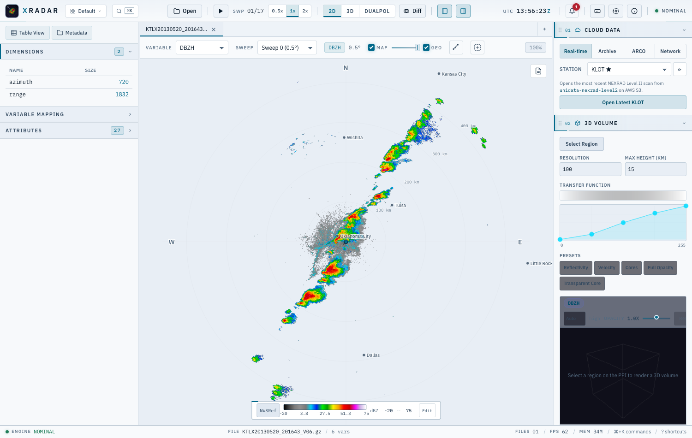
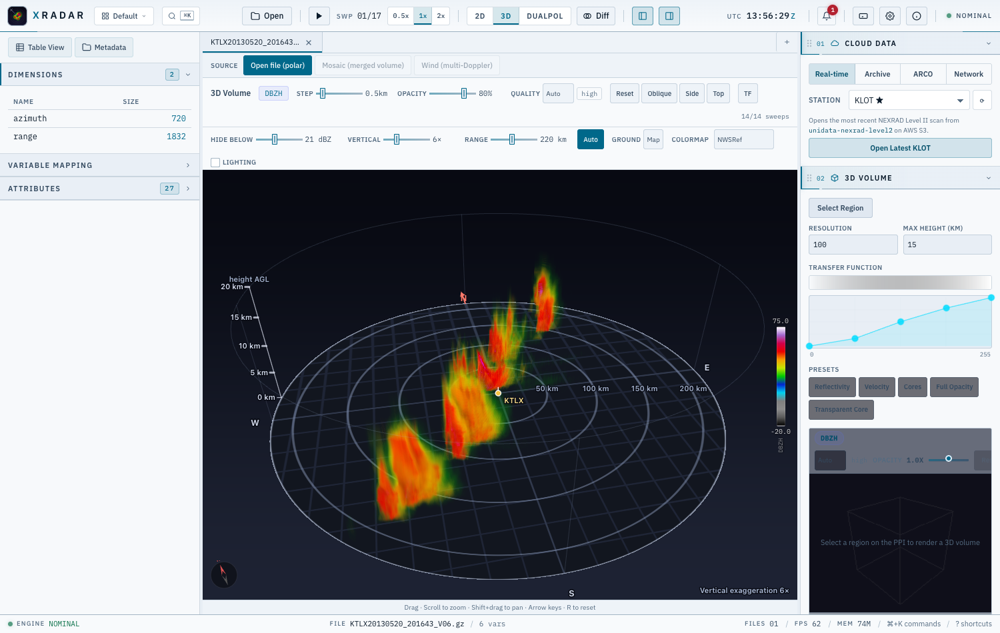
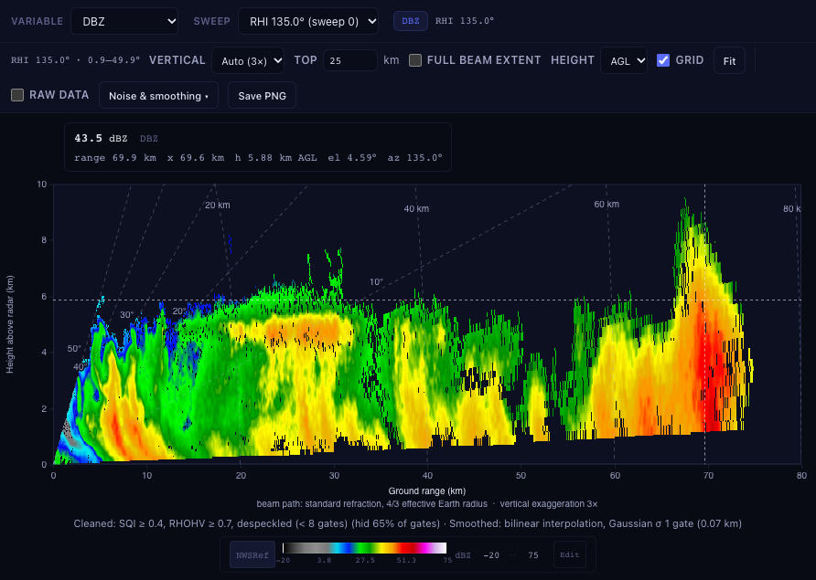
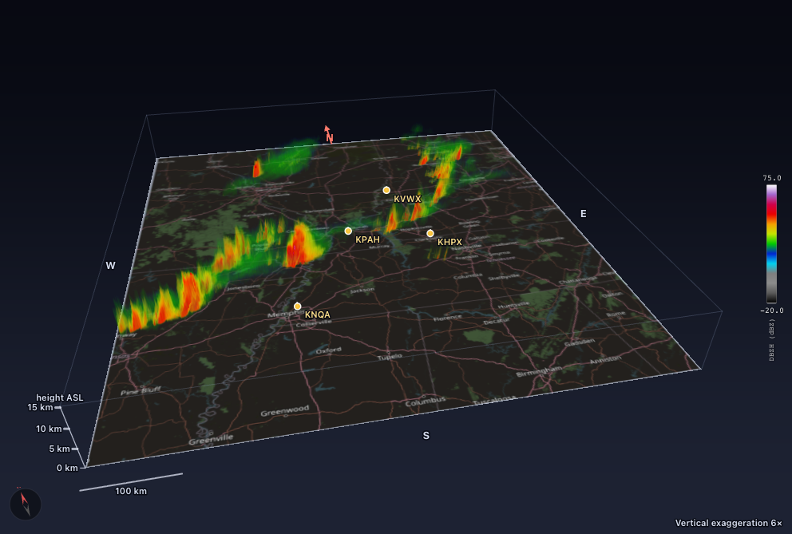
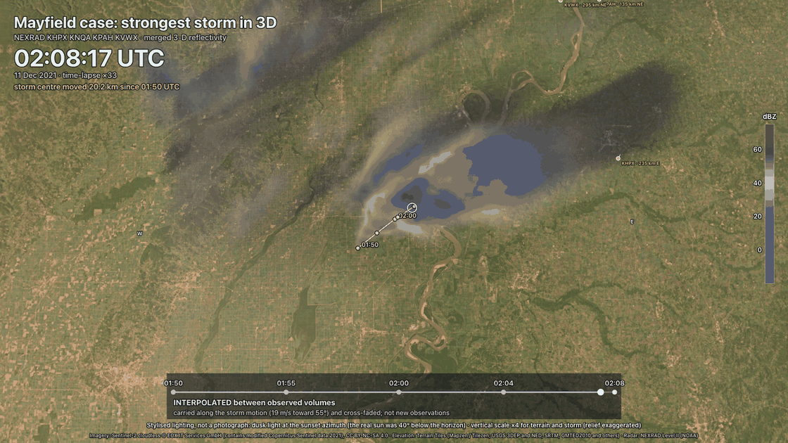

# radarx-desktop

[](https://github.com/syedhamidali/radarx-desktop/actions/workflows/ci.yml)
[](https://github.com/syedhamidali/radarx-desktop/releases/latest)
[](https://codecov.io/gh/syedhamidali/radarx-desktop)
[](LICENSE)

A desktop app for looking at weather radar data and working with it: open a file, see it in 2D and 3D, clean it,
run algorithms on it (hydrometeor classification, storm detection, ...), and export the result. Built on
[xradar](https://github.com/openradar/xradar), [xarray](https://xarray.dev/) and
[radarx](https://github.com/syedhamidali/radarx). **Nothing else to install**: the installers include everything.

It is built for research, so it holds itself to one rule: everything on screen or in a file is observed data, a
labelled method applied to it, or a labelled picture, and nothing is invented. See the
[science policy](docs/SCIENCE.md).

<p align="center">
  
</p>

<sub>Reflectivity from KTLX (Oklahoma City), 20 May 2013, 0.5° sweep. NEXRAD Level II, exported from the app.</sub>

<p align="center">
  
  
</p>

<sub>The 2D view in the dark and light themes (screenshots taken offline, so the map basemap is switched off; the app
draws OpenStreetMap or OpenTopoMap under the scan when it is on).</sub>

## Download

Get the installer for your system from the [latest release](https://github.com/syedhamidali/radarx-desktop/releases/latest). You only need one file.

| System | File |
|---|---|
| Mac with Apple silicon (M1 and later) | `...aarch64.dmg` |
| Mac with an Intel chip | `...x64.dmg` |
| Windows 10 / 11 | `...x64-setup.exe` |
| Ubuntu / Debian | `...amd64.deb` |
| Fedora / Red Hat | `...x86_64.rpm` |

The builds are not code-signed, so the first launch shows a warning:

- **macOS:** drag the app to Applications. If macOS says it "cannot be opened" or is "damaged", open
  **System Settings → Privacy & Security** and click **Open Anyway**, or run
  `xattr -cr /Applications/radarx-desktop.app` once in Terminal.
- **Windows:** click **More info → Run anyway**.
- **Linux:** `sudo apt install ./radarx-desktop_*.deb` (or `sudo dnf install ./*.rpm`).

The first launch can take up to a minute while the OS scans the app; after that it starts in about a second.

**Updates:** the installed app tells you when a newer version exists (a small chip in the status bar), shows the release notes
and installs only when you say so; updates are signature-checked, never interrupt a running job, and can be switched off in
Settings → Updates. Linux `.deb`/`.rpm` installs are told a new version exists and link to the release page. See
[docs/UPDATES.md](docs/UPDATES.md).

**Open files from the file manager:** right-click a radar file and choose **Open With → radarx-desktop**, or double-click it
once you have chosen the app (Get Info → Open with → Change All on macOS). NetCDF/CfRadial, HDF5/ODIM and gzip files are
registered by extension, including numbered copies such as `file.nc.1` or `file.h5.2`. On macOS the app is also offered
for files with no extension, like NEXRAD Level II (`KTLX20130520_201643_V06`). On Windows, files without an extension need **Open with → Choose another app** once.

## What it does

### Browse the radar network

Switch on **Sites** above the map to see the 156 NEXRAD sites (and your own CSV/JSON list for other networks); click
one for its card: position, the age of its latest scan, **Open latest volume** and **Browse archive**. Nothing goes to
the internet before a dialog says what will be fetched and how big it is. See [docs/RADAR_SITES.md](docs/RADAR_SITES.md).

### See it in 2D and 3D

Pan and zoom a GPU-rendered PPI on a map, then switch to the 3D volume: every sweep is ray-marched on the GPU, with
a transfer-function editor, a map ground plane and adjustable vertical exaggeration.

<p align="center">
  
  
</p>

### Range-height scans (RHI)

RHI sweeps are recognised and drawn as what they are: a vertical cut through the storm (ground range along x, height
along y), with the messy real-world cases handled (rays stored out of order, interleaved passes, pseudo-RHIs cut out
of a volume) and a noise and smoothing menu. See [docs/RHI.md](docs/RHI.md).



### Mosaics, winds and 3D flow

Merge several radars onto one grid (radarx) and see the mosaic over the map or as a 3D volume. Retrieve the 3D wind
from two or more Doppler radars and watch it as **animated flow** and arrows in 3D, on the same scene as the storm.
The flow follows the retrieved wind only (no extrapolation outside the analysis), and what it shows and does not show
is written down. See [docs/MOSAIC.md](docs/MOSAIC.md) and [docs/MULTIDOPPLER.md](docs/MULTIDOPPLER.md).



### Realistic ground and storm clips

Optionally put the 3D scene on terrain with satellite imagery (the storm hides behind hills by construction) and draw
the storm with a stylised, sun-lit look. Both are opt-in, labelled on the image as stylised, and never change the
data; the scientific colour scale stays the default. `tools/storm_clip` renders a storm-centred MP4 with the same
renderer. Imagery is Sentinel-2 cloudless (CC BY-NC-SA 4.0) and Terrain Tiles, fetched only when you switch it on;
see [docs/REALISTIC_3D.md](docs/REALISTIC_3D.md) and [docs/STORM_CLIP.md](docs/STORM_CLIP.md).



### Cross-sections

Draw a line on the PPI, or click an azimuth for an RHI-style cut out of the radar, and get a vertical section of the
whole volume in a view you can make as large as you like: docked under the PPI (drag its height) or in a window that
fills the screen. Real pixel size, axes in km, colour bar, hover read-out, vertical exaggeration, height range, mask
and smoothing controls, and PNG export. Sector scans are not stretched across the part of the circle that was not
scanned. See [docs/CROSSSECTION.md](docs/CROSSSECTION.md).


### Run algorithms and see the result right away

Algorithms are plug-in **modules** (a Python file with a decorator). A result is not just a table: it can be a new
field that you view in 2D, in 3D, or export. Included: hydrometeor classification, KDP, QPE, hail (SHI/MESH),
rotation couplets, shear, ZDR arcs, ZDR columns, storm detection, cell size sorting, and more. Write your own in
about ten lines, see [docs/MODULES.md](docs/MODULES.md).


### Clean the data

Quality control built on radarx: SNR gate, fuzzy-logic echo classification, speckle removal, noise correction, and
optional gap filling and smoothing. Every step is a switch you can turn off, and the mask is applied to all the
polar fields, not just reflectivity.


### Or skip the window: command line and Python

Everything above also runs without the GUI, on the same engine: `rxd info -i FILE`, `rxd plot -i FILE`,
`rxd run radarx_hid -i FILE --all-sweeps`, `rxd pipeline "Doppler velocity" -i FILE`,
`rxd mosaic -i F1 F2 F3 -o mosaic.nc -p map.png`, `rxd winds -i F1 F2 ...`, `rxd sounding -i SONDE.csv`, `rxd qpe -i 'folder/*' -o rain.nc`, `rxd export -i FILE -o out.zarr`,
`rxd animate -i FOLDER -o storm.mp4` (a storm-centred 3D animation, [docs/ANIMATE.md](docs/ANIMATE.md))
(see [docs/CLI.md](docs/CLI.md)). From a notebook: `from engine import api; api.open("FILE").run("radarx_hid")`
(see [docs/API.md](docs/API.md)).

### Export it

PNG, SVG and PDF figures with colorbar, rings and title; NetCDF (CfRadial1), CfRadial2, Zarr and CSV data; batch
and animation export. Cleaned and derived fields are written into the file next to the original moments.

Outputs are **standards-clean and self-describing**: CF-1.8 / CfRadial 1.4 and FM-301 layouts, CF flag attributes,
the software and library versions, every parameter and a `history` line per step, and no absolute paths of your
machine, so a result can be repeated and opens in other tools. See
[docs/OUTPUT_STANDARDS.md](docs/OUTPUT_STANDARDS.md).

## More features

- **Formats:** NEXRAD Level II, ODIM H5, CfRadial 1/2, IRIS/Sigmet, Rainbow, Furuno, IMD, UF and more through xradar
  (gzip-wrapped files work as they are)
- **Cloud data:** open NEXRAD Level II straight from AWS S3, browse the archive, or open ARCO / icechunk data
- **Mosaics:** grid and merge several radars with radarx
- **Rainfall:** rain rate and accumulation with a selectable relation (Z-R, KDP, Z-ZDR, hybrid), uncertainty and beam quality, gauge adjustment and validation, basin-average rainfall; labelled as estimates (see [docs/HYDROLOGY.md](docs/HYDROLOGY.md))
- **Dual-pol:** ZDR, KDP, RhoHV, HID dashboards, scatter plots and histograms
- **Cross-sections, profiles and time series**, difference between two sweeps or files
- **Stays responsive:** requests are scheduled and cancellable, and the 3D view lowers its quality on its own if it
  gets slow (see [docs/RESPONSIVENESS.md](docs/RESPONSIVENESS.md), [docs/PERFORMANCE.md](docs/PERFORMANCE.md))
- **Stable:** the engine runs in its own supervised process; bad files, runaway modules and low memory produce a
  message, not a crash (see [docs/STABILITY.md](docs/STABILITY.md), [docs/RELIABILITY.md](docs/RELIABILITY.md))
- **Smaller installers:** the engine bundle was slimmed from 346 MB to 220 MB unpacked and the shell binary from
  13.8 MB to 7.7 MB (see [docs/PACKAGING_AUDIT.md](docs/PACKAGING_AUDIT.md))
- **Automatic updates, under your control:** signature-checked, never mid-job, switchable off
  ([docs/UPDATES.md](docs/UPDATES.md))
- **Web build:** the same engine as a web service ([docs/WEB.md](docs/WEB.md)); like every surface it needs a free account ([docs/ACCOUNTS.md](docs/ACCOUNTS.md))

## Where it is going

Hydrology (radar rainfall to runoff and flash-flood indicators) and machine learning for flash floods, environment
data from HRRR, ERA5, soundings and MRMS, winter weather, lightning, cloud microphysics and domain packs, all with
the provenance of every layer shown (observed, model/analysis, retrieved, simulated). The master list of planned
work is the GitHub issue [Roadmap: the futuristic radar workbench](https://github.com/syedhamidali/radarx-desktop/issues/120),
with one roadmap issue per area. Nothing there is promised for a date.

## How it works

```
 Tauri app (Rust)  ──starts──▶  Python engine  (xradar · xarray · radarx · Pillow · matplotlib)
 Svelte + WebGL2   ◀─WebSocket─  reads files, runs modules, exports
```

The window is a Svelte app in a small Tauri shell, drawing with its own WebGL2 renderers. The data work happens in a
Python engine that the app starts and talks to over a local WebSocket (JSON plus raw binary arrays). The installers
bundle that engine (see [docs/BUNDLING.md](docs/BUNDLING.md)); [ARCHITECTURE.md](ARCHITECTURE.md) has the full picture.

## Build from source

You need Node.js 20+, Rust (stable), Python 3.10+ (3.12+ for radarx), and on Linux the WebKit/GTK and Cairo
development packages.

```bash
git clone https://github.com/syedhamidali/radarx-desktop.git
cd radarx-desktop

npm install

cd python
python3 -m venv .venv && source .venv/bin/activate    # Windows: .venv\Scripts\activate
pip install -e ".[dev,radarx]"
cd ..

npm run tauri dev          # run it
npm run tauri build        # build an installer for this OS (see docs/BUNDLING.md for the packaged engine)
```

<details>
<summary>System libraries</summary>

**macOS:** `xcode-select --install`

**Ubuntu / Debian:**
```bash
sudo apt install libwebkit2gtk-4.1-dev libappindicator3-dev librsvg2-dev \
                 patchelf libgtk-3-dev
```

**Windows:** WebView2 is already part of Windows 10/11.
</details>

In development the app uses `python/.venv` automatically. Set `XRADAR_PYTHON=/path/to/python` to use another
interpreter. Exports go to `~/Downloads/radarx-exports` unless you choose a folder.

## Development

Read [CONTRIBUTING.md](CONTRIBUTING.md) (set-up, checks, commit style, DCO sign-off, how to add a module) and the
[science policy](docs/SCIENCE.md) that every feature has to meet. The pull request template carries the checklist.

```bash
ruff check --config ruff.toml python/ && ruff format --config ruff.toml python/
(cd python && python -m pytest tests/)      # Python tests
npx svelte-check --tsconfig ./tsconfig.json && npx tsc --noEmit && npm run test:unit    # frontend checks
python scripts/check_links.py               # Markdown links
```

```
radarx-desktop/
├── src/             Svelte frontend (2D and 3D viewers, WebGL2 renderers, panels, stores)
├── src-tauri/       Rust shell (starts and watches the engine, updater)
├── python/
│   ├── server.py    WebSocket entry point
│   ├── engine/      reader, renderer, exporter, derived variables, mosaic, winds, CLI, API, plugin SDK
│   ├── modules/     plug-in algorithms (drop a file here to add one)
│   ├── packaging/   builds the self-contained engine for the installers
│   └── tests/
├── docs/            all documentation (index: docs/index.md), including SCIENCE, LICENSES, CLI, API
├── scripts/         performance measurements, licence notices, link checker
└── tools/           offline storm-clip renderer
```

## Using the 3D view

1. Open a file. Sweeps load automatically.
2. Switch to **3D**. The volume appears as sweeps arrive, lowest elevation first.
3. **Orbit:** drag. **Zoom:** scroll. **Pan:** Shift+drag. **Reset:** `R`.
4. Tune **Step**, **Opacity**, **Hide below**, **Vertical** exaggeration and **Range** in the toolbar, or open **TF**
   to shape the transfer function.
5. To focus on one storm, go back to 2D, use the box-select button, draw a box, then switch to 3D.

## License

radarx-desktop is source-available under the [PolyForm Noncommercial License 1.0.0](LICENSE): you may use, copy and
modify it for **noncommercial purposes** (personal use, research, education, charities, public-interest and government
use). **Commercial use is not permitted** without a separate written license from the copyright holder, who keeps all
other rights. See [NOTICE](NOTICE) for how to ask for one.

The app builds on third-party software, fonts, colour maps, data and imagery, each under its own terms:
[THIRD_PARTY_NOTICES.md](THIRD_PARTY_NOTICES.md) lists them (generated and checked in CI; see
[docs/LICENSES.md](docs/LICENSES.md)). Note that one optional layer, the Sentinel-2 cloudless imagery of the realistic
ground, is itself non-commercial (CC BY-NC-SA 4.0). Contributions come under the project licence with a
[DCO](DCO) sign-off. The licence wording and these notices are to be reviewed by a lawyer; nothing here is legal advice.
