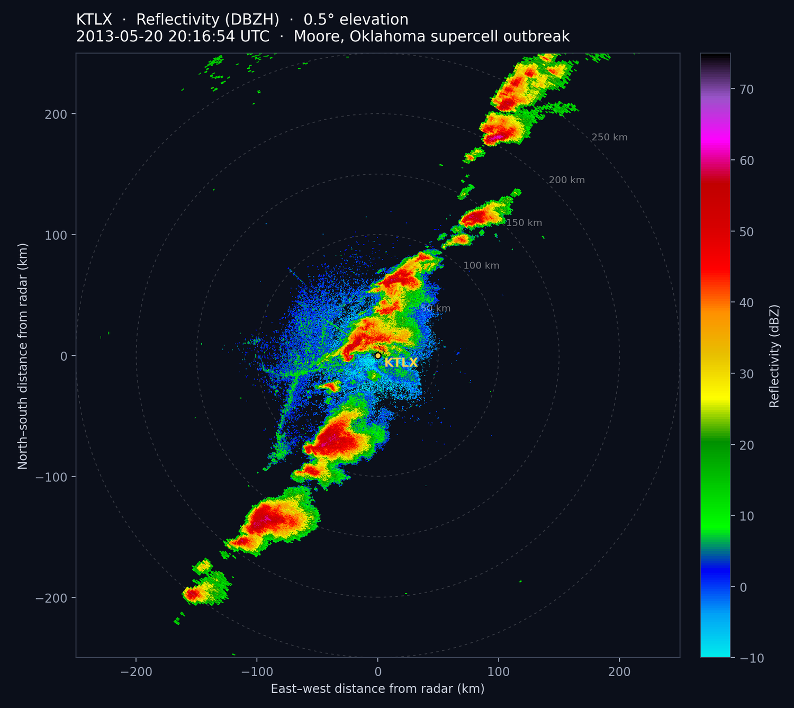
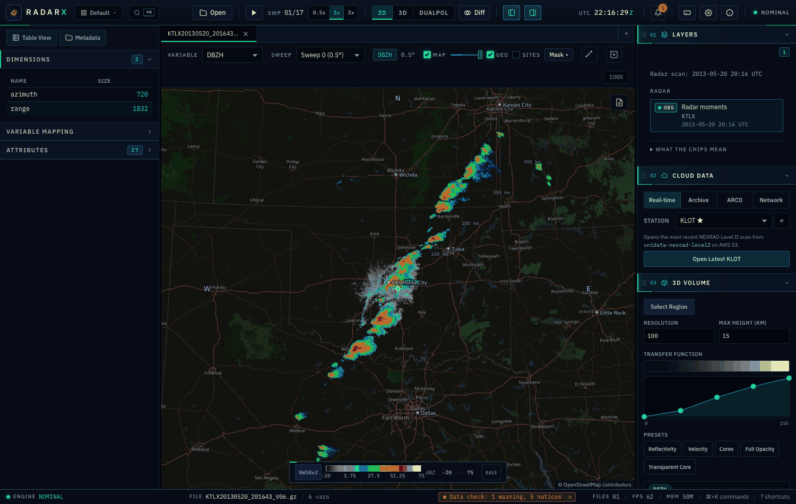
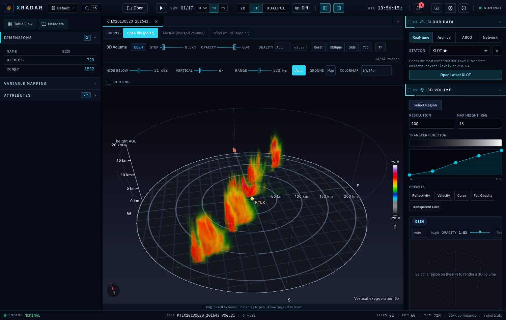
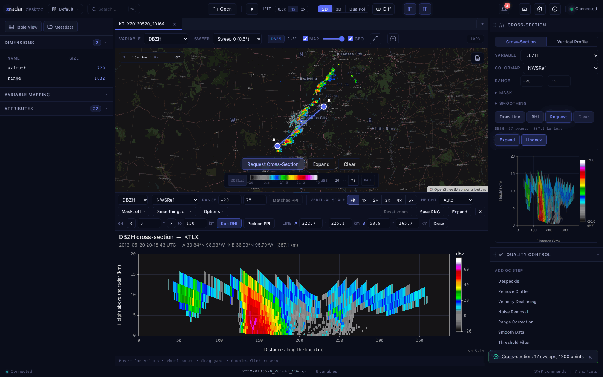
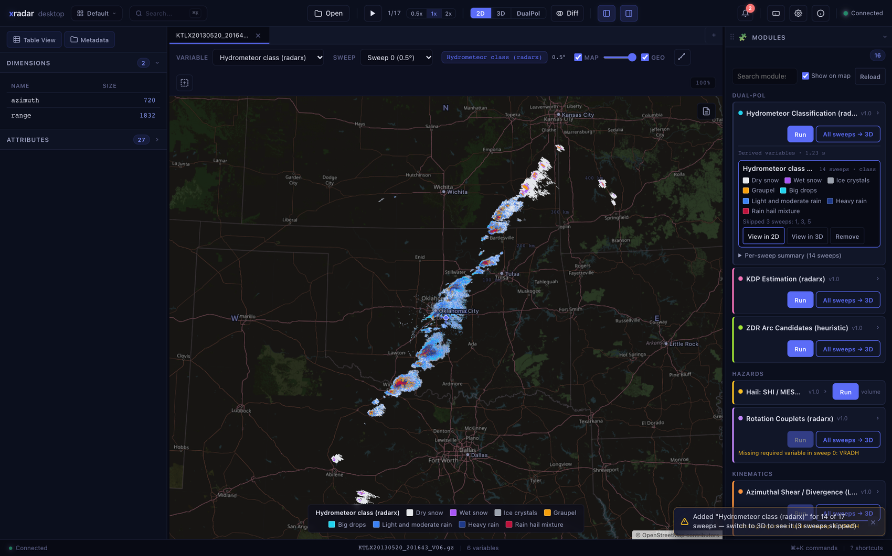
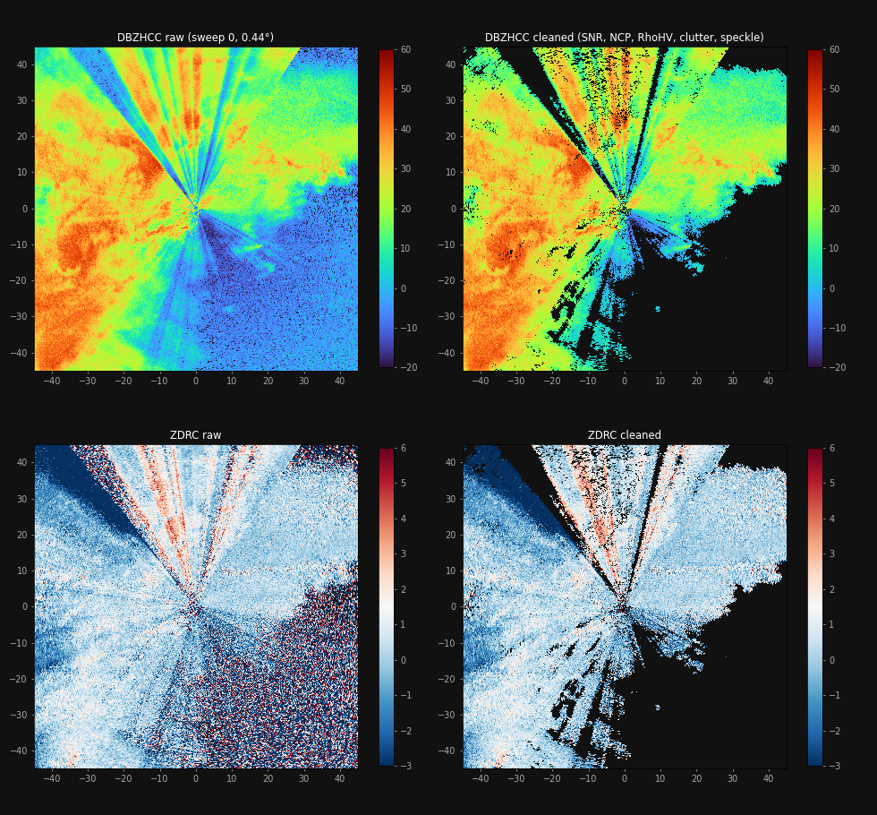

# xradar-desktop

[](https://github.com/syedhamidali/xradar-desktop/actions/workflows/ci.yml)
[](https://github.com/syedhamidali/xradar-desktop/releases/latest)
[](LICENSE)

A desktop app for looking at weather radar data and working with it: open a file, see it in 2D and 3D, clean it,
run algorithms on it (hydrometeor classification, storm detection, ...), and export the result. Built on
[xradar](https://github.com/openradar/xradar), [xarray](https://xarray.dev/) and
[radarx](https://github.com/syedhamidali/radarx). **Nothing else to install**: the installers include everything.

<p align="center">
  
</p>

<sub>Reflectivity from KTLX (Oklahoma City), 20 May 2013, 0.5° sweep. NEXRAD Level II, exported from the app.</sub>



## Download

Get the installer for your system from the [latest release](https://github.com/syedhamidali/xradar-desktop/releases/latest). You only need one file.

| System | File |
|---|---|
| Mac with Apple silicon (M1 and later) | `...aarch64.dmg` |
| Mac with an Intel chip | `...x64.dmg` |
| Windows 10 / 11 | `...x64-setup.exe` |
| Ubuntu / Debian | `...amd64.deb` |
| Fedora / Red Hat | `...x86_64.rpm` |

The builds are not code-signed, so the first launch shows a warning:

- **macOS:** drag the app to Applications. If macOS says it "cannot be opened" or is "damaged", open
  **System Settings → Privacy & Security** and click **Open Anyway**, or run
  `xattr -cr /Applications/xradar-desktop.app` once in Terminal.
- **Windows:** click **More info → Run anyway**.
- **Linux:** `sudo apt install ./xradar-desktop_*.deb` (or `sudo dnf install ./*.rpm`).

The first launch can take up to a minute while the OS scans the app; after that it starts in about a second.

**Open files from the file manager:** right-click a radar file and choose **Open With → xradar-desktop**, or double-click it
once you have chosen the app (Get Info → Open with → Change All on macOS). NetCDF/CfRadial, HDF5/ODIM and gzip files are
registered by extension, including numbered copies such as `file.nc.1` or `file.h5.2`. On macOS the app is also offered
for files with no extension, like NEXRAD Level II (`KTLX20130520_201643_V06`). On Windows, files without an extension need **Open with → Choose another app** once.

## What it does

### See it in 2D and 3D

Pan and zoom a GPU-rendered PPI on a map, then switch to the 3D volume: every sweep is ray-marched on the GPU, with
a transfer-function editor, a map ground plane and adjustable vertical exaggeration.



### Cross-sections

Draw a line on the PPI, or click an azimuth for an RHI-style cut out of the radar, and get a vertical section of the
whole volume in a view you can make as large as you like: docked under the PPI (drag its height) or in a window that
fills the screen. Real pixel size, axes in km, colour bar, hover read-out, vertical exaggeration, height range, mask
and smoothing controls, and PNG export. Sector scans are not stretched across the part of the circle that was not
scanned. See [docs/CROSSSECTION.md](docs/CROSSSECTION.md).



### Run algorithms and see the result right away

Algorithms are plug-in **modules** (a Python file with a decorator). A result is not just a table: it can be a new
field that you view in 2D, in 3D, or export. Included: hydrometeor classification, KDP, QPE, hail (SHI/MESH),
rotation couplets, shear, ZDR arcs, ZDR columns, storm detection, cell size sorting, and more. Write your own in
about ten lines, see [docs/MODULES.md](docs/MODULES.md).



### Clean the data

Quality control built on radarx: SNR gate, fuzzy-logic echo classification, speckle removal, noise correction, and
optional gap filling and smoothing. Every step is a switch you can turn off, and the mask is applied to all the
polar fields, not just reflectivity.



### Export it

PNG, SVG and PDF figures with colorbar, rings and title; NetCDF (CfRadial1), CfRadial2, Zarr and CSV data; batch
and animation export. Cleaned and derived fields are written into the file next to the original moments.

## More features

- **Formats:** NEXRAD Level II, ODIM H5, CfRadial 1/2, IRIS/Sigmet, Rainbow, Furuno, IMD, UF and more through xradar
  (gzip-wrapped files work as they are)
- **Cloud data:** open NEXRAD Level II straight from AWS S3, browse the archive, or open ARCO / icechunk data
- **Mosaics:** grid and merge several radars with radarx
- **Dual-pol:** ZDR, KDP, RhoHV, HID dashboards, scatter plots and histograms
- **Cross-sections, profiles and time series**, difference between two sweeps or files
- **Stays responsive:** requests are scheduled and cancellable, and the 3D view lowers its quality on its own if it
  gets slow (see [docs/RESPONSIVENESS.md](docs/RESPONSIVENESS.md))

## How it works

```
 Tauri app (Rust)  ──starts──▶  Python engine  (xradar · xarray · radarx · Pillow · matplotlib)
 Svelte + WebGL2   ◀─WebSocket─  reads files, runs modules, exports
```

The window is a Svelte app in a small Tauri shell. The data work happens in a Python engine that the app starts and
talks to over a local WebSocket, sending arrays as Apache Arrow. The installers bundle that engine
(see [docs/BUNDLING.md](docs/BUNDLING.md)).

## Build from source

You need Node.js 20+, Rust (stable), Python 3.10+ (3.12+ for radarx), and on Linux the WebKit/GTK and Cairo
development packages.

```bash
git clone https://github.com/syedhamidali/xradar-desktop.git
cd xradar-desktop

npm install

cd python
python3 -m venv .venv && source .venv/bin/activate    # Windows: .venv\Scripts\activate
pip install -e ".[dev,radarx]"
cd ..

npm run tauri dev          # run it
npm run tauri build        # build an installer for this OS (see docs/BUNDLING.md for the packaged engine)
```

<details>
<summary>System libraries</summary>

**macOS:** `xcode-select --install` and `brew install cairo pkg-config`

**Ubuntu / Debian:**
```bash
sudo apt install libwebkit2gtk-4.1-dev libappindicator3-dev librsvg2-dev \
                 patchelf libgtk-3-dev libcairo2-dev pkg-config
```

**Windows:** WebView2 is already part of Windows 10/11.
</details>

In development the app uses `python/.venv` automatically. Set `XRADAR_PYTHON=/path/to/python` to use another
interpreter. Exports go to `~/Downloads/xradar-exports` unless you choose a folder.

## Development

```bash
ruff check --config ruff.toml python/ && ruff format --config ruff.toml python/
(cd python && python -m pytest tests/)      # Python tests
npx svelte-check --tsconfig ./tsconfig.json && npx tsc --noEmit    # frontend checks
```

```
xradar-desktop/
├── src/             Svelte frontend (2D and 3D viewers, panels, stores)
├── src-tauri/       Rust shell (starts and watches the engine)
├── python/
│   ├── server.py    WebSocket entry point
│   ├── engine/      reader, renderer, exporter, derived variables, mosaic, plugin SDK
│   ├── modules/     plug-in algorithms (drop a file here to add one)
│   ├── packaging/   builds the self-contained engine for the installers
│   └── tests/
└── docs/            MODULES, BUNDLING, MOSAIC, RESPONSIVENESS
```

## Using the 3D view

1. Open a file. Sweeps load automatically.
2. Switch to **3D**. The volume appears as sweeps arrive, lowest elevation first.
3. **Orbit:** drag. **Zoom:** scroll. **Pan:** Shift+drag. **Reset:** `R`.
4. Tune **Step**, **Opacity**, **Hide below**, **Vertical** exaggeration and **Range** in the toolbar, or open **TF**
   to shape the transfer function.
5. To focus on one storm, go back to 2D, use the box-select button, draw a box, then switch to 3D.

## License

xradar-desktop is source-available under the [PolyForm Noncommercial License 1.0.0](LICENSE): you may use, copy and
modify it for **noncommercial purposes** (personal use, research, education, charities, public-interest and government
use). **Commercial use is not permitted** without a separate written license from the copyright holder, who keeps all
other rights. See [NOTICE](NOTICE) for how to ask for one and for the third-party software the app builds on.
