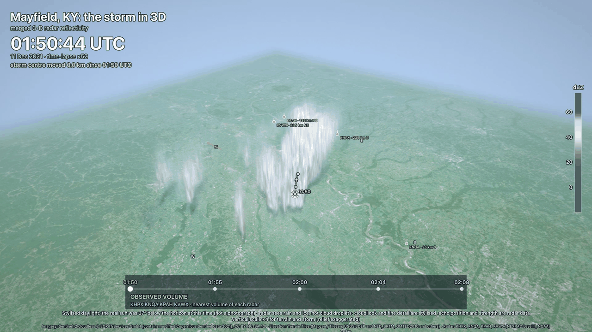
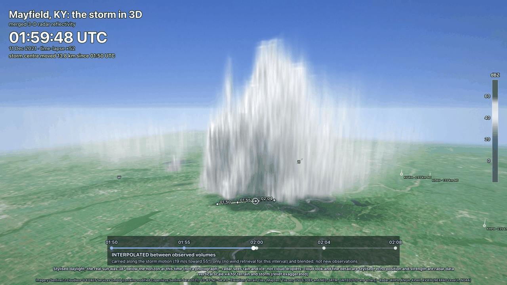

# `xrd animate`: storm-centred 3D animations from many volumes

`xrd animate` turns a pile of radar volumes (one radar over time, or several radars over time, any
number of files) into an MP4: the strongest storm of the scene in 3D, a camera that flies around it
while the storm travels across the map, a UTC clock, the storm's track on the ground, and labels
that say which frames are real volumes and which are interpolated. It draws with the app's own 3D
renderer (the ray-marched volume, colour scale, map and overlay of the 3D tab) in a headless
Chrome, so the picture matches the app.

```bash
xrd animate -i mayfield -o mayfield.mp4                          # the folder with one sub-folder per radar
xrd animate -i 'mayfield/*/*_V06' --camera top-down -o top.mp4   # a glob, another camera
xrd animate -i mayfield -p still.png --still-at 12               # one frame, to try a camera or a look
xrd animate -i mayfield --no-render                              # the plan only: steps, track, frames (no browser)
```

It is the command-line form of the clip tool in `tools/storm_clip/` (see [the clip page](STORM_CLIP.md),
which has the details of the renderer, the realistic look and the cyclone flight).

## Install and what it needs

```bash
pip install -e python/                      # the engine and the `xrd` command
pip install -U radarx                       # gridding the radars (Python >= 3.12), needed for every run
pip install -e 'python/[video]'             # the optional extra: Playwright and PyAV   (pip install 'radarx-desktop-engine[video]')
npm ci && npm run build                     # once, in a source checkout: the app that draws (dist/)
```

| Needs | Why | When it is missing |
|---|---|---|
| `radarx` | merges the radars onto a 3D grid (`xrd mosaic` uses it too) | exit code 4 with the install line |
| `playwright` (extra `video`) | drives Chrome | exit code 4: `pip install 'radarx-desktop-engine[video]'` |
| Google Chrome | the renderer runs in it (`channel="chrome"`: the system Chrome, nothing is downloaded) | exit code 4, says to install Chrome or use `--browser ''` after `python -m playwright install chromium` |
| `av` / PyAV (extra `video`) | encodes H.264 | the frames are still written as numbered PNG files and the command prints the `ffmpeg` line that makes the MP4 |
| the built app (`dist/`) | the renderer itself | exit code 4 with the build steps |

Neither Playwright nor PyAV is a dependency of the package: `import engine` never loads them, and the
rest of `xrd` works without them. `--no-render` needs none of the four rows below `radarx`.

**Where the app is found.** `--app-dist DIR`, then `$XRADAR_APP_DIST`, then `<checkout>/dist` (the
folder `npm run build` writes; found automatically when the engine is installed with
`pip install -e python/`), then `./dist`. A build is accepted only if it contains the clip renderer;
an older build is refused with "rebuild it". The installers (`.dmg`, `.msi`, `.AppImage`) embed the
frontend in the executable, so their resources cannot be used for this today: build `dist/` from a
checkout. Without PyAV:

```console
$ xrd animate -i mayfield -o mayfield.mp4
...
wrote mayfield_frames
to make the MP4 from those frames: ffmpeg -framerate 30 -i 'mayfield_frames/frame_%05d.png' -c:v libx264 -crf 18 -pix_fmt yuv420p -movflags +faststart 'mayfield.mp4'
```

## What it does, step by step

1. **Files to volumes.** Each file gets a radar and a time: from a NEXRAD style name
   (`KHPX20211211_015930_V06`) or, when the name does not say, from the file itself.
2. **Time steps.** The volumes are grouped by radar. The steps follow the volumes of a *reference radar*
   (`--reference`, default: the radar that gives the most steps, then the smallest time differences). For every
   step each other radar contributes its **nearest** volume, if it is within `--tolerance-s` (330 s).
   A step needs two radars (`--min-radars`; one for a single radar) and a step whose volumes are all
   repeats of the previous step is dropped. Everything that is not used is listed with the reason.
3. **Grids, one time step at a time.** The radars of one step are gridded together
   (`engine.mosaic`, the same code as `xrd mosaic`) at 2 km to find and track the storm, then at 500 m on a box
   around the whole track. Only one step's radar volumes are in memory at once; every result is cached on disk.
4. **The storm.** The strongest convective cell (column maximum of at least `--cell-dbz` 45 dBZ, score =
   maximum dBZ + 2 x echo top + 4 x log10 area) of the first step is followed from step to step
   (`--track cells`, or `linear`: the straight-line fit; or `eye` for a tropical cyclone).
5. **Frames.** The clip runs the data time from the first to the last volume (holding each end for 1.5 s). Between
   two volumes the echo is carried along the storm motion and blended (or along the observed Doppler wind
   with `--winds`): those frames are **interpolated** and say so on the screen.
6. **Render.** Chrome draws frame *i* for the clip time *i* / fps in one full-quality pass (nothing depends
   on the speed of the machine). Frames are saved as they are made; the MP4 is written at the end.

## The time steps

```console
$ xrd animate -i mayfield --no-render
5 time steps from 4 radar(s) (KHPX, KNQA, KPAH, KVWX); reference KVWX
KHPX, KNQA, KPAH, KVWX  11 Dec 2021  |  4 radar(s)  |  5 time steps over 18.1 min  |  1080 frames (36 s at 30 fps, 1920x1080)
  time steps  reference radar KVWX, tolerance 330 s; each radar contributes its nearest volume (offset in s from the reference)
    step  UTC       KHPX  KNQA  KPAH  KVWX
    ----  --------  ----  ----  ----  ----
       0  01:50:44  +193   -26  +171    +0
       1  01:55:22   -85   +49  -107    +0
       2  02:00:00   -30  +108   -25    +0
       3  02:04:18   +39  -150   +89    +0
       4  02:08:52   +99   -88  -185    +0
  offsets     KHPX mean 89 s, max 193 s (5/5 steps); KNQA mean 84 s, max 150 s (5/5 steps); KPAH mean 115 s, max 185 s (5/5 steps); KVWX mean 0 s, max 0 s (5/5 steps)
  storm       followed with the 'cells' tracker: moved 20.9 km toward 55 deg in 18.1 min (mean 19.2 m/s)
    step  UTC          lat      lon  x_km  y_km   m/s  max_dBZ  area_km2  top_km
    ----  --------  ------  -------  ----  ----  ----  -------  --------  ------
       0  01:50:44  36.147  -89.922  -9.3  -5.7     -       62       652    14.0
       1  01:55:22  36.187  -89.858  -3.5  -1.3  26.0       64       616    15.0
       2  02:00:00  36.223  -89.797   1.9   2.7  24.3       65       636    15.0
       3  02:04:18  36.228  -89.788   2.8   3.3   4.0       65       720    14.0
       4  02:08:52  36.257  -89.732   7.8   6.4  21.6       65       616    15.0
  frames      136 observed (13%), 944 interpolated (87%); gaps between volumes 4.3 to 4.6 min; time-lapse x33; interpolation carried along the storm motion only (no wind retrieval)
  camera      orbit from the default orbit, follows 30% of the storm's move; 8 keys, azimuth swept 399 deg, elevation 6 to 86 deg, distance 100 to 215 km
  grids       5 steps at 500 m: 5 computed, 0 from the cache (~/.cache/xradar-desktop/animate); peak memory 1468 MB
nothing was drawn (--no-render): this is the plan; remove --no-render to render it
```

How to read it:

- **offsets**: seconds between the step's reference time and that radar's volume (a positive number means
  the radar scanned later). The mosaic weights the volumes by time, but one step is not an instant:
  up to a few minutes of spread is normal for NEXRAD.
- **storm**: the tracked centre in km from the grid origin and in latitude / longitude, and the speed between
  steps. The per-step speed jumps because the centre of a cell wanders by a few km from scan to scan (step
  3 above): the mean over the whole track is the number to trust. A cyclone is better followed with `--track eye`
  or `linear`.
- **frames**: how many frames sit on a real volume (the two 1.5 s holds, and the moments within 6 s of a volume)
  and how many are interpolated; the gaps between the volumes show how much is carried between them.
  A clip of a few volumes is mostly interpolation, and the screen says so on every such frame.

`--json` prints the same as one document (`inputs`, `steps`, `radar_offsets`, `storm`, `frames`, `camera`,
`look`, `grid`, `output`, `warnings`); `jq '.storm.track[] | [.time, .lat, .lon, .speed_ms_since_previous]'` gives the track.

**Files that are not used** are listed, for example when a radar's volumes are far from every step, when a
file is a repeat, or when a radar cannot be read (the TDWR files of the Laura case):

```console
$ xrd animate -i laura --no-render
  not used    5:
    THOU20200827_045319_V08: could not be read: Could not open THOU20200827_045319_V08: it looks like a NEXRAD Level II file but could not be read: ...
    TIAH20200827_045407_V08: could not be read: site position 30065, -95567 is out of range (a TDWR file with unscaled coordinates)
    ...
```

| Option | Meaning |
|---|---|
| `--reference RADAR` | the radar whose volume times are the steps (default `auto`) |
| `--tolerance-s S` | largest time difference between a step and a radar's volume (330) |
| `--min-radars N` | radars a step needs (2, or 1 for one radar) |
| `--min-step-s S` | thin the steps: none closer together than this (for a long series, `--min-step-s 600`) |
| `--start TIME`, `--end TIME` | use only this window, e.g. `--start 2021-12-11T02:00:00Z` |
| `--max-steps N` | only the first N steps |

A folder is accepted in two forms: a folder of radar files, or a *case folder* with one sub-folder per radar
(only files whose names carry a radar and a time are taken from the sub-folders, so a `results/` folder
beside them is ignored). Globs and `-i -` (names on stdin) work as in every `xrd` command.

## The camera

`--camera` is a preset name or a camera file.

| Preset | What it is |
|---|---|
| `orbit` (default) | a wide oblique view, a slow orbit, a low view along the storm's motion, a top-down view and back (about 36 s) |
| `wide` | a slower, wider orbit for a system a few hundred km across, e.g. a cyclone (`--view-km`) |
| `top-down` | straight down, north up, slowly closing in and out |
| `window` | a camera standing on the ground beside the storm track, true scale (`--observer`, `--observer-dist`, `--observer-side`, `--eye-m`, `--pitch`, `--pan`) |
| `flight` | the cyclone flight: in along a rainband, through the eyewall, into the eye (use with `--track eye`) |

The camera orbits a **target** that follows only part of the storm's move (`--target-lag`, default 0.3; 0 =
fixed on the middle of the track, 1 = locked on the storm), so the storm still travels across the map and past
its landmarks. `--fov DEG` sets the field of view of the whole clip, `--vexag` the vertical exaggeration
(4; the storm is tall and thin, true scale is 1).

### Camera file (TOML or JSON)

```toml
# animate_camera.toml  (docs/examples/animate_camera.toml is a complete one)
target_lag = 0.35      # optional
fov = 50               # optional: the field of view of every key that has none

[[key]]
t = 0                  # clip time in seconds
azimuth = 230          # alias: theta. Degrees; where the camera is, seen from the target (180 = south of it)
elevation = 32         # alias: phi. Degrees above the horizon (90 = straight down)
distance = 200         # alias: dist. km from the target
target = [0, 0, 4]     # optional [east, north, height] in km, relative to the followed point; or dx / dy / dz
fov = 60               # optional, per key

[[key]]
t = 12
azimuth = 330
elevation = 15
distance = 90
```

Between the keys every value follows a **monotone cubic Hermite curve** (the same as
`src/lib/utils/clipCamera.ts`): continuous velocity, no overshoot between keys, zero speed at both ends,
so there are no jerks and no cuts. An azimuth of 505 after 365 is a further 140 degrees of orbit (the
angle is not wrapped). The clip length is `--duration`, else `duration = ` in the file, else the time of the last key; a camera
that ends before the clip stays at its last pose, and keys after the end are reported.

Mistakes are caught before anything is gridded, with the fix in the message:

```console
$ xrd animate -i mayfield --camera bad.toml
error: unknown key "azimut" in keyframe 2 (did you mean "azimuth"?). Known keys: t, azimuth, elevation, distance, target, dx, dy, dz, fov
$ xrd animate -i mayfield --camera topdwn
error: unknown camera preset "topdwn". Did you mean "top-down"? Presets: orbit, wide, top-down, window, flight; or give a camera file (.toml / .json)
```

Other checks: keys must be sorted (`t` increasing), every key needs `t`, `azimuth`, `elevation` and
`distance`, values must be numbers in a sensible range (elevation -5 to 89.9, distance 1 to 3000 km, fov 10
to 120), and at least two keys.

## The look

The look system of [the realistic 3D page](REALISTIC_3D.md) is used as it is: `--look-preset NAME`, then
`--look FILE` (TOML or JSON), then `--set key=value` (highest priority). The scientific dBZ colour scale on
the map is the default; `--realistic` switches to terrain with satellite imagery and the stylised storm
(`--ground`, `--storm-style`, `--palette`, `--light` choose the parts). The look keys are checked **first**, in the
renderer, before any gridding:

```console
$ xrd animate -i mayfield --realistic --set exposur=1.4 -o x.mp4
error: unknown look key "exposur" (did you mean "exposure"?)
```

The imagery and elevation tiles come from the cache of `~/.cache/xradar-desktop/tiles` (`--tile-cache`);
without `--offline` missing tiles are fetched once, politely, as described on the realistic page (and the
EOX imagery carries its attribution and ShareAlike terms, shown on the screen). Modelled lightning is **off**
by default (`--lightning-model` draws flashes labelled "MODELLED from radar echo, NOT observed").

## What the screen says

| On screen | Meaning |
|---|---|
| the large clock, `time-lapse x33` | the data time (UTC) of this frame and how fast the data runs against the clip |
| `OBSERVED VOLUME` (yellow dot on the bar) | the frame is within 6 s of a real volume: the radar volumes of that step, nearest volume of each radar |
| `INTERPOLATED between observed volumes ... not new observations` | the echo is the earlier volume carried forward and the later one carried back along the storm motion, blended: nothing here was observed at this moment |
| `carried along the storm motion ... only (no wind retrieval for this interval)` / `... and the observed Doppler wind` | what carries the echo between volumes (`--winds` gives the second) |
| the progress bar with times | every real volume; the white dot is now |
| the line on the ground | the storm's path: solid where it has travelled, dashed ahead, a dot with the UTC time at every volume, a ring at the storm now |
| `storm centre moved 14.6 km since 01:50 UTC` | measured on the track |
| radar masts and `KHPX · 235 km E` | radar sites inside the box; outside it, markers on the edge with name and distance |
| `Stylised daylight; the real sun was 39 degrees below the horizon (not a photograph)` | the light is chosen, not observed; the radar sees rain and ice, not cloud droplets, so the cloud look is stylised while echo position and strength are radar data |
| the credit line | the radars, and the imagery / terrain attribution when those are used (`--credit` replaces the radar part) |

Nothing is invented: where the radar has no echo none is drawn, and the look controls never add echo.

## Cache, resume and memory

- **Memory is bounded by one time step**, not by the series. The radar files of one step are opened,
  gridded and closed before the next step is touched; what is kept is a column maximum and the cells (coarse
  pass) and the fine grid, which is written to disk at once. Measured on a synthetic series with a 300 MB
  "group" per step (a 4-radar NEXRAD step is about 1.5 GB decoded: the real peak on the Mayfield case was
  1.47 GB, Laura with six radars 2.1 to 2.7 GB), peak memory of the whole process was **446 MB for 5 steps,
  445 MB for 50 and 455 MB for 500 steps**, while the cache on disk grew from 11 MB to 1057 MB. The
  test suite checks the same with `tracemalloc` (20 times more steps, no more memory, one group live at a time).
  The renderer holds at most three grids in the browser.
- **The cache** (`--cache-dir`, default `~/.cache/xradar-desktop/animate` or `$XRADAR_ANIMATE_CACHE`) holds the
  coarse results and the fine grids, keyed by the file names, sizes and times plus the grid settings
  (`--detail-m`, `--cell-dbz`, ...). A **different camera, look, length, size or frame rate does not
  grid again**: the Mayfield plan took 107 s the first time and 0.75 s the second. A changed file gets a new key;
  `--fresh` ignores the cache; deleting the folder is always safe. Entries are written atomically, so a crash
  never leaves a half-written one that looks finished.
- **Resume.** Frames are written to `<cache>/jobs/<job>/frames/` as they are drawn, each atomically. Run the
  same command again after an interruption (Ctrl-C, a crash, a closed laptop) and only the missing frames are
  drawn (`resuming: 61 of 180 frames are already rendered`); the job is identified by the grids, the camera,
  the look, the size, the frame rate and the build of the app, so a changed setting starts a new job and never
  mixes frames. Frames are deterministic, so a resumed clip is the same as an uninterrupted one.
- **The MP4 is written at the end**, to `name.mp4.part` and renamed, so a crash never leaves a broken file
  under the final name. The working frames are then deleted (`--keep-frames` keeps them). They need disk space:
  a 1080p PNG is about 2 to 3 MB with the realistic look, so 720 frames are about 2 GB; the command checks the free space after the first
  frame and stops with the fix (`--frame-format jpg` is about 3 times smaller, a shorter clip, `--size`, or
  `--cache-dir` on a bigger disk).
- **Output** `-o clip.mp4`, or `-o folder/` for a PNG sequence (`frame_00000.png`, ...). With only `-p still.png`
  one frame at `--still-at` seconds is drawn and no video (a fast way to try a camera or a look; the grids come
  from the cache).

Speed (Apple M1 Pro, the work is in the GPU): a 1080p frame with terrain, imagery and soft shadows took 0.51 to
0.59 s, so the 720 frames of the example clip took 7 minutes, plus about a minute to encode; a 960x540 frame
with the flat map takes 0.06 to 0.1 s. The software renderer is several times slower.

## The record of a clip

Next to the result `xrd animate` writes `clip.animate.json` (`folder/animate.json` for a PNG sequence,
`still.animate.json` for a still) and puts a short note in the MP4's tags (`title`, `comment`: the radars, the
time span, that frames between volumes are interpolated, and the name of that file). The record has the
command line, the date, the versions (engine, radarx, xradar, Python, Playwright, PyAV, Chrome, the build of
the app), every input volume (radar, volume time, offset from the step, file name and size, where the time came
from), every parameter, the page settings (the look), the steps, the storm track, the frame plan, the camera,
the files that were not used and the method in words, so a clip can be checked and repeated later.

## All options

`xrd animate --help` lists them; the common ones (`-i`, `-o`, `-p`, `-v`, `-q`, `--json`, `--config`,
`--print-command`) are those of [every `xrd` command](CLI.md).

| Group | Options |
|---|---|
| clip | `--duration S` or `--timelapse X` (length = data span / X + 3 s), `--fps 30`, `--size 1920x1080`, `--title`, `--subtitle`, `--credit` |
| storm and grids | `--cell-dbz 45`, `--track cells\|linear\|eye`, `--crop-km 60`, `--detail-m 500`, `--winds`, `--cache-dir`, `--fresh` |
| camera | `--camera NAME\|FILE`, `--target-lag`, `--fov`, `--view-km`, `--vexag`, and for `window`: `--observer X,Y`, `--observer-dist`, `--observer-upwind`, `--observer-side`, `--eye-m`, `--pan`, `--pitch` |
| look | `--look FILE`, `--look-preset NAME`, `--set KEY=VALUE`, `--realistic`, `--ground`, `--storm-style`, `--palette`, `--light`, `--sea`, `--map-theme`, `--basemap`, `--lightning-model` |
| render | `--tile-cache DIR`, `--offline`, `--app-dist DIR`, `--browser CHANNEL`, `--software`, `--crf 18`, `--x264-preset medium`, `--frame-format png\|jpg`, `--keep-frames`, `--no-render` |

A config file holds the same names with `_` or `-`; options on the command line win. An option that does
not exist is refused with the nearest one:

```toml
# mayfield.toml
command = "animate"
input = ["mayfield"]
output = "mayfield.mp4"
camera = "docs/examples/animate_camera.toml"
realistic = true
look = "docs/examples/animate_look.toml"

[set]
exposure = 1.3
```

```console
$ xrd --config mayfield.toml
$ xrd animate -i mayfield --tolerence-s 300
error: unrecognized option(s): --tolerence-s. Did you mean --tolerance-s?
```

Exit codes are those of the other commands: 0 success, 2 a wrong option or setting (a camera or look file,
a size, a duration), 3 the input files (none found, none usable, fewer than two time steps), 4 a missing
Python package, Chrome or the built app, 1 the processing failed (no storm found: lower `--cell-dbz`).

## Examples on the real cases

The two cases of the test collection, read only (nothing is written next to the radar files):

```bash
# Mayfield, Kentucky, 11 Dec 2021: four radars, five volumes each over 18 minutes
xrd animate -i SEVERE_CASES_TEST/mayfield -o mayfield.mp4
xrd animate -i SEVERE_CASES_TEST/mayfield -o mayfield_window.mp4 --camera window --realistic --timelapse 24
xrd animate -i SEVERE_CASES_TEST/mayfield -o mayfield_custom.mp4 --camera docs/examples/animate_camera.toml \
    --realistic --look docs/examples/animate_look.toml --title "Mayfield, KY: the storm in 3D"

# Hurricane Laura, 27 Aug 2020: four readable radars (the two TDWR files are named and left out), four volumes in 15 minutes
xrd animate -i SEVERE_CASES_TEST/laura -o laura.mp4 --track eye --camera flight --crop-km 140 --detail-m 1000 \
    --realistic --look-preset "Hurricane (stormy)"
```




## Limits

- **One tracked storm.** The strongest cell of the first step; a merged squall line counts as one cell. The
  track is the centre of reflectivity of that cell, which wanders by a few km between volumes.
- **Interpolation is not observation.** Between two volumes (4 to 5 minutes for NEXRAD) the echo is carried
  along one storm-motion vector (or the retrieved wind where `--winds` has one, about 30% of the cells), so
  parts that move differently (outflow, a second line) are only cross-faded there, and growth or decay between
  volumes is a blend, not what happened. A clip that is almost all interpolation with gaps of more than 10 minutes between volumes gets a warning.
- **The radars' volumes are not simultaneous**: the offsets are printed; a step is not an instant.
- **Time steps follow one reference radar.** Every radar contributes one volume per step; a radar that scans
  more often than the reference has volumes that are not used (they are listed).
- **Needs Chrome, ideally with a GPU**, and a built app. Without a working GPU path the command falls back to Chrome's software renderer (`--software` chooses it): it works anywhere, a still took 19 s instead of 7 s here, and a clip is much slower. Resolution is limited by the
  GPU's 3D-texture and canvas limits. Tested on macOS (Apple M1 Pro); the Chrome switches for Linux and Windows
  are not tested here (`XRADAR_CHROME_ARGS` adds switches).
- **No sound track.** The clip tool of `tools/storm_clip/` can add a synthesised soundscape; `xrd animate` does not.
- **The ground needs tiles.** The flat map's tiles are fetched by Chrome from the basemap server while the
  frames are drawn (xrd keeps no cache of them); the satellite imagery and terrain of `--realistic` go through
  the tile cache, and `--offline` uses only that. Without tiles the ground is a grid and the command says so.
- **Radar data are not downloaded.** Give files on disk.

## Tests

`python/tests/test_animate.py` (no browser needed except the marked end-to-end tests, which are skipped when
Playwright, Chrome or the built app is missing): grouping and time matching, the tolerance, the nearest
volume, skipped files with reasons, frame planning and the observed / interpolated split, interpolation
weights and shifts, the data-time mapping, the Hermite curve, the follow target, the preset choreographies
(all compared with values computed by the TypeScript of `clipCamera.ts`), camera file parsing and its errors,
option and config errors with suggestions, the cache (hits, changed files, partial entries), resume after a
crash, atomic writes, the memory bound on a synthetic series of 240 steps, the install messages, and, with
Chrome, a rendered PNG sequence, the resume of a job, the MP4, the still and the early look check.
`src/lib/utils/clipCamera.test.mjs` covers the field-of-view channel.
