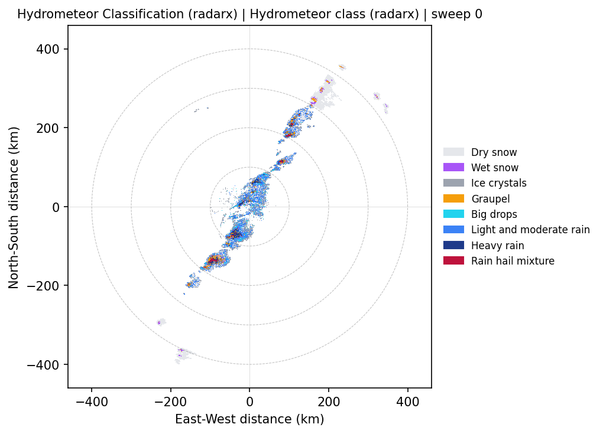
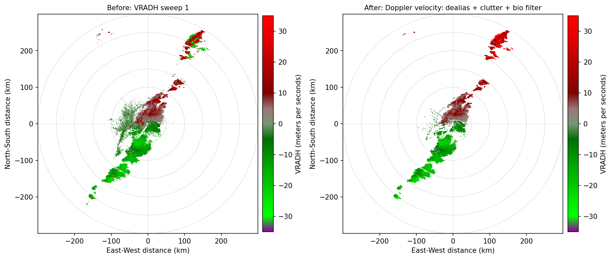
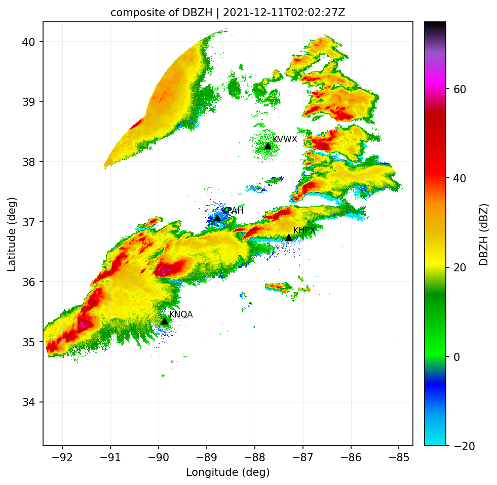
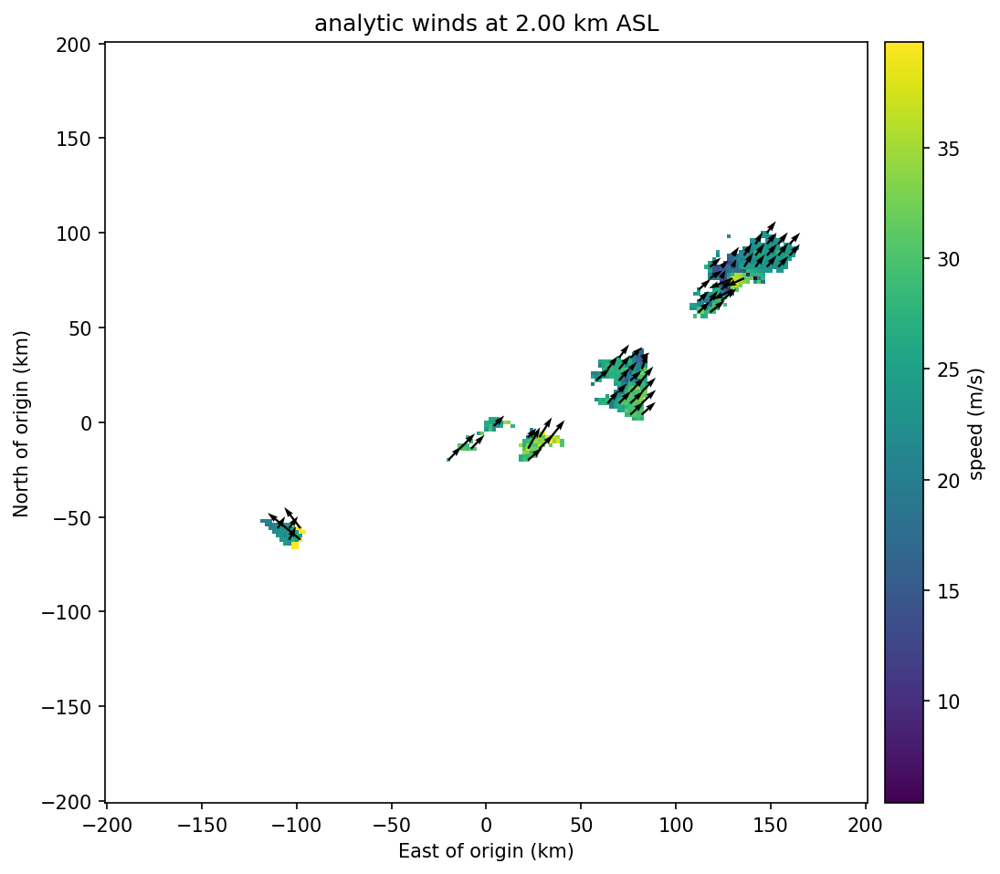

# The `rxd` command line

Everything the desktop app does can be done from a terminal, a shell script or a cron job, with
the same engine and the same results: look at a file, clean it, run an algorithm, merge radars,
save the outcome. No window, no server.

```text
rxd                       # a friendly overview of everything below
rxd examples              # a guided tour of copy-paste commands
rxd COMMAND --help        # purpose, options, real examples
```

```{note}
**The command was called `xrd` before.** It is now `rxd`. `xrd` still works,
as the same program, so existing scripts keep running; in a terminal it prints a one-line note,
and it will be removed in a future release. Switch with a find-and-replace of `xrd` by `rxd`.
```

## You need an account

Radarx Desktop needs a free account, in the terminal as well as in the app (see {doc}`ACCOUNTS`). Sign in once:

```console
$ rxd login
E-mail: ada@example.org
Password (not shown):
Signed in as ada@example.org.
$ rxd whoami
Signed in as ada@example.org
  sign-in valid until 2026-10-20 18:05 (renewed automatically)
$ rxd logout
```

The password is typed without echo, never goes on the command line and is never stored; the session is kept in a
private file in your user configuration folder, shared with the app. Without a session every
command except `login`, `logout`, `whoami`, `examples`, `completion`, `--help` and `--version` prints how to sign in
and exits with **code 5**. With no network a sign-in keeps working for 30 days after the server last checked it.
The deprecated `xrd` command behaves identically.

## Quick start

The six commands most people need (replace the file name with yours):

```bash
rxd info -i KTLX20130520_201643_V06.gz                       # 1. what is in the file?
rxd plot -i KTLX20130520_201643_V06.gz                       # 2. a picture -> KTLX..._DBZH_sweep0.png
rxd run radarx_hid -i KTLX20130520_201643_V06.gz -p hid.png  # 3. an algorithm (hydrometeor classes)
rxd pipeline "Doppler velocity" -i KTLX20130520_201643_V06.gz -p before_after.png   # 4. clean the data
rxd mosaic -i KHPX..._V06 KNQA..._V06 KPAH..._V06            # 5. several radars on one map
rxd export -i KTLX20130520_201643_V06.gz -o ktlx.zarr        # 6. save it (NetCDF, Zarr, CSV, PNG)
```

Without `-o`/`-p` a sensible file name is chosen, written to the current directory and printed,
and everything that was chosen for you is said in one line (`using ...`, `wrote ...`).

## Install

`rxd` is installed from the Python wheel that comes with every release (the steps, for macOS, Linux and Windows,
are on the {doc}`installation` page):

```bash
pip install "https://downloads.labshope.com/radarx/v0.3.1/radarx_desktop_engine-0.3.1-py3-none-any.whl"
pip install -U radarx             # optional: mosaics, winds and the radarx_* algorithms (Python >= 3.12)
rxd --version
```

Tab completion: `rxd completion bash > ~/.local/share/bash-completion/completions/rxd`,
`source <(rxd completion zsh)` or `rxd completion fish > ~/.config/fish/completions/rxd.fish`.

## The same options everywhere

| Option | Meaning |
|---|---|
| `-i`, `--input FILE [FILE ...]` | input file(s), globs, folders or `-` (a list on stdin); repeatable; bare `FILE` arguments work too |
| `-o`, `--output PATH` | the result; the **extension** says what is written (`.nc` `.zarr` `.csv` `.json` `.png`); a folder gets one file per format |
| `-p`, `--plot PATH` | also write a figure (`.png` `.pdf` `.svg`) of the result |
| `-P`, `--param KEY=VALUE` | a module / pipeline-step / mosaic / winds parameter (repeatable) |
| `-V`, `--variable NAME` | a variable, any spelling the variable mapping knows (`velocity`, `VRADH`, `VEL` ...) |
| `-s`, `--sweep N` | sweep index; default: **the lowest sweep that has what is needed** |
| `-f`, `--format FMT` | only when the `-o` extension is not enough |
| `-v`, `-q`, `--json` | progress and details (`-vv`: engine log and tracebacks) / only errors / machine-readable output |
| `--config FILE`, `--print-command` | keep an analysis in a file / print the equivalent full command |
| `--budget-gb GB` | the memory this run may use (default: chosen from the free memory; see `rxd budget`) |

## The commands, in the order you work

| Step | Command | Purpose |
|---|---|---|
| Look | `rxd info` | format, radar, time, sweeps, variables, Nyquist velocity |
| | `rxd check` | data-quality report with evidence and a suggested QC recipe ({doc}`DATA_CHECK`) |
| | `rxd auto` | inspect any set of inputs, plan the analyses that fit, run the approved ones ({doc}`AUTOPILOT`) |
| | `rxd plot` | a PPI picture of one variable |
| | `rxd budget` | can this computer do it? memory, time and the plan for each operation |
| Clean | `rxd pipeline` | QC recipes: `list`, `show`, `run` (default), `script` |
| Analyse | `rxd run MODULE` | an algorithm on one sweep or all sweeps (same as `rxd modules run`) |
| | `rxd modules` | `list` (default) or `show ID` the algorithms |
| | `rxd cells` | storm cells; several files are tracked in time |
| | `rxd sounding` | a radiosonde file: CAPE, CIN, shear, helicity, freezing level, precipitable water |
| Combine | `rxd mosaic` | several radars on one map |
| | `rxd winds` | 3-D winds from two or more radars |
| | `rxd animate` | a storm-centred 3D animation (MP4) from many volumes, with an optional synthesised sound track (`--sound`) |
| Hydrology | `rxd qpe` | rain rate / rainfall accumulation with uncertainty, gauge adjustment ({doc}`HYDROLOGY`) |
| | `rxd basin` | area-weighted rainfall over basins: table, hyetograph, return period |
| Save | `rxd export` | NetCDF, CfRadial2, Zarr, CSV or an image |
| Help | `rxd examples`, `rxd completion` | a tour of commands; shell completion |

### Look: `info` and `plot`

```console
$ rxd info -i KTLX20130520_201643_V06.gz
KTLX20130520_201643_V06.gz
  format     nexrad_level2
  radar      KTLX at 35.3331, -97.2775, 388 m
  time       2013-05-20T20:16:43Z
  size       9.5 MB on disk, 331.5 MB decoded
  variables  DBZH PHIDP RHOHV VRADH WRADH ZDR
  sweeps     17
    idx   elev  mode          rays  gates  range_km  nyquist  variables
    ---  -----  ------------  ----  -----  --------  -------  --------------------------------
      0   0.48  surveillance   720   1832       460  -        DBZH PHIDP RHOHV ZDR
      1   0.48  surveillance   720   1192       300  ~26.0    DBZH VRADH WRADH
      2   0.88  surveillance   720   1832       460  -        DBZH PHIDP RHOHV ZDR
    ...
    (~ = estimated from the largest velocity in the sweep: the file has no Nyquist value)
```

Note how the NEXRAD split cut shows: velocity (`VRADH`) lives on the odd sweeps. You rarely need
to remember that: `rxd plot -V velocity` and `rxd run radarx_shear` pick the right sweep for you.

```console
$ rxd plot -i KTLX20130520_201643_V06.gz
using variable DBZH (the first reflectivity field; -V NAME to change)
wrote KTLX20130520_201643_V06_DBZH_sweep0.png

$ rxd plot -i KTLX20130520_201643_V06.gz -V velocity
using sweep 1 (the lowest sweep with velocity; choose with -s N)
wrote KTLX20130520_201643_V06_VRADH_sweep1.png
```

`rxd plot` uses the publication renderer of the app (range rings, colour scales per variable, no-echo
codes masked): `--theme dark`, `--dpi 300`, `--vmin/--vmax`, `-p figure.pdf` for a vector file.

`rxd check` is the same data check the app shows after opening a file: what looks wrong (aliasing,
range folding, clutter, ZDR offset, time gaps ...), with the evidence, where it is, and a suggested
QC recipe. It changes nothing and exits 0 even when it finds problems (3 only when a file cannot be
read). `--fix-plan -o recipe.json` writes the suggested recipe for `rxd pipeline`. Every check, its
method and thresholds: {doc}`DATA_CHECK`.

`--json` always prints a list with one report per file, also for a single file. (Before 0.3.1 one
file gave a single report object, not a list; a script that read it should now take the first item.)

```console
$ rxd check -i KTLX20130520_201643_V06.gz --fix-plan -o recipe.json
```

### Analyse: `modules`, `run`, `cells`

```console
$ rxd modules --category Dual-pol
  id                    category  scope   requires          title
  --------------------  --------  ------  ----------------  -----------------------------------
  radarx_hid            Dual-pol  sweep   DBZH, ZDR         Hydrometeor Classification (radarx)
  radarx_kdp            Dual-pol  sweep   PHIDP             KDP Estimation (radarx)
  radarx_melting_layer  Dual-pol  volume  DBZH, ZDR, RHOHV  Melting Layer (radarx)
  radarx_qvp            Dual-pol  volume  DBZH, ZDR, RHOHV  Quasi-Vertical Profile (radarx)
  zdr_arc               Dual-pol  sweep   DBZH, ZDR         ZDR Arc Candidates (heuristic)

$ rxd modules show radarx_hid          # purpose, requirements and every parameter with its default
```

```console
$ rxd run radarx_hid -i KTLX20130520_201643_V06.gz -p cli-hid.png
radarx_hid  Hydrometeor Classification (radarx)  |  KTLX20130520_201643_V06.gz  |  sweep 0  |  1.3 s
  summary
    Classified gates: 132634
    Most common class: Light and moderate rain
    Method / band: park / S
    ...
  table: Class statistics
                      class  code  gates  share
    Light and moderate rain     6  47934   36.1
               Ice crystals     3  31875   24.0
                   Dry snow     1  22606   17.0
    ...
  field: Hydrometeor class (radarx) [class]  720x1832, 10.1% valid
wrote cli-hid.png
```



A module result can be saved by extension: `-o cells.csv` (a table), `-o summary.json`,
`-o fields.nc` (the gridded fields), `-o picture.png`, or `-o results/` (a folder with json, csv and nc;
`-f json,csv,nc,png` chooses). Parameters are `-P name=value`; a typo is caught with the fix:

```console
$ rxd run radarx_hid -i KTLX20130520_201643_V06.gz -P meth=park
error: Module 'radarx_hid' has no parameter 'meth'. Did you mean 'method'? Parameters: method, band, ...
```

**All sweeps.** `--all-sweeps` runs the module on every sweep and stores ONE derived variable per
output field in the file it writes (without `-o`: `<file>_<module>_all.nc`). Sweeps that lack an
input (here the Doppler cuts have no ZDR) are skipped, with the reason:

```console
$ rxd run radarx_hid -i KTLX20130520_201643_V06.gz --all-sweeps -o hid_all.nc -v
[  2%] Hydrometeor Classification: sweep 1/17
...
radarx_hid  Hydrometeor Classification (radarx)  |  KTLX20130520_201643_V06.gz  |  all sweeps  |  8.4 s
  derived variable(s): radarx_hid:hydrometeor_class
  processed 14 sweep(s), skipped 3
    skipped sweep 1: No differential reflectivity (ZDR) field found on sweep 1. Variables on sweep 1: DBZH, VRADH, WRADH.
  per-sweep summary:
 sweep  Classified gates       Most common class Method / band Melting layer Echo mask radarx
     0            132634 Light and moderate rain      park / S     not given        on  0.5.1
 ...
wrote hid_all.nc
```

**Storm cells** (`rxd cells`): one file lists the cells, several files (of one radar) are tracked in time order.

```console
$ rxd cells -i 'mayfield/KHPX*' --threshold-dbz 45 -o cells_all.csv --tracks tracks.csv -p tracks.png
21 track(s)  |  4 scans  |  50 cells  |  backend numpy
track_id  lifetime  speed_mps  direction_deg    status  max_dbz
    T001         3       5.72          132.3     ended     66.5
    T005         4      35.26          217.8 continued     58.0
    ...
wrote cells_all.csv
wrote tracks.csv
wrote tracks.png
```

**Soundings** (`rxd sounding`): read a radiosonde file (University of Wyoming text or CSV, SPC / SHARPpy,
IEM JSON, IGRA2, or a CSV whose header names the columns) and print its parameters, each labelled with
the parcel it belongs to (surface-based, mixed-layer 100 hPa, most-unstable 300 hPa), its unit and its height
reference (m AGL). A value that cannot be computed is `n/a`; a wind speed with no unit in the file is read as
m/s and the output says so (`--wind-units kt`). Needs radarx; nothing is downloaded. See
{doc}`ENVIRONMENT`.

```console
$ rxd sounding -i BMX_20220330_00Z.csv --wind-units kt
BMX launch time not in the file  (csv, 80 levels, BMX_20220330_00Z.csv)
data class: observed; This file has no per-level positions or times: the profile is treated as a vertical line ...

surface-based  CAPE 101 J/kg  CIN -3 J/kg  LCL 1635 m AGL  LFC 1808 m AGL  EL 6584 m AGL  LI -1.1 K
most-unstable  CAPE 101 J/kg  CIN -3 J/kg  ...
bulk shear 0-6km 15.8 m/s
SRH 0-3km right 247 m2/s2  left 66 m2/s2
freezing level 3520 m AGL   wet-bulb zero 2454 m AGL   -20 degC 6289 m AGL
precipitable water 22 mm (to 7.0 hPa)
```

`-v` adds the definitions and references, `--json` everything, `-o result.json` / `-o profile.csv` write the full
result or the levels (with a provenance header).

### Clean: `pipeline`

A recipe is an ordered list of steps (SNR gate, clutter filter, biological-echo filter,
de-aliasing, speckle removal ...). `pipeline list` shows them, `pipeline show` the steps with every
setting, `pipeline script` prints the equivalent Python.

```console
$ rxd pipeline list
  recipe                                            target  kind      steps
  ------------------------------------------------  ------  --------  -----------------------------------------------------------------
  Doppler velocity: dealias + clutter + bio filter  VRADH   built-in  snr_gate > clutter_filter > biological_filter > dealias > speckle
  Reflectivity QC                                   DBZH    built-in  snr_gate > echo_mask > clutter_filter > speckle > gap_fill
  Dual-pol QC                                       ZDR     built-in  snr_gate > rhohv_gate > echo_mask > biological_filter > speckle

$ rxd pipeline "Doppler velocity" -i KTLX20130520_201643_V06.gz --target VRADH -p cli-pipeline.png -o vel_qc.nc
Doppler velocity: dealias + clutter + bio filter  |  KTLX20130520_201643_V06.gz  |  target VRADH  |  14 sweep(s)  |  8.0 s
  #  step                    status   removed  modified  filled  valid%  note
  -  ----------------------  -------  -------  --------  ------  ------  --------------------------
  1  SNR gate                skipped        0         0       0   100.0  no SNR field on this sweep
  2  Ground clutter filter   ok          5242         0       0    99.6
  3  Biological echo filter  ok        173512         0       0    86.8
  4  Dealias velocity        ok             0     98334       0    86.8
  5  Remove speckle          ok         28329         0       0    84.7
  derived variable: pipeline:doppler_velocity_dealias_clutter_bio_fil_vradh
wrote vel_qc.nc
wrote cli-pipeline.png
```



A unique part of the recipe name is enough (`"Doppler velocity"`), and a path to a recipe JSON saved from
the app works too. Change a setting with `-P STEP.PARAMETER=VALUE` (`-P snr_gate.min_snr=5`) or switch a step
off with `-P gap_fill=off`. The result lives in the file that is written (`-o`, default
`<file>_<recipe>.nc`) because a derived variable only exists inside one run.

### Combine: `mosaic` and `winds` (need radarx)

Origin, map box and grid are chosen from the radar positions and printed; override them with
`--extent`, `--origin`, `--resolution-m`, `--dz-m` ... Without `-o`/`-p` the results are named after the product and time.

```console
$ rxd mosaic -i mayfield/KHPX20211211_015930_V06 mayfield/KNQA20211211_015611_V06 \
             mayfield/KPAH20211211_015935_V06 mayfield/KVWX20211211_015522_V06 -v
[  8%] Preparing radar volumes
[ 15%] Gridding radars onto 723 x 796 cells (band 1/7)
...
[ 92%] Rendering PNG
[14.7 s]
composite of DBZH  |  4 radar(s)  |  686 x 788 cells @ 1000.0 m
  extent  W -92.403  S 33.271  E -84.711  N 40.332  (degrees)  (chosen to cover all radars; --extent W,S,E,N to change)
  values  valid 22% of cells  min -20.0  max 63.9  mean 21.1 dBZ
  radar     lat      lon  volume time           coverage%  share%
  -----  ------  -------  --------------------  ---------  ------
  KHPX   36.737  -87.286  2021-12-11T02:01:56Z         31      15
  KNQA   35.345  -89.873  2021-12-11T01:58:41Z         31      28
  KPAH   37.068  -88.772  2021-12-11T02:02:27Z         31      22
  KVWX   38.260  -87.725  2021-12-11T01:57:27Z         31      34
using mosaic_composite_DBZH_20211211T0202.nc and mosaic_composite_DBZH_20211211T0202_map.png as the outputs (add -o / -p to choose)
wrote mosaic_composite_DBZH_20211211T0202.nc
wrote mosaic_composite_DBZH_20211211T0202_map.png
```



`-o mosaic.nc` is the gridded NetCDF, `-o mosaic.png` the colour image **plus** its world file
(`.pgw`) and projection (`.prj`), so QGIS/GDAL place it; `-p map.png` is a map figure with the radar
sites. `--product cappi --height-m 2000` or `--product echo_top` change the product.

```console
$ rxd winds -i mayfield/KHPX20211211_015930_V06 mayfield/KNQA20211211_015611_V06 \
            mayfield/KPAH20211211_015935_V06 mayfield/KVWX20211211_015522_V06 \
            --extent 200 --max-range-km 200 --dx-m 2000 --zmin-m 500 --zmax-m 6000 --dz-m 500 \
            -P min_crossing_angle=20 -o winds.nc -p winds.png --level-km 2
analytic winds  |  4 radar(s)  |  grid 201 x 201 x 12 (dx 2000 m)
  origin  36.8568, -88.4233  (centre of the radars; --origin LAT,LON to change)
  levels  0.50 to 6.00 km above sea level (12)
  radar   KHPX  2021-12-11T02:02:24Z
  ...
  warning: The volumes were observed 5 min apart; the storm moves between scans. Give a storm motion to advect them to a common time.
wrote winds.nc
wrote winds.png
```



`--method variational`, `--dealias auto|always|never` and any further engine option (`-P key=value`)
are passed to the same code the app uses; warnings of the engine are shown, not hidden. The
vectors are drawn where at least two radars give a usable crossing angle.

### Animate: `animate` (needs radarx; rendering needs the `video` extra)

Many volumes of one or more radars over time become an MP4: the strongest storm in 3D, a camera that flies
around it while it travels across the map, a UTC clock, the storm's track and labels that say which frames
are real volumes and which are interpolated. The files are grouped by radar and time, every time step takes
each radar's nearest volume within a tolerance, the rest is listed with the reason, the radars of one step are
gridded at a time (bounded memory) and cached on disk, an interrupted job resumes, and the MP4 is written
atomically at the end. {doc}`The full page <ANIMATE>` has the camera file, the look, the report and the limits.

```console
$ rxd animate -i mayfield --no-render                    # the plan: steps, offsets, storm track, frames (no browser)
$ rxd animate -i mayfield -o mayfield.mp4                # the folder with one sub-folder per radar
$ rxd animate -i mayfield -o top.mp4 --camera top-down --duration 30
$ rxd animate -i mayfield -o custom.mp4 --camera camera.toml --realistic --look-preset "Golden hour" --set exposure=1.4
$ rxd animate -i mayfield -p still.png --still-at 12      # one frame, to try a camera or a look
$ rxd animate -i mayfield -o storm.mp4 --winds --sound --flashes-from-glm glm/   # a SYNTHESISED sound track: wind, rain, thunder timed to observed GLM flashes
```

```text
pip install "radarx-desktop-engine[video] @ <the wheel address>"   # Playwright (drives the system Chrome, which draws and encodes)
```

Rendering needs Google Chrome (the system Chrome; no browser is downloaded) and the 3D renderer files of the app:
an installed Radarx app (0.3.1 or later) ships them and `rxd animate` finds them by itself, or name a folder with
`--app-dist`. Chrome encodes the film itself (H.264 + AAC in an MP4); `--encoder auto|browser|pyav|png` chooses
PyAV (if you installed it yourself) or numbered PNG frames with the `ffmpeg` line that encodes them instead.
(The installed app's own Movie Studio gets Playwright as the optional *movie components* download instead of
this extra; see {doc}`ANIMATE`.)
The terminal report (or `--json`) gives the track, displacement and speed, the time offsets of every radar,
the share of interpolated frames and the frame count, so a result can be checked without watching the video.

### Hydrology: `qpe` and `basin` (need radarx)

Rainfall from a folder of volumes. Several scans in time are integrated into an accumulation in mm (advection-corrected
between scans); one volume per radar gives the instantaneous rate. Everything is labelled `RETRIEVED` (a radar estimate)
or `ADJUSTED` (after gauges); see {doc}`HYDROLOGY` for the equations, references and limits.

```console
$ rxd qpe -i 'mayfield/KHPX/*_V06' --basins basins.geojson --gauges gauges.csv --gauge-interval-s 1200 \
          --start 2021-12-11T01:50:00 --end 2021-12-11T02:10:00 --hold-edges-s 300 -o rain.nc -p rain.png
rainfall accumulation  |  1 radar(s), 4 volume(s)  |  2021-12-11T01:50:00Z to 2021-12-11T02:10:00Z (20.0 min)  |  477 x 469 cells @ 1000 m  |  4.4 s
  method   hybrid: Z = 300 R^1.4  (R = 0.01701 Z^0.7143) if R(Z) < 6 mm/h; R(Z,ZDR) = 0.0142 Z^0.77 zdr^-1.67 to
           50 mm/h; R(KDP) = 44 |KDP|^0.822 above (KDP >= 0.3 deg/km); class gated by radarx HID
  label    ADJUSTED: an estimate, not an observation
  values   max 19.7 mm  mean 0.14 mm over 166,144 km2  |  max rate 171 mm/h  |  area >= 0.1 mm 15,632 km2
  uncertainty  median 29 % (1 sigma: relation scatter, calibration; errors fully correlated in time)
  ...
  gauges   16 used (16 good records)  |  kriging with external drift
                             n  rel. bias  RMSE mm  corr   KGE
  radar (before)            16  -18.2 %       1.42  0.97  0.75
  adjusted (leave-one-out)  16  -0.3 %        0.75  0.97  0.95
wrote rain.nc
wrote rain.png
```

* `--relation wsr88d|marshall_palmer|tropical|stratiform_east|...` and `--method auto|hybrid|z|kdp|z_zdr|a` choose the
  estimator (`rxd qpe --list-relations`); `-P zr_a=200 -P zr_b=1.6` a custom Z = a R^b; `--freezing-level-m` excludes the
  melting layer; `--dem terrain.nc` adds beam blockage and height above ground.
* `-o .nc` is the CF grid, `.png` the picture plus world file, `.json` the full summary (provenance, statistics, basins,
  gauge validation, return periods), `.csv` the basin table (and one `<name>_<id>_series.csv` per basin).
  Without `-o`/`-p`: `qpe_<time>.nc` and `qpe_<time>_map.png`.
* Gauges are local files (CSV/JSON/NOAA hourly and daily/METAR): `--gauges FILE --adjust mfb|brandes|ked`; the validation
  (bias, RMSE, correlation, KGE, leave-one-out) is printed and in `--json`. Nothing is downloaded.
* `rxd basin -i FILES -b polygons.geojson|.shp|.gpkg` is the same run with the basins required: the table with area-weighted
  mean and maximum depth, area above thresholds (`--thresholds 10,25,50`), the hyetograph figure (`-p`, `--bin-minutes`) and,
  with `--frequency table.json`, the return period of the basin-mean depth.
* A long series is read one file at a time; give `--extent W,S,E,N` so that each file is decoded once.

### Save: `export`

```bash
rxd export -i KTLX20130520_201643_V06.gz -o ktlx.nc                  # CfRadial1 NetCDF (the default)
rxd export -i KTLX20130520_201643_V06.gz -o ktlx.zarr                # Zarr
rxd export -i KTLX20130520_201643_V06.gz -o dbz_sweep0.csv -V DBZH   # azimuth, range, value
rxd export -i KTLX20130520_201643_V06.gz -f cfradial2 -o ktlx_cf2.nc
rxd export -i KTLX20130520_201643_V06.gz -o qc.nc --pipeline "Reflectivity QC" --run radarx_hid --include-derived
```

Derived variables only exist inside one run, so `export` can compute them first (`--pipeline RECIPE`,
`--run MODULE`, repeatable, all sweeps) and write them into the file with `--include-derived`.

### Plan: `budget` (any amount of data)

Before a big job, ask what this computer allows and what each operation would cost on your files.
Nothing is processed: one file per radar is opened to measure it, the other files are scaled by
their size.

```bash
rxd budget -i 'mayfield/*/*_V06'                     # every operation, as text
rxd budget -i data/ --ops mosaic winds --json        # only some operations, machine-readable
rxd budget -i data/ --budget-gb 4 --max-minutes 10   # plan for 4 GB and a 10-minute limit
```

```text
memory  budget 2.2 GB (auto), hard limit 12.0 GB  |  free now 2.8 GB of 16.0 GB
cores   10
disk    16.8 GB free in /home/me/work

inputs  16 file(s), 4 radar(s) KHPX, KNQA, KPAH, KVWX  |  123 MB on disk, about 7.4 GB decoded

read          peak   10.9 GB  time     37 s  -> fits with 1 change(s): peak 913 MB, time 37 s
              - volumes processed one at a time, memory freed after each (lossless): none
mosaic        peak    1.7 GB  time     14 s  -> runs as asked
export NetCDF peak    4.5 GB  time    1 min  -> WILL NOT RUN
              the output needs about 16.3 GB, only 16.8 GB is free in /home/me/work
              - write to a disk with more space (-o elsewhere)
              - use Zarr or CfRadial2 (compressed, about 4 x smaller than NetCDF CfRadial1)
export Zarr   peak    951 MB  time    1 min  -> runs as asked
```

Every operation ends in one of three answers:

- **runs as asked**: the estimate fits.
- **fits with changes**: each change is listed with what it costs scientifically. Lossless changes
  (one volume at a time, reading lazily) come first; changes that use less data (a coarser grid,
  fewer levels, only every Nth volume, a shorter range around each radar) are made only when the
  lossless ones are not enough, and only when they really save memory.
- **will not run**: even the allowed changes are not enough. The message says what you can change:
  more memory, fewer radars or files, a smaller area, another output format.

The same decision is taken automatically when `mosaic`, `winds` or a NetCDF `export` runs, with no
option to set: nothing changes while the job fits. When a change is made it is printed as a warning
and written into the result file (the `processing_reductions` attribute), so the output always says
what was left out and why. A job that cannot fit stops at the start with that message, instead of
running out of memory halfway.

| Setting | Meaning |
|---|---|
| `--budget-gb GB` (any command) or `RADARX_BUDGET_GB` | the memory a run may use; without it the budget follows the free memory, and data is reduced only above three quarters of the computer's memory |
| `RADARX_GOVERNOR=strict` | never reduce data: refuse instead |
| `RADARX_GOVERNOR=off` | no checks (the old behaviour) |

Estimates come from measured runs on NEXRAD Level II volumes and are approximate (about +-25 %);
times for the variational wind analysis and for rendering animation frames are rough guesses and
are marked as such in the output.

## Input: files, globs, folders, stdin

```bash
rxd info -i KHPX20211211_015930_V06 KNQA20211211_015611_V06      # several files after one -i
rxd info -i 'mayfield/*/*_V06'                                  # a glob (quote it: rxd expands it)
rxd info -i mayfield/KHPX                                       # a folder = the radar files inside
ls mayfield/KHPX/*_V06 | rxd info -i -                          # a list on stdin
rxd info KTLX20130520_201643_V06.gz                             # bare file names work too
```

A pattern that matches nothing, an empty folder or a missing file is an input error (exit code 3)
that says what was looked for. Files from the Level-II archive on S3 are not fetched by the command line
(it never downloads anything on its own); download them first or use the app's cloud browser.

## Keep an analysis: `--config` and `--print-command`

A config file holds the same options (long names; `_` or `-`). Options on the command line win.

```toml
# run.toml
command = "run"
module = "storm_detection"
input = ["KTLX20130520_201643_V06.gz"]
output = "cells.csv"

[param]
threshold_dbz = 45
```

```console
$ rxd --config run.toml --print-command
storm_detection  Storm Cell Detection  |  KTLX20130520_201643_V06.gz  |  sweep 0  |  1.7 s
  summary
    Cells: 19
    ...
wrote cells.csv
command: rxd run storm_detection --input KTLX20130520_201643_V06.gz --output cells.csv --param threshold_dbz=45
```

`--print-command` also writes out what was chosen for you (for example `-s 1`), so the printed line
reproduces the run exactly. TOML needs Python 3.11+ (JSON always works, YAML needs PyYAML).

## When something is wrong

Errors say what went wrong **and** the fix; there is never a traceback unless you ask (`-vv`).

```console
$ rxd plot -i KTLX20130520_201643_V06.gz -V velocity -s 0
error: No velocity field found on sweep 0. Variables on sweep 0: DBZH, ZDR, PHIDP, RHOHV. Sweeps that have it: 1, 3, 5, 6, 7, 8, 9, 10 (+6 more). Use -s 1 on the command line.

$ rxd run radarx_hid -i KTLX20130520_201643_V06.gz -s 1
error: Hydrometeor Classification (radarx) needs DBZH, ZDR, but sweep 1 has no ZDR (it has: DBZH, VRADH, WRADH). Sweeps that have all of them: 0, 2, 4, 6, 7, 8, 9, 10. Use -s 0 on the command line (without a sweep the right one is chosen for you).

$ rxd mosiac -i KTLX20130520_201643_V06.gz
error: unknown value 'mosiac'. Did you mean 'mosaic'?

$ rxd winds -i mayfield/KHPX20211211_015930_V06
error: winds needs at least two radar files: give them with -i (for example: rxd winds -i FILE1 FILE2 [FILE3 ...]) - only 1 given

$ rxd info -i missing.nc ; echo $?
error: File not found: missing.nc (looked for /.../missing.nc). Check the path and the spelling.
3
```

| Exit code | Meaning |
|---|---|
| 0 | success |
| 1 | the processing failed (the algorithm could not run on this data) |
| 2 | the command was used wrongly: unknown option, module, recipe, variable, bad `-P`, sweep out of range |
| 3 | an input file is missing, is not a file, or cannot be read |
| 4 | an optional Python package is missing; the message says how to install it (`pip install -U radarx`) |
| 5 | no signed-in account: run `rxd login` (every command except `login`, `logout`, `whoami`, `examples`, `completion`, `--help`, `--version`) |
| 70 | an unexpected internal error (re-run with `-vv` for the traceback and report it) |
| 130 | interrupted |

## Scripting

`--json` prints one JSON document on stdout (results, parameters, the files written) and nothing else;
messages go to stderr; `-q` silences everything but errors. `NO_COLOR=1` (or `--no-color`) turns colour off.

```bash
for f in data/*_V06; do
  rxd run storm_detection -i "$f" -P threshold_dbz=45 --json -o "cells_$(basename "$f").csv" | jq '.scalars.Cells'
done
rxd info -i data --json | jq -r '.[] | [.radar, .time] | @tsv'
```

Real runs for this page used the KTLX example volume (20 May 2013) and four radars of the Mayfield
case (11 Dec 2021: KHPX, KNQA, KPAH, KVWX); `rxd animate` was also run on the Mayfield and Hurricane Laura cases.
