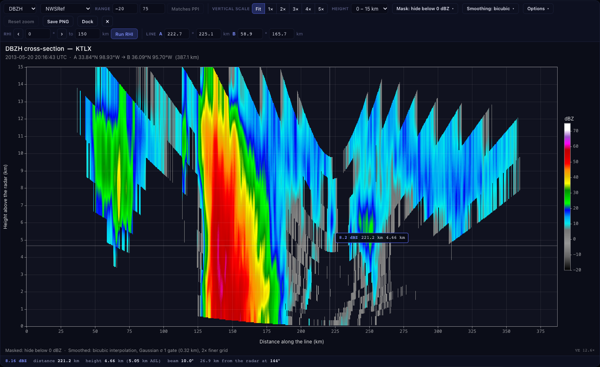

# Cross-sections

A cross-section is a vertical slice through a radar volume: distance along a line on the ground on the
horizontal axis, height above the radar on the vertical axis, and the value of one variable as colour. It is cut
out of the PPI sweeps of the volume (each sweep contributes the cells its beam passes through), so it works for
any file with several elevation angles.

## Three places to see it

| Where | How to get there |
| --- | --- |
| **Sidebar panel** (small, as before) | *Cross-Section* panel in the right sidebar |
| **Docked under the PPI** | draw a line (it opens by default), or *Dock under PPI* in the panel. Drag the handle between the PPI and the section to change its height; the height is remembered. The close button (x) returns to the small panel and remembers that choice. |
| **Large window** | *Expand* (panel, PPI pill or dock toolbar). About 92% x 90% of the window; focus stays inside, **Esc** closes, *Dock* puts it back under the PPI. |

## Making a section

* **Draw**: *Draw Line* (panel or dock toolbar), click A, click B. The section is extracted straight away. Drag the
  A and B handles on the PPI to move the line; it re-runs when you let go.
* **Type**: in the *Line* row, give each end as an azimuth (degrees) and a range from the radar (km). Enter or
  leaving the field re-runs the section.
* **RHI-style cut**: *RHI* gives a section straight out of the radar along one azimuth, to a maximum range.
  Type an azimuth and a range and press *Run RHI* (the arrows step the azimuth by 1 degree), or press *RHI* /
  *Pick on PPI* and click the PPI once: the azimuth of the click is used. The distance axis is then the range from
  the radar.

The line is shown on the PPI. Sample points lie on the WGS84 geodesic, one every ~250 m (up to 1200 per line); heights
use the 4/3 effective-Earth-radius beam model. A section covering the part of a *sector scan* that was not scanned is
left empty instead of repeating the edge ray.

## The large view

* Drawn at the device pixel ratio (crisp on high-DPI screens), with axes in km, tick labels, a colour bar with
  units, and a title with variable, instrument, scan time (UTC) and where the line runs.
* **Hover** shows value, distance along the line, height (and above sea level when the file has the radar altitude),
  the beam elevation and the position of the point relative to the radar. The wheel zooms, dragging pans,
  double-click or *Reset zoom* shows everything.
* **Vertical scale**: *Fit* fills the window; 1x-5x keeps the picture in proportion (1x: a kilometre up is as long as a
  kilometre along). The effective exaggeration is printed in the corner.
* **Height**: Auto (just above the echo, at most 20 km) or 0-5 ... 0-40 km.
* **Variable, colormap, range**: the same defaults as the 2D view; *Match PPI* copies the PPI's colormap and range
  (they follow the PPI until you change them here).
* **Options**: *Fill gaps between elevations* (off draws only the beam itself), *Height above sea level*, and a white
  background for the saved image.
* **Save PNG**: a download in a browser, a Save dialog in the desktop app. The image
  is rendered at 2x or more and carries a description (variable, line, mask, smoothing) as PNG text metadata.

## Mask

*Mask* hides values of the variable: **below**, **above**, **between** or **outside** one or two limits, optionally
including the limits themselves. One-click presets fit the variable (reflectivity below 0 / 10 / 20 dBZ, velocity
|V| below 2 or 5 m/s, ZDR, RhoHV, ...). The mask is remembered per variable. Masked gates are removed before any
smoothing, so smoothing never blends across them, and the mask is printed in the figure caption.

## Smoothing

*Smoothing* changes how the section is drawn, not the data:

* **Interpolation**: *Nearest* (blocky gates, as measured), *Bilinear* or *Bicubic*. The smooth modes also
  interpolate in height between neighbouring elevation angles (only where the gap between them was filled).
* **Gaussian**: 0 (off) to 4 gate lengths. It is a normalised convolution that ignores missing data, so the edges
  of echo keep their level and the footprint of the echo is not changed: nothing is smeared into empty areas or
  unscanned sectors.
* **Finer grid**: 1x-4x, the section is rendered on a grid finer than the radar gates.

The caption says what was applied. The settings are remembered.

## Sampling

The line can be given by its two ends (latitude / longitude, or azimuth and range from the radar) or, for an RHI-style
cut, by an azimuth and a maximum range (optionally a minimum range), with 2 to 2000 sample points. For every sample the
section keeps, per sweep, the height, the value, the beam elevation, the ground range and the azimuth, which the
hover read-out shows.
