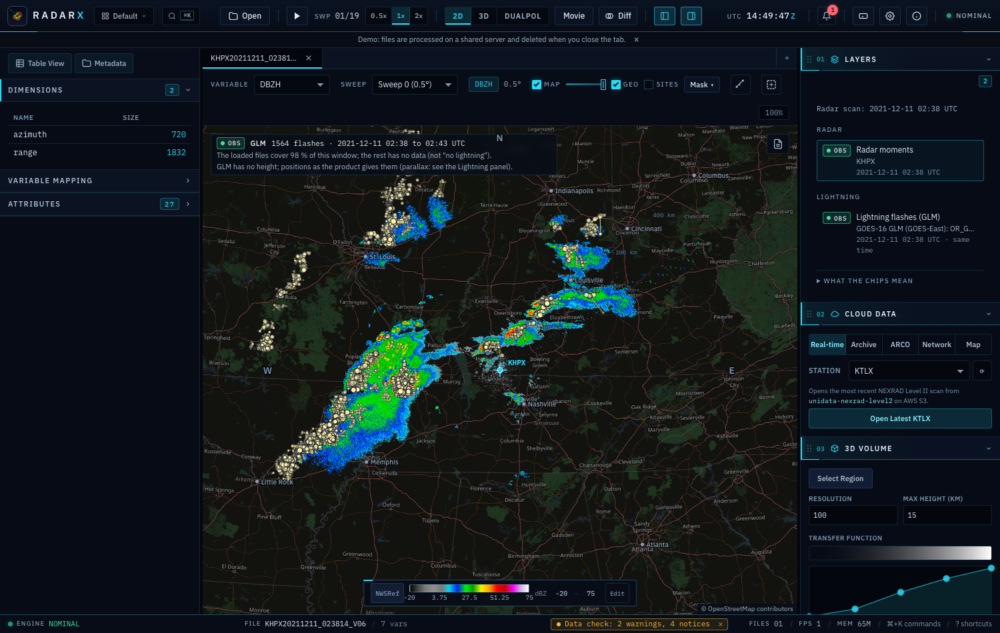
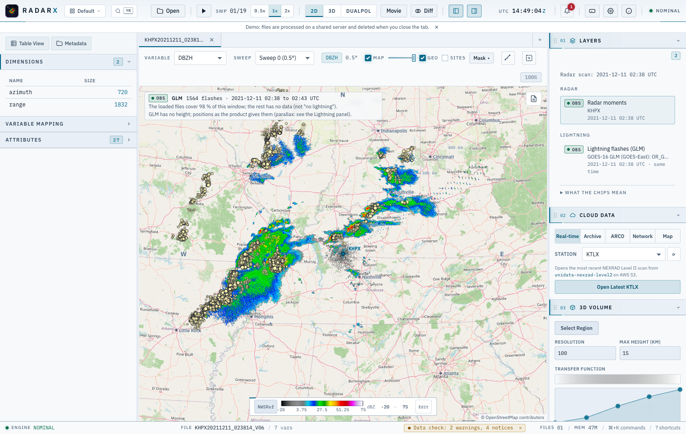
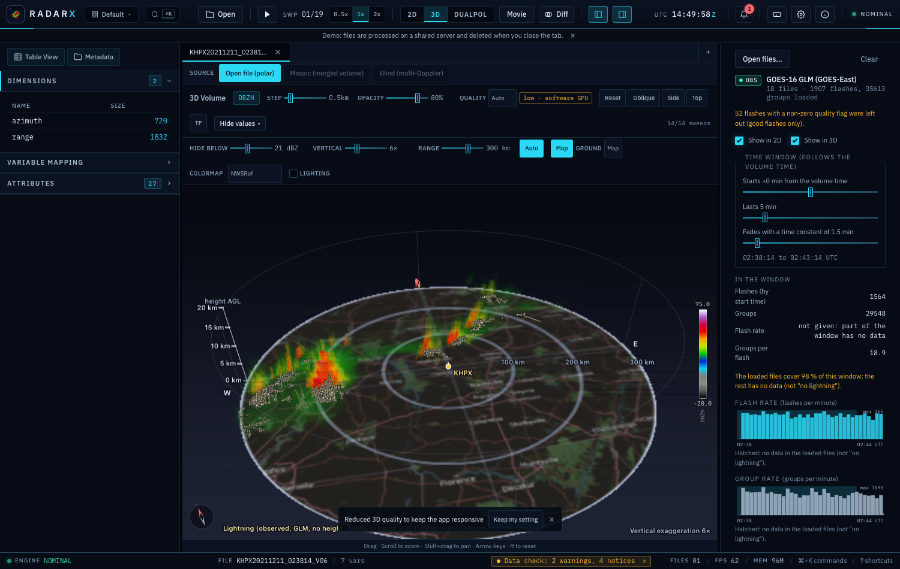
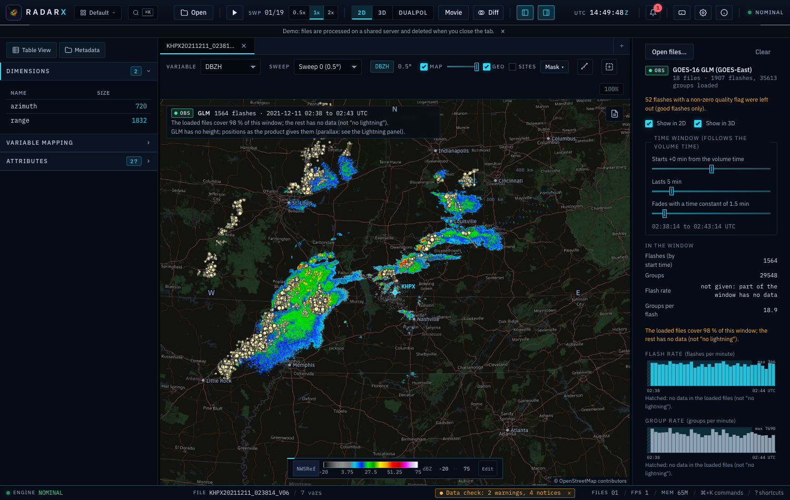
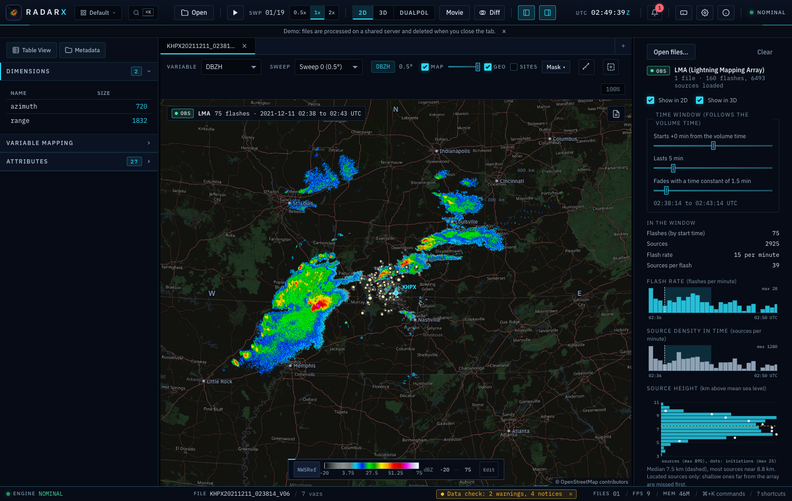
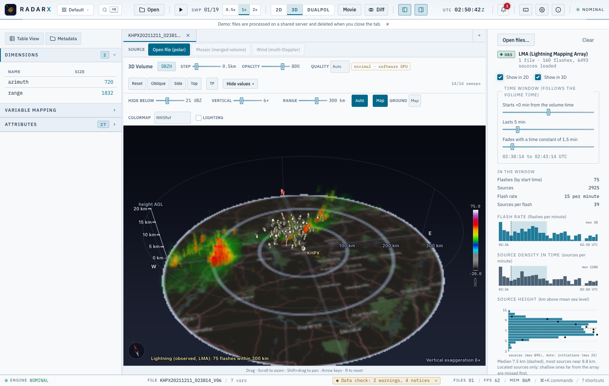

# Lightning

The lightning layer shows **observed** flashes over the radar: from the GOES Geostationary Lightning Mapper
(GLM) or from a ground Lightning Mapping Array (LMA), in the 2D map and in the 3D view. You open the files
from your disk; nothing is downloaded. The layer is class **OBSERVED** ({doc}`science-and-trust`): positions,
times and strengths are what the instrument reported. Lightning that is modelled or guessed from the radar
echo is a different thing and is never mixed with it.




## Open files

Open the **Lightning** panel and choose **Open files...**:

* **GOES GLM**: Level 2 *LCFA* files (`OR_GLM-L2-LCFA_G16_s...nc`) from GOES-16, -17, -18 or -19. Several
  files can be opened together (one file is 20 seconds).
* **LMA**: ASCII source files (`LYLOUT_...dat`, also `.gz` and `.bz2`). Reading them needs the optional
  radarx library.

With a radar volume open, only the 450 km around that radar are read, so a whole hour of GLM for the full disk
stays small. Without one, the whole file is read (up to 200 000 points; more are cut by whole flashes and the
panel says so).

Lightning files are read in the desktop app. In the browser version they are not available yet.

## What is drawn

* Every dot is a **measured point**: an LMA source at its time, longitude, latitude and height, or a GLM
  group (the centre of the lit pixels in one frame). The points of one flash are joined in time order.
* **Brightness** is the strength of the point (LMA: power in dBW; GLM: radiant energy on a log scale, both
  scaled between the 5th and 95th percentile of the points that were read) and it **fades with age**.
* The **time window** follows the valid time of the active radar volume. By default it starts at the volume
  time and lasts 5 minutes; start, length and the fade time are sliders in the panel. A window that lies outside
  the time the files cover draws nothing and says so: that is "no data", not "no lightning".
* In **3D** the LMA sources are at their height above the radar's ground (the radar altitude in the file is
  subtracted; terrain is not modelled) and stretched with the vertical exaggeration like the echoes. GLM has
  no height, so its points lie on the ground, and the view says so.
* The **Layers** panel lists the layer with its source, valid time and the OBS chip.



## Flash rate and statistics

The panel counts flashes and points in the window and plots the **flash rate** (flashes per minute) and the
rate of groups or sources over the time the files cover. The shaded band is the window, the dashed line the
volume time. A bin that the files do not cover completely is **hatched, never zero**, and the rate of a window
that is only partly covered is not given.



## Flash clustering

**GLM** files already hold events, groups and flashes as grouped by the NOAA product; the layer uses its flashes
and its groups as they are and shows the time threshold that the file states. Flashes with a non-zero quality
flag are left out unless you ask for them (the panel says how many).

**LMA** sources are grouped into flashes by the radarx library (`cluster_flashes`), which also reads the files. Two sources are linked when

$$\left(\frac{\Delta x}{D}\right)^2 + \left(\frac{\Delta t}{T}\right)^2 \le 1,$$

with $\Delta x$ the straight-line distance, $\Delta t$ the time difference, and a flash is a connected group
of linked sources (single linkage). This is the space-time metric that Fuchs et al. (2016) used with the
DBSCAN method (Ester et al. 1996). The defaults are the values Fuchs et al. used for the sensitive Colorado
network: $D$ = 3 km, $T$ = 0.15 s (they used 6 km for the less sensitive Alabama and Washington, D.C. networks),
sources kept when the reduced chi-square is at most 1 and at least six stations located them, and a longest
flash of 3 s. All of these are boxes in the panel. The longest-flash cut (a longer flash is cut in time order)
is this program's own and agrees with the paper only in that long flashes are split.

* Fuchs, B. R., E. C. Bruning, S. A. Rutledge, L. D. Carey, P. R. Krehbiel and W. Rison, 2016: Climatological
  analyses of LMA data with an open-source lightning flash-clustering algorithm. *J. Geophys. Res. Atmos.*, **121**,
  8625-8648, doi:10.1002/2015JD024663.
* Ester, M., H.-P. Kriegel, J. Sander and X. Xu, 1996: A density-based algorithm for discovering clusters in large
  spatial databases with noise. *Proc. KDD-96*, 226-231.

## LMA statistics: source heights and lightning jumps




For an LMA the panel adds two things, both computed by the radarx library:

* **Source height**: how many sources (bars) and flash initiations (dots) lie in each height bin, in
  kilometres above mean sea level (bin height 500 m), with the median and the most common height. This is a
  distribution of *located* sources: a source is found less often with distance from the array and when fewer
  stations see it, and shallow sources far from the array are missed first, so a storm far from the network
  looks higher than it is.
* **Lightning jumps**: the "2 sigma" algorithm of Schultz, Petersen and Carey (2009) on the flash rate per
  minute: the rate is averaged over 2 minutes, a jump is flagged when its rate of change exceeds two standard
  deviations of the five earlier changes while the rate is at least 10 flashes per minute. Jumps are marked in red
  on the flash-rate chart. The algorithm needs 14 minutes of data; with less, the panel says so instead of
  showing "no jump". Minutes without data are counted as zero for this algorithm (it needs a continuous
  series) and the panel says how many.

**Charge layers are not inferred.** Where charge sits is an interpretation of the sources, not something the array
measures, so the program does not offer it.

Gridded products (source density, flash extent density, flash initiation density on a map) are not in the
panel yet.

## GLM parallax

(The geometry is the radarx library's `glm_parallax`; with an older radarx the program uses its own copy of the same maths.)

GLM looks from 35 786 km. A flash high in the cloud is seen displaced away from the satellite by about the
height times the tangent of the satellite's zenith angle: about one kilometre per kilometre of height over the
central United States. The panel states the size for your data: for example 5 km of cloud-top height error is
about 5 km of shift.

The file does **not** state the height of the surface the product positions refer to (the product navigates to a
"lightning ellipsoid" some 6 to 16 km above the Earth ellipsoid). The program therefore **assumes 12 km** for it; this is an
assumption, check it against the GOES-R product documentation before relying on it.

By default the positions are drawn as the product gives them and the parallax is shown as an uncertainty. If you
choose **Move flashes to a cloud-top height**, every position is moved along the line of sight to the satellite
from the assumed height to the height you give (WGS84 Earth, the satellite at the nominal position in the file),
and the panel says it is applied. A flash assumed higher moves towards the point under the satellite, a lower one
away from it.

## What the data cannot say

* **Detection efficiency** is not in the files and is not computed. GLM sees less toward the edge of its field of
  view and for weak flashes; an LMA locates sources best inside and near its network, and worse with range and with fewer
  stations on a source. A flash that is not drawn may still have happened. The panel prints the field of view
  (GLM) or the station count (LMA); it does not draw a coverage footprint it cannot compute.
* GLM pixels are about 8 km at nadir and grow toward the edge, so a GLM "channel" is a cluster of pixels, not a
  lightning path.
* GLM has no height. LMA heights are above sea level and are not corrected for terrain.
* Times are UTC.

## Command line

`rxd lightning` does the same without the app: it reads GLM or LMA files, clusters, prints the flash rate and
writes flashes or rates as CSV or everything as JSON.

```bash
rxd lightning -i 'glm/OR_GLM-L2-LCFA_G16_s2021345024*.nc' --box 36 -92 39 -86
rxd lightning -i glm/*.nc -o flashes.csv -o rates.csv --bin-s 60
rxd lightning -i LYLOUT_211211_020000_0600.dat --link-distance 6000 --link-time 0.15 --json
```
