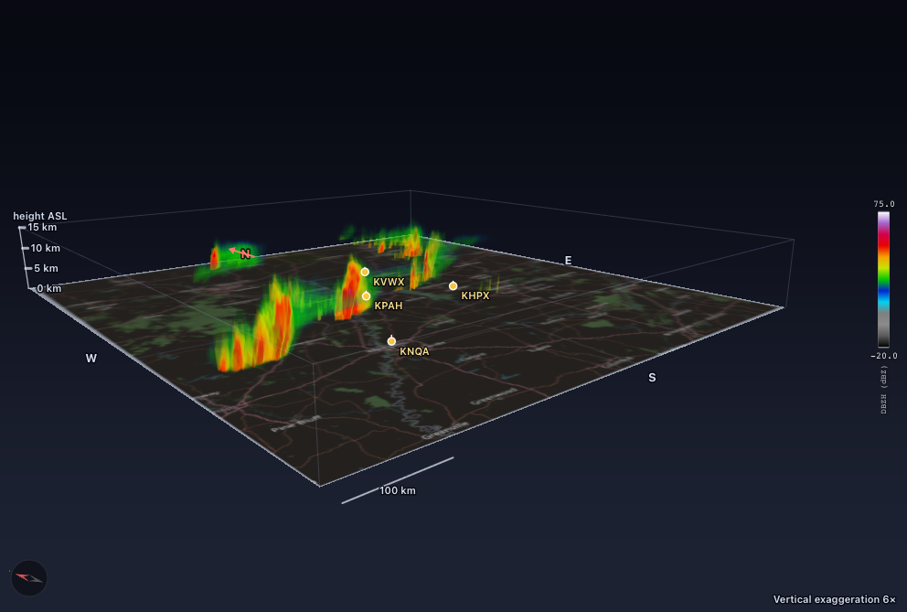
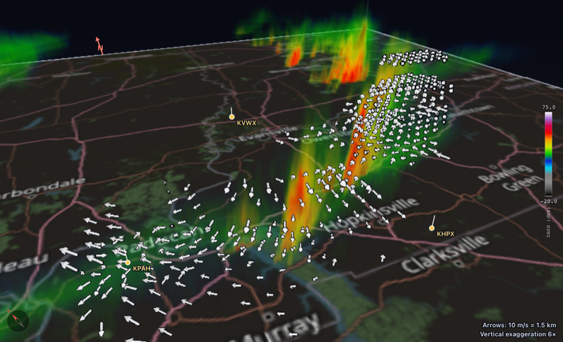

# Radar mosaic (multi-radar merge)

Merge one or more open radar volumes onto a shared grid and draw the result on the map. The
heavy lifting is done by [radarx](https://github.com/syedhamidali/radarx) (`grid_radars`,
`merge_radars`, `network_bias`), whose compiled kernels run multithreaded. Needs
`pip install "radarx>=0.5.1"` (Python 3.12+).

```{image} images/ui/mosaic-view.png
:alt: Composite reflectivity of four radars around Mayfield, Kentucky
:width: 100%
```

A composite-reflectivity mosaic of four radars (KHPX, KNQA, KPAH, KVWX) at 02:04 UTC on 11 December 2021, the
night of the Mayfield tornado. Cells that no radar measured an echo in are left empty, so the storms stand out and
each radar's range ring stays visible. The panel on the right sets the radars, the product, the resolution and the
merge:

```{image} images/ui/mosaic-panel.png
:alt: The mosaic panel
:width: 30%
```


## Use it
1. **Open the radars.** Either open files normally (they appear in the Mosaic panel), or use
   **Cloud Data → Network**: pick a centre station, radius, radar count and time and it opens
   each neighbour's nearest volume, then starts the mosaic.
2. **Mosaic panel** (right sidebar): tick the radars, choose variable and product, press **Run**.
   - **Products:** CAPPI (height above sea level), Composite (column max), Echo top.
   - **Merge:** distance/beam/time-weighted blend (off = nearest radar wins), optional bias
     calibration against a reference radar, optional advection to a common time.
   - **Extent:** all radars, or the current map view. Resolution 250 m - 5 km.
3. The result is drawn on the map. Hover for the merged value and each radar's contribution
   (value, range, beam elevation). Use opacity, **Mosaic view**, **Fit to mosaic**.
4. **Export** NetCDF (lon/lat grid + per-radar variables, CF attributes) or PNG (+ `.pgw`/`.prj`).

Typical cost for two 16-sweep volumes: ~0.4 s at 1 km, ~1.3-2.2 s at 500 m.

## 3D view of the mosaic
The mosaic engine always grids every radar onto a 3D Cartesian grid before it reduces it to the
2D product (CAPPI, composite or echo top). That merged 3D field is kept (unless you untick
**Advanced → Keep the 3D volume**), so the 3D tab can draw it: press **View in 3D** under the
result, or pick **Mosaic (merged volume)** in the **Source** bar of the 3D tab. **Open file
(polar)** is the original view of the polar volume of one file and is unchanged.


The merged volume is ray-marched like the polar volume and has the same controls: transfer
function editor, "hide below", vertical exaggeration, map or grid on the ground, lighting, a
quality governor that keeps the frame time bounded, colormap, and an orbit / zoom / pan camera.
The radar sites are drawn as masts with their names; the scene has a north arrow, a scale bar and
a height axis in km above sea level, and its background (and the labels on it) follows the app
theme (or the **Background** menu). Measured on an Apple M1 Pro (headless Chrome, Metal) with the
four-radar Mayfield mosaic (723 x 796 x 30 cells, 17 MB kept in the engine, 34 MB texture): the
governor settles on its highest level, a frame costs about 3-15 ms of GPU time and orbiting runs
at the refresh rate of the display (45 fps in that test).



How the volume is made and sent:
- Cells where no radar measured an echo are empty on **every** level (radarx gives covered cells
  without echo a low fill value for the blend; the 2D path already masks it and the volume applies
  the same rule per level).
- The field is quantised to 8 bits against the colour range (0 = no echo, 1..255 over
  `[vmin, vmax]`; for echo top the range of the variable). It is kept in the mosaic cache next to
  the float grids, so it counts towards the cache memory bound. Volumes over 64 million cells
  are not kept (the 2D mosaic is unaffected; the panel says why). A CAPPI that keeps its volume
  also grids the other levels (about +0.7 s for four radars at 1 km).
- In the browser it is an RG8 3D texture (R = code, G = has data), downsampled by max-pooling when
  it would exceed the quality governor's texture budget; trilinear filtering is renormalised with
  G, so the echo edges stay soft but do not bleed into empty cells.

## 3D wind
Press **View in 3D** under the result of the **Wind (multi-Doppler)** panel (or pick **Wind
(multi-Doppler)** in the Source bar). The retrieved wind is drawn as 3D arrows on top of the
merged reflectivity of the mosaic if there is one, else of the wind analysis' own reflectivity
grid, or on its own (**Volume: None**).



Controls: show / hide, level range (km ASL), horizontal and vertical density (every n-th cell /
level), arrow length and width, colour by speed, w or none, and "crossing angle >=" (cells where
the beams cross at a small angle constrain the wind badly). The arrows are white with a dark edge
on a dark scene and dark with a light edge on a light scene, so they stay visible over any
volume colour; coloured arrows keep the same edge. Each arrow points along (u, v, w) as seen in
the vertically exaggerated scene and its length is proportional to the 3D speed (the legend in
the corner gives km per 10 m/s). The default density follows the cells that have wind. If the
mosaic and the wind grid have different AEQD origins, the wind is shifted into the mosaic frame
(translation only). Up to 80 000 arrows are drawn (the horizontal stride grows to fit); with 80 000
arrows (the Mayfield analysis with the crossing-angle limit off) the frame time still stayed
within the display's refresh on an M1 Pro. Streamlines are not drawn. The Mayfield example uses
velocities that are not dealiased, so its wind is noisy at the edges; the arrows show whatever
the retrieval returned.

## Colormap in 3D
The 3D views (polar, mosaic, wind) have a **Colormap** menu with the same names as the 2D colour
bar. The choice is remembered per variable and shared with the 2D view (pick one there and it is
used in 3D, and the other way round; it survives a restart). Only the colours change: the
opacity curve (and any edit you made in the transfer function editor) is kept. Categorical
products (hydrometeor classes, ...) keep their class colours and the menu is disabled for them.

## Notes
- Mixed volume times (> 10 min apart) and duplicate sites are flagged in the file list.
- NEXRAD data uses -33 dBZ as a "no echo" fill, which breaks dB-space averaging, so reflectivity
  is averaged linearly. Cells below the colour-scale minimum are transparent.
- Calibration needs >= 200 matched cells between 15 and 50 dBZ in the overlap; otherwise the
  bias is reported as unavailable.
- Advection needs a storm motion `[u, v]` (m/s); without one it is skipped with a warning.

## Protocol
```
→ {type:"create_mosaic", request_id, file_ids, variable, product, height_m?, threshold_dbz?,
   grid:{resolution_m, extent:"auto"|{west,south,east,north}, z_max_m, z_step_m, max_range_km},
   merge:{enabled, range_scale_km, time_scale_s, beamwidth_deg, calibrate, reference_index, advect}}
← progress…, {type:"mosaic_result", request_id, mosaic_id, corners, vmin, vmax, legend, stats,
   radars:[{name, coverage_fraction, share, bias_db…}], …, png_bytes, chunks} + PNG binary frames
← {type:"mosaic_error", request_id, message}
   (create_mosaic also takes keep_volume?: bool, default: keep when the grid fits; the result
    carries has_volume, volume_shape, volume_note)
→ {type:"get_mosaic_volume", request_id, mosaic_id}
← {type:"mosaic_volume", request_id, mosaic_id, variable, units, grid:{x0, y0, cell_m, nx, ny, nz,
   z:[m ASL…], origin_lat, origin_lon, west…north}, vmin, vmax, dtype:"uint8",
   scale:{offset, step, nodata:0}, radars:[{name, latitude, longitude, altitude_m, x_m, y_m}],
   byte_length, chunks} + uint8 frames (nz, ny, nx), x fastest; or {type:"mosaic_error", for:"volume"}
→ {type:"get_wind_volume", request_id, wind_id}
← {type:"wind_volume", request_id, wind_id, fields:[{name, units}], shape:[n, nz, ny, nx], grid,
   radars:[{…, x_m, y_m}], byte_length, chunks} + float32 frames (u, v, w, speed, dbz,
   crossing_angle, uncertainty); or {type:"multidoppler_error", request_id}
→ {type:"mosaic_probe", mosaic_id, lon, lat}   ← {type:"mosaic_probe_result", value, radars:[…]}
→ {type:"export_mosaic", mosaic_id, format:"netcdf"|"png", path, overwrite?} ← {type:"file_saved"}
```
