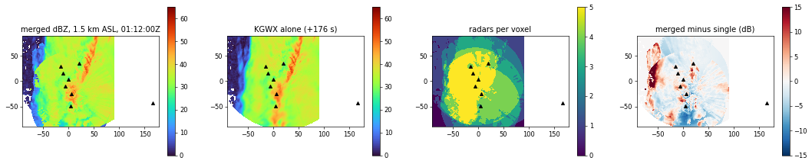
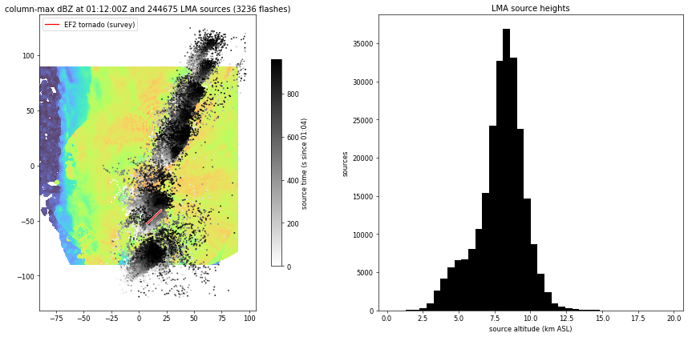
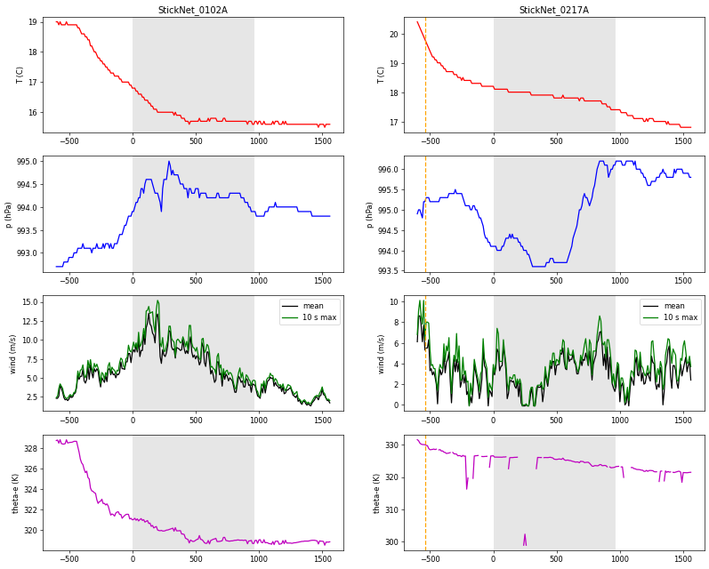
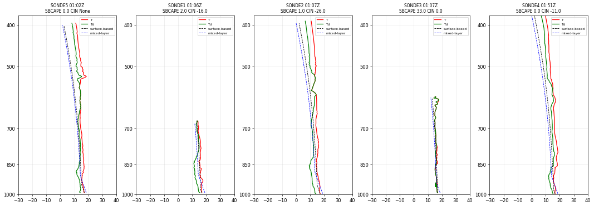
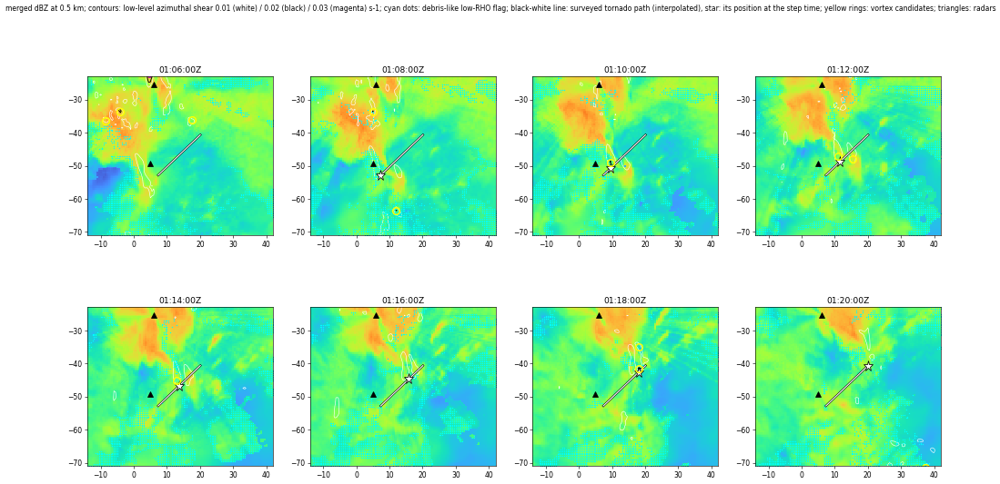
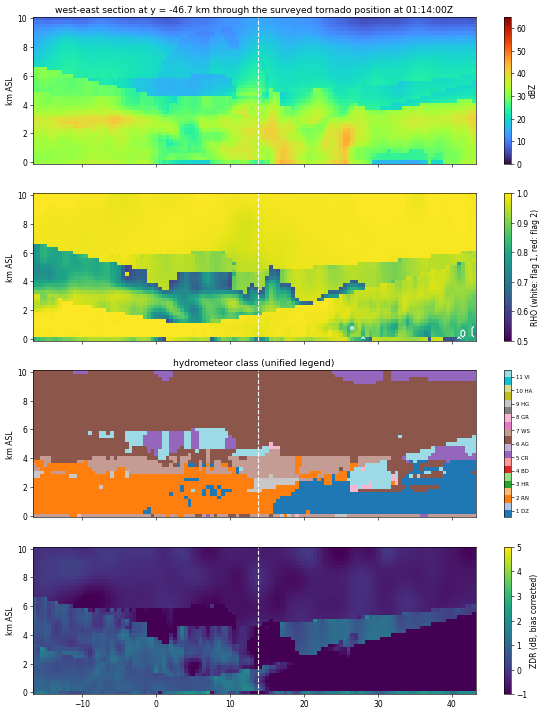
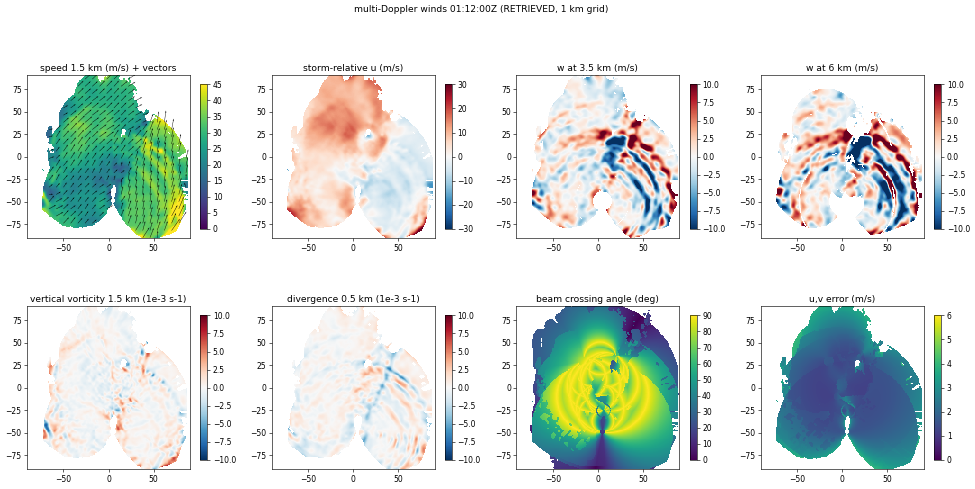

# PERiLS IOP2 data bundle for the real-data storm movie

The bundle is the data side of a movie of the 30 March 2022 PERiLS IOP2 quasi-linear convective system (QLCS) and its EF2 tornado:
**2022-03-31 01:04:00 to 01:20:00 UTC (16 min = 960 s)**, 17 time steps every 60 s. It holds only measurements and
labelled retrievals (no invented data, [SCIENCE.md](SCIENCE.md)), in the layout of the SPEC v1 that the renderer and the audio agents
code against, plus additive fields. Why this window: [PERILS_DATA_INVENTORY.md](PERILS_DATA_INVENTORY.md).

Build (read only on the data folder, no network, idempotent and resumable, about 25 min on a laptop):

```
python/.venv/bin/python tools/perils_movie/build_bundle.py \
    --window 2022-03-31T01:04:00Z 2022-03-31T01:20:00Z --out ~/Downloads/xradar-exports/perils_movie/bundle
python/.venv/bin/python tools/perils_movie/verify_bundle.py --bundle ~/Downloads/xradar-exports/perils_movie/bundle --out /tmp/perils_verify
python/.venv/bin/python tools/perils_movie/to_clip_bundle.py --bundle ... --out /tmp/perils_clip_bundle   # for tools/storm_clip
```

`--stages`, `--force`, `--no-qc`, `--no-zdr-cal`, `--no-winds`, `--step-s`, `--tol-s` are in `--help`. Another window (for example the
PIPS rain peaks at 00:14 to 00:30) is only a different `--window`.

## 1. Layout

```
bundle/
  README.md                  progress board for the other agents
  manifest.json              SPEC v1 manifest (+ qc, merge method, HID legend, sources, deviations)
  volumes/step_NNNN.npz      merged 3-D radar volume + rotation / debris / hydrometeor class / 2-D diagnostics
  winds/step_NNNN.npz        multi-Doppler u, v, w, vorticity, divergence, storm-relative wind (1 km grid)
  lma/flashes.json           lightning sources grouped into flashes
  stations/stations.json     surface stations and disdrometers; stations/<id>_dsd.npz; stations/hail_events.json
  soundings/index.json       radiosondes with diagnostics; soundings/<id>.csv
  tornadoes/tornadoes.json   damage-survey tornadoes (observed) with an INTERPOLATED path
  context/mrms_NNNN.npz      MRMS merged reflectivity and 0-2 km azimuthal shear (0.01 deg)
  context/surface_NNNN.npz   Barnes analysis of the surface stations (analysis, not a model)
  context/rotation_tracks.json   vortex candidates and tracks, comparison with the survey, vortex kinematics
  context/vortex_kinematics.json   per step Vrot, couplet diameter, omega, period, sense, resolution verdict, debris indicator
  context/kgwx_polar_local_HHMMSS.npz   native KGWX gates (VEL, REF, RHO, ZDR) within 4 km of the surveyed tornado
  context/tobac_track.json   the data owner's tobac track of the echo (independent motion)
  context/environment.json   sounding diagnostics through time + StickNet medians
  profiles/mrr_RaDAPS.npz, rwp_RaDAPS.npz   Micro Rain Radar and 915 MHz wind profiler
  science_events.json        data-derived events with numbers (captions the renderer may show)
```

Time: `t_s` is always seconds since the window start (`manifest.window.start`). Grid: azimuthal equidistant on a sphere
(R = 6 370 997 m, Py-ART's) centred at 33.575865 N, 88.548519 W; x east, y north; x and y from -90 to +90 km every 500 m (361 points);
**z is height above mean sea level**, 0 to 10 km every 250 m (41 levels). Arrays are `(z, y, x)`.

## 2. SPEC v1 conformance and deviations

Everything of SPEC v1 is there under the same names. Deviations and additions (all additive, none removes a v1 field):

1. `manifest.spec_version` = "1.1"; extra manifest keys: `tornadoes`, `rotation_tracks`, `science_events`, `hail_events`, `profiles`, `hid_legend`, `pattern_motion`, `qc`, `merge`,
   `environment_profile_for_hail`, `deviations_from_spec_v1`; steps carry `files` (source file names), `diagnostics`, and optional `winds`, `winds_summary`, `surface`.
2. `grid.z_km` is **height above sea level**. The source grids put z = 0 at each radar's own site altitude (78 m for COW1, 61 DOW7, 86 DOW8, 231 KBMX, 179 KGWX, 330 NOXP,
   74 SMART-R 2, 98 UAH): the same level index is a different height for every radar. Every radar was resampled to height above sea level (linear in z) before merging.
3. `volumes/step_NNNN.npz` also holds `vel_src`, `pol_src` (1-based index into `manifest.radars`; the radars are listed alphabetically: COW1, DOW7, DOW8, KBMX, KGWX, NOXP, SMARTR2, UAH),
   `rotation` (float16), `tds`, `hid` (uint8) and the 2-D arrays listed below. `vel`, `dbz` are float32; `zdr`, `kdp`, `rho` are **float16** (3 digits; the space they save is 15 %).
4. `winds/` is on a **1 km** grid (`x_km`, `y_km`, `z_km` are in each file), not the 500 m grid, because the retrieval is run at 1 km.
5. The steps list the radars that contributed (`radars`), their `offsets_s` (volume mid-time minus step time) and the source file names.
6. Stations: `series` keys beyond the SPEC (`dewpoint_c`, `theta_e_k`, `mixing_ratio_gkg`, `wind_gust_ms`, `log10_nw`, `lwc_gm3`, `dmax_mm`, `d0_mm`, `rain_rate_parsivel_mmh`, `hail_intensity_hits_cm2h`, lat/lon for moving
   platforms) and per-station `class`, `instrument`, `qc`, `moving`, `x_km`, `y_km`, `rain_accum_window_mm`. The series keep 10 min (600 s) of data before and after the window; moving platforms are
   flagged `moving` and their `lat` / `lon` is the median position.
7. Soundings: the index has `relation_to_window` ("pre-storm", "in-window", "post-storm"), `x_km`, `top_height_asl_m`, parcel paths for the Skew-T and the full engine diagnostics. `drift` is
   `[[t_s, lat, lon, alt_m ASL], ...]` every 15th level (15 s for the UIUC 1 Hz data).
8. `lma/flashes.json` keeps SPEC v1 (`t_start_s`, `t_end_s`, `centroid` [lat, lon, alt m], `n_sources`, `sources` [t_s, lat, lon, alt m, power dBW]) and adds `params`, `files`,
   `sources_per_minute_in_box`, `stations`, `class`, `instrument`.
9. `environment` (manifest) is `context/environment.json`: **there is no model or reanalysis time series**: WRF / MPAS output is not on disk and ERA5 covers another region (section 12).

## 3. Merged radar volume

**Time steps.** A step is every 60 s from 01:04:00 to 01:20:00 (17). Every radar contributes the volume whose **mid-time** (start plus half the volume duration, from the file attributes) is nearest to the step, if it is within
**190 s** (half of the 6.2 min WSR-88D cycle); the signed offset is stored. The merged volumes are *not* advected to the step time: they are observations at slightly different times (offsets in the table of section 11).

**Merge** (`tools/perils_movie/merge.py`):
- *reflectivity*: mean **in linear Z** of the radars with a valid value in the voxel, weights `band_weight / ROI^2` (ROI = Py-ART's radius of influence in km, at least 0.5; a smaller radius means gates closer to the voxel); X band has weight 0.5 because it is
  attenuated in heavy rain and is not corrected here (a choice, not a measurement), S and C weight 1. `nradars` = number of radars with data.
- *radial velocity*: cannot be averaged between radars looking from different directions: the voxel takes the value of the **best radar** (smallest ROI, ties to the higher band weight); `vel_src` says which. Mixed dual-Doppler analysis is the job of `winds/`.
- *polarimetric* `zdr`, `rho`, `kdp` and the hydrometeor class come **together from the best dual-pol radar** (`pol_src`); never averaged between bands.
- NaN = no data. A voxel without echo above 0 dBZ has no velocity or dual-pol value either.

**QC** (minimal, reversible: `--no-qc` switches the gates off, impossible values are still removed; the counts per criterion and radar are in `pgrid.load_grid().qc`):
physical ranges (REF -30..80 dBZ, |VEL| <= 100 m/s, ZDR -5..8 dB, KDP -3..30 deg/km, RHO 0..1.05); voxels with ROI > 3.5 km removed (poorly sampled); reflectivity with RHO < 0.6 removed unless it is at least 35 dBZ
(debris and hail keep their echo); UAH NCP < 0.1 removed; velocity or dual-pol without a reflectivity gate removed; merged reflectivity below 0 dBZ is "no echo". SMART-R 2: `DBZC` is used (its `REF` has unmasked fill values) and its `KDP`
is dropped (garbage, around -327). The velocities in the files are the owners' dealiased "Corrected mean doppler velocity"; the dealiasing was not redone (the per-radar residuals of the wind synthesis are the check, section 6).

**ZDR calibration (visible, switchable, recorded).** The radars' ZDR is not calibrated: NOXP has +3.5 to +4 dB and SMART-R 2 jumps between +0.7 and +3.9 dB from volume to volume (median ZDR of rain at 25 to 40 dBZ). A per-volume bias estimate is subtracted:
median ZDR of voxels with 25 to 40 dBZ, RHO >= 0.97, ROI < 2.5 km, 0.3 to 2.5 km above sea level, minus the typical rain value 0.55 dB; with fewer than 3000 samples the radar's previous estimate is used, and without any the ZDR of that volume is dropped (UAH: always,
98 samples). It is an estimate of +-0.3 dB at best (the real drop size distribution of the day is not the typical one); the log of every volume is in `manifest.qc.zdr_calibration.log`. `--no-zdr-cal` leaves ZDR as delivered.

## 4. Per-step derived products (RETRIEVED from radar)

All are in `volumes/step_NNNN.npz`, summarised per step in `manifest.steps[i].diagnostics`.

| Field | What and how | Limits |
| --- | --- | --- |
| `rotation` (nz, ny, nx), `rotation_ll`, `vrot_ll` | **Azimuthal shear** (s-1, cyclonic > 0): local linear least-squares plane through the radial velocity of one radar in a 2.5 km square window (NaN aware, >= 60 % of the points), projected on that radar's azimuthal direction (Smith and Elmore 2004; Mahalik et al. 2019, as the LLSD of radarx does on polar data); range 3 to 80 km from the radar, ROI <= 2.5 km; the largest value over the radars. `rotation_ll` = maximum below 2 km. `vrot_ll` = largest `(Vr(p+s) - Vr(p-s)) / 2` across an azimuthal baseline of 1, 2 or 3 km below 2 km | the 500 m grid and the radius of influence (0.5 to 3.5 km) smooth a 400 m wide vortex away; gridding seams along a radar's axes make shear ribbons (removed from the vortex list by a length / aspect test) |
| `rotation_tracks.json` | vortex candidates = compact regions (length <= 12 km, aspect <= 4) of `rotation_ll >= 0.012 s-1`, position of the maximum, peak and mean shear, area, `vrot`, radar, position uncertainty (grid cell to ROI plus offset x motion); linked step to step within 5 km | candidates, not detections of tornadoes |
| `tds` (uint8) | debris signature **candidate**: RHO < 0.8, Z >= 30 dBZ, below 2 km (flag 1); flag 2 also within 2 km of shear >= 0.012 s-1 | large drops, hail, X-band resonance and gridding also lower RHO |
| `hid` (uint8) + `manifest.hid_legend` | radarx fuzzy-logic hydrometeor classification per radar (Park et al. 2009 at S, Dolan et al. 2013 at C, Dolan and Rutledge 2009 at X) with the BMX 00 UTC temperature profile, then mapped to ONE legend (1 drizzle, 2 rain, 3 heavy rain, 4 big drops, 5 ice crystals, 6 aggregates / dry snow, 7 wet snow, 8 graupel, 9 high-density graupel / small hail, 10 hail (C) or rain-hail mixture (S), 11 vertically aligned ice) | X band has no hail class; the temperature profile is 150 km away and 110 min old |
| `shi`, `mesh_mm`, `posh_pct` | Witt et al. (1998) from radarx with the 0 and -20 degC levels of the BMX 00 UTC sounding (3659 and 6877 m ASL) | grid ends at 10 km, calibrated in Oklahoma and Florida; MESH is an upper estimate of the largest stone |
| `vil` | Greene and Clark (1972), radarx, capped at 56 dBZ | no layer below the lowest beam; truncated at 10 km |
| `echotop18_km`, `30`, `40` | Lakshmanan et al. (2013), radarx | heights above sea level; `top_truncated` marks columns that reach the 10 km top |
| `zdr_column_km` | Snyder et al. (2015), radarx: depth above the freezing level with ZDR >= 1 dB, RHO >= 0.8, Z >= 30 dBZ | depends on the ZDR bias correction |
| `conv_strat` (0 none, 1 stratiform, 2 convective) | Steiner, Houze and Yuter (1995) at 2 km: convective if >= 40 dBZ or more than `10 - bg^2/180` dB above the mean of the echo within 11 km, then a radius of 1, 2, 3, 4 or 5 km (background < 25, 25-30, 30-35, 35-40, >= 40 dBZ) | the radius table and the peakedness function are the author's recollection of the paper, not checked against it |
| `bwer` | bounded weak echo region candidate: column minimum 1 to 4 km at least 20 dB below the 4.5 to 8 km maximum (>= 35 dBZ) and ringed (3 to 6 km) by echo at least 15 dB stronger | thresholds are the author's; a candidate list |
| `cmax` | column-maximum reflectivity | |

## 5. Hail, rain and size sorting

- **Radar hail evidence**: `hid` classes 9 and 10, `mesh_mm`, `posh_pct`, `shi`, `zdr_column_km`, `tds`; the strongest MESH and the deepest ZDR column per window are in `science_events.json` (kind `hail_signature`, with the caveats).
- **Hail reports**: there are no SPC / NWS / PERiLS hail reports in the folder (the report notebook fetches them from the network), so none are in the bundle.
- **Disdrometer hail evidence** (`stations/hail_events.json`): per 10 s PIPS sample the number of particles of 8 mm or more (raindrops this large break up) from the owner's QC'd size-velocity matrix; a sample with at least 2 is a `hail_candidate` with the largest
  diameter, their mean fall speed and the raindrop fall speed (Atlas et al. 1973) of that size. The RaDAPS WXT hail sensor (`hail_intensity_hits_cm2h`) is in its series. In this window the PIPS saw no particle of 8 mm or more (largest 4.2 to 5.5 mm).
- **Rain** (`stations/<id>_dsd.npz`, series): for each PIPS the N(D) of the owner's QC (m-3 mm-1) on the 32 Parsivel diameter bins, the size-velocity counts, Dm, D0, log10 Nw, LWC, Dmax, rain rate (owner's derived and Parsivel's own), reflectivity;
  accumulation over the window. Dm and Nw follow the standard moments (Testud et al. 2001; `stations.dsd_moments`, tested on an exponential distribution whose answer is known).
- **Size sorting**: the quantities that show it are all in the bundle: low-level `zdr`, `kdp`, `rho`, `dbz` on the grid, the PIPS Dm and Nw against rain rate (in `science_events.json` kind `rain_dsd`: the correlation of Dm with rain rate and the change from the first to the last third of the window).
  radarx `zdr_arc` (Wilson and Van Den Broeke 2021) is a **supercell** algorithm (forward-flank downdraft direction); it was run on the 0.5 km level with the FFD direction set opposite to the pattern motion (stage `arc`, `manifest.steps[i].diagnostics.zdr_arc`: per storm object the arc area, mean and top-10 % ZDR (3.5 to 4 dB with the bias-corrected ZDR), the KDP foot and the ZDR-KDP separation length (5 to 25 km) and angle): **candidates only** in a QLCS, and ZDR itself is an estimate-corrected quantity;
  `rain_trajectories` / `size_sorting` need a surface-quality wind analysis and were not run. The window is the trailing stratiform rain at the PIPS
  (the leading-edge sorting happened at 00:15 to 00:40), so what the PIPS show here is the trailing-stratiform DSD.

## 6. Multi-Doppler winds (RETRIEVED)

`winds/step_NNNN.npz` (`tools/perils_movie/winds.py`): per step the dealiased radial velocities of the radars of that step are moved to the step time by the pattern motion times each radar's time offset (translation, linear interpolation), averaged horizontally
(3 x 3 NaN-aware) and sampled every 1 km, and given to `radarx.retrieve.multi_doppler` (variational analysis with the cost structure of Gao et al. 1999: observations of every radar, anelastic mass continuity, smoothness; fall speed removed from w with the radarx relation and the 3659 m freezing level; `w = 0` at the bottom
and top; observation error 2 m/s; no background wind; three grid levels, 300 iterations each). Fields on `(41, 181, 181)`: `u`, `v`, `w` (m/s), `vorticity`, `divergence` (s-1, centred differences at 1 km), `u_sr`, `v_sr` (relative to the pattern motion), `uv_error` (m/s,
the standard deviation estimated by the analytic dual-Doppler solution `dual_doppler_analytic` on the same input), `crossing_deg` (largest horizontal angle between two beams), `nradars`. Cells with fewer than two radars or a crossing angle below 30 degrees, or a speed above 70 m/s, are NaN.

Limits: the solver stops at its iteration limit (`converged` = 0 in every step: it did not converge fully); `w` is the least reliable component (boundary conditions, 1 km smoothing, gridding artefacts: Collis et al. 2010; the maps show arc-shaped banding) and is not
an estimate of the strongest updraft; the lowest 500 m and the top levels are weakly constrained; no attenuation correction of X-band velocity; the storm motion used to move the data is that of the echo pattern.

## 7. Lightning (OBSERVED)

`lma/flashes.json`: the 10 min `LYLOUT_*_0600.dat.gz` source files (NALMA, 14 stations in north Alabama, plus the NSSL deployable LMA, 8 sites in Mississippi, v1.1) read with `radarx.io.read_lma` (chi2 <= 1, at least 6 stations, 0 to 20 km altitude; Fuchs et al. 2016)
and the sources inside 32.2 to 35.0 N, 87 to 90 W grouped into flashes with `radarx.retrieve.cluster_flashes` (single linkage in space-time, distance 6 km (the value Fuchs et al. use for the Alabama network), time 150 ms, at least 2 points, flashes cut at 3 s). Flashes with at least 2 sources are kept. Parameters,
station counts and the files are in the JSON. LMA detects VHF breakdown (in-cloud channels), not ground strike points, with a detection efficiency that falls with range from the stations.

## 8. Stations and soundings (OBSERVED)

Stations (`stations/stations.json`): 4 PIPS, 24 StickNet, the RaDAPS WXT station (rain, hail sensor, T, RH, p, wind), 5 vehicle mesonets (DOW7, DOW8, SCOUT1 to 3) and 3 FARM Parsivels; each with `credit`, `qc`,
dew point and theta-e derived with Bolton (1980) (`thermo.py`). **Gust fronts** (`science_events.json`, kind `gust_front_passage`): the largest 2-minute temperature fall (>= 1 K) at a fixed station, accepted if the pressure rose >= 0.4 hPa or the wind peak was >= 3 m/s above its pre-front median; the numbers
(temperature fall, pressure rise, wind jump, theta-e change, shift) are the raw differences. The outflow speed is a fit to the passage times at 3 or more stations when there are that many in the data.

Soundings (`soundings/index.json`): all launches from 4 h before to 1.5 h after the window: UIUC FARM (5 sites x 7, GRAW, 1 Hz with positions), UAH and ULM (to 22:55) and the operational 00 UTC ones: 42 profiles, each as a common CSV (height ASL, p, T, Td, wind, lat, lon, seconds since the window start) with
**the engine's own diagnostics** (`engine/sounding.py` -> radarx parcel functions): CAPE and CIN of the surface-based, mixed-layer and most-unstable parcels, LCL, LFC, EL, lifted index, 0 to 1 / 3 / 6 km shear, Bunkers motion, storm-relative helicity, 0, -10, -20 degC heights, precipitable water, plus the parcel paths for
a Skew-T (dry adiabat to the LCL then a liquid-only pseudo-adiabat, drawing aids that differ from the CAPE kernel). Most sondes end at 4 to 7 km: then the 0 to 6 km shear, the Bunkers motion and the parcel above are not computed, the CAPE is cut off (a lower bound; the engine notes say so).
The LZK 00 UTC file has no dew point and is listed without diagnostics.

## 9. Tornado (survey: OBSERVED; radar evidence: RETRIEVED)

`tornadoes/tornadoes.json`: the NWS damage-survey events (NSED) of the day in 30.5 to 35.5 N, 91 to 86 W within one hour of the window: id, EF rating, start and end (UTC), begin and end point, **path = a straight line between the surveyed begin and end points at constant speed (INTERPOLATED)**,
width from the SPC table (400 yd = 366 m), `max_wind_mph` = the upper bound of the EF-scale range for the rating (an estimate from damage, not a measurement; `wind_note`), the first 300 characters of the survey narrative, source and credit. The tornado of the window is **EF2, 01:08 to 01:20 UTC, 33.1008 N 88.4691 W to 33.2105 N 88.3316 W**.
Radar evidence and the offset between the radar vortex candidates and the surveyed track (km and s): `context/rotation_tracks.json`, `survey_comparison`, and section 11.

## 10. Context

- **MRMS** (`context/mrms_NNNN.npz`): GRIB2 read with `wgrib2` (`/opt/local/bin/wgrib2`, found on the PATH; no GRIB reader is in the Python environment, nothing was installed): `mergedref_dbz` (MergedBaseReflectivityQC, 500 m above MSL) and `azshear_s-1` (0 to 2 km layer maximum azimuthal shear) cropped to 32.6 to 34.5 N, 89.7 to 87.4 W on their 0.01 degree grid, `lat`, `lon`; the
  nearest file within 150 s. There is no MRMS MESH in the folder.
- **Surface analysis** (`context/surface_NNNN.npz`, class *analysis*): Barnes single-pass analysis (sigma 15 km, only where at least 2 stations are within 30 km) of T, Td, theta-e, p, mixing ratio and the wind of the fixed stations at the step time, on a 2 km grid. An interpolation of observations, not a model.
- **Environment** (`context/environment.json`): one row per radiosonde (site, launch, position, relation to the window, surface T and Td, SBCAPE, SBCIN, MLCAPE, MUCAPE, LCL, LFC, 0-1 / 0-3 / 0-6 km shear, SRH, freezing, -10 and -20 degC heights, precipitable water, top height) from the engine diagnostics, plus the median and 10 / 90 % of the 24 StickNet probes (T, Td, theta-e, p, wind) every 60 s. There is **no model or reanalysis environment**:
  WRF / MPAS output is not on disk and ERA5 is in another region; the gridded surface thermodynamics (T, Td, theta-e, p, mixing ratio, wind) per step are the Barnes analysis of the stations above (class analysis), not a model field with run and valid times.
- **tobac** (`context/tobac_track.json`): the data owner's tracked echo (KGWX, 15 dBZ): centroid, area, maximum reflectivity; an independent motion estimate.
- **Profiles** (`profiles/`): the RaDAPS Micro Rain Radar (`t_s`, `height_m` above the radar, `dbz`, `fall_speed_ms`, `rain_rate_mmh`, `lwc_gm3`, `pia_db`) and the 915 MHz profiler (`u`, `v`, `w`, `snr_db`, `qcTag`) at 33.5956 N, 88.9879 W, 41 km west of the grid origin, 5 to 25 min around the window (in trailing stratiform rain).

## 11. The tornado rotating: what the data give and what they do not

`context/vortex_kinematics.json` (also inside `context/rotation_tracks.json` as `vortex_kinematics`, and as the event `tornado_rotation_kinematics`),
`tools/perils_movie/couplet.py`. For each of the 13 steps of the surveyed tornado's life: the radial velocity of every radar of the step is sampled
along the azimuthal line through the strongest shear centre within 3 km of the surveyed position (below 1 km ASL; every 100 m, bilinear); the largest
outbound and inbound values and their separation give the velocity difference `dV`, the rotational velocity `Vrot = dV / 2`, the couplet diameter and radius, the angular velocity
`omega = dV / d` and the period `2 pi / omega` (solid-body core assumption), the sense (cyclonic when the outbound extreme lies on the clockwise side of the inbound one as seen from the radar),
the vortex centre and its offset from the survey, the radar, its time offset, and the effective resolution `max(500 m grid, radius of influence, range x beam width)` (the beam width of the mobile radars is not in
the grids: a nominal 1.0 degree is assumed). The radar with the finest effective resolution is the `best` one (always NOXP, 4 to 12 km from the tornado).

| Quantity (13 steps, 01:08 to 01:20) | Value |
| --- | --- |
| Vrot | 8 to 15 m/s (median 11) |
| couplet diameter | 1.1 to 5.9 km (median 1.8); 1.1 to 2.4 km in the 11 steps with a compact couplet |
| angular velocity / period (parent circulation) | about 0.013 s-1 / about 8 min |
| sense | cyclonic in 11 of 13 steps (the other 2 are early steps with 5 to 6 km wide extremes, a shear line, not a vortex) |
| effective resolution | 500 m (best radar) |
| **verdict** | **the tornado vortex (surveyed width 366 m) is UNRESOLVED at every step**: width / resolution = 0.73 < 2. The couplet is the parent circulation (low-level shear zone), wider than the tornado |
| debris indicator | 1 700 voxel-steps of low-RHO / high-Z flag within 5 km of the survey (1 000 also near a rotation maximum); the same flag exists over 38 000 voxels domain-wide in every step (weak-echo edges, X-band noise): weak evidence |
| survey-scale ESTIMATE (not a measurement) | EF2 wind range 50 to 60 m/s over the 366 m damage width implies a solid-body spin of 0.27 to 0.33 s-1, a **period of 19 to 23 s** (`period = pi D / V`), `survey_scale_estimate` in the JSON; the renderer may use it for the spin of a drawn funnel, labelled as an estimate |

**Polar data at native resolution.** The only polar volumes of the window are KGWX CfRadial files (01:05:37, 01:11:53, 01:18:09 UTC); the COW1 CfRadial files end at 23:20 UTC and DOW7, DOW8, NOXP, SMART-R 2 and UAH exist
only as 500 m grids in the folder. So **no native-gate mobile-radar data exist for the tornado time**, and **no 50 to 100 m local grid can be made from real gates** (one made from the 500 m data would only be an
interpolation without new information; it is not provided). What is provided: the native KGWX gates (250 m range spacing, 0.48 degree ray spacing) of the three lowest sweeps within 4 km of the surveyed position, `context/kgwx_polar_local_<time>.npz`
(`x_km`, `y_km`, `z_m`, `azimuth_deg`, `range_m`, `sweep`, `vel`, `ref`, `rho`, `zdr`; `sweeps` = JSON with the per-sweep numbers: range 78 to 85 km, azimuthal sample spacing 650 to 715 m, beam width at the target 1.2 to 1.3 km, beam height 1.3 to 2.5 km ASL, maximum
ray-to-ray velocity difference 21 to 33 m/s, flagged when it is close to the Nyquist velocity (a possible dealiasing fold), effective resolution 650 to 715 m: UNRESOLVED too). It is the real velocity field around the vortex at the finest resolution that exists, which is coarser than the 500 m grid.

For the shot: use the 17 steps' `rotation` / `rotation_ll`, the per-step centre (`per_step[i].centre_km`, tracking the surveyed track within 1 to 2 km), Vrot, couplet diameter and sense of the parent circulation as measured; the tornado funnel's width (366 m) and path from `tornadoes.json`;
and, if the funnel is drawn spinning, the survey-scale period as an *estimate*.

## 12. Verification (numbers and figures)

Made by `tools/perils_movie/verify_bundle.py` (read only; numbers in `verification.json`, quoted here). Figures are in `docs/images`.

**Merged volume vs one radar** (step 01:12, 1.5 km ASL, KGWX volume 176 s from the step; ):
coverage 96 % merged vs 94 % KGWX alone; 122 380 common cells: mean difference -0.13 dB, rms 4.1 dB, correlation 0.94; 70 % of the merged cells have 3 or more radars, 13 % two, 17 % one.
Over the 17 steps: voxels with echo 86.5 to 91.7 % of the 5.3 million (mean 88.8 %), 2.5 radars per voxel with echo. Against **MRMS** merged base reflectivity (5 steps, 2 km sampling, 7 100 to 7 800 cells): mean difference -0.6 to -1.2 dB, rms 5.0 to 5.6 dB, correlation 0.79 to 0.84.
Time offsets of the volumes to the steps (|s| mean, max): COW1 38, 87; DOW7 32, 57; KGWX 104, 184; NOXP 32, 69; SMART-R 2 32, 61; UAH 29, 56.

**Radar vs the PIPS disdrometers** (lowest valid level 250 m ASL; reflectivity from the owner's QC'd DSD): the radar is 4.2 to 5.3 dB lower (PIPS1A -4.2, 1B -5.2, 2A -4.6, 3B -5.3), correlation of the 17 step values 0.13 to 0.60; the radar rain rate from `Z = 300 R^1.4` is 3 to 4 mm/h against 6.5 to 8.4 mm/h at the disdrometers. It is a first-order check of the
mosaic in stratiform rain 250 m above the ground (the disdrometer is at 2 m; the radar sample is smoothed over 0.5 to 3.5 km); X-band attenuation is not the cause here (light rain), so the radars (merged by their
radius-of-influence weights) are probably biased low or the lowest 250 m evaporate (not investigated).

**Lightning** (): 244 675 sources in 3 236 flashes (at least 2 sources) in 16 min; 13 400 to 18 000 sources and 135 to 260 flashes per minute; median flash 41 sources; median source height 8.2 km ASL. 367 flashes started within 15 km of the surveyed tornado during its life (31 per minute).

**Stations** (): outflow passages with the temperature fall, pressure rise and wind jump measured by the stations: StickNet 0224A (t = 560 s: -2.0 K in 2 min, +1.05 hPa, wind 15 m/s from 7), 0218A (t = 825 s: -2.1 K in 4 min, +1.3 hPa, 9.4 m/s), Mesonet SCOUT1 (t = -84 s: -1.2 K, +1.8 hPa), 0217A (t = -540 s, weak). The four times do not lie on one boundary
(the fit gives 29 m/s with an rms residual of 13 km), so **no outflow speed is claimed**. 0102A, 6 km from the tornado start, shows a gradual 3 K fall, +1.5 hPa and a 15 m/s gust from -500 to +300 s. Stations: 37 (4 PIPS, 24 StickNet, RaDAPS, 5 mesonets, 3 FARM Parsivels), 0 hail candidate samples (largest PIPS drop 4.25 to 5.5 mm).

**Soundings** (; engine diagnostics): pre-storm sondes (21:19 to 22:55) have surface-based CAPE 100 to 560 J/kg and CIN -10 to -90, 0 to 3 km shear 24 to 36 m/s, freezing level 3.4 to 3.7 km ASL; the four launched in the window (01:03 to 01:08) have SBCAPE 0 to 33 J/kg (stabilised by the outflow), 0 to 1 km shear 19 to 29 m/s, and the five post-storm ones (01:51 to 02:08)
SBCAPE 0 to 1, surface layer 5.3 to 5.6 K colder than at the same site 2.3 h earlier, colder by 1 K or more through 750 to 1 300 m (event `cold_pool_sounding`; the balloons drift and the comparison includes the daily change). The 00 UTC BMX sounding (hail products) has the freezing level at 3 659 m and -20 degC at 6 877 m.

**Tornado vs radar** (): the strongest compact low-level shear candidate (>= 0.012 s-1) within 12 km of the surveyed position exists at 10 of the 13 steps; its distance from the (interpolated) survey is 1.1 km at best, median 1.9 km, mean 2.8 km (position uncertainty of the candidates 0.75 km, of the straight-line survey a few hundred metres to a km); the survey position
that matches best is that of 30 s later (the survey is 30 s late relative to the radar candidate: a shift of -30 s, mean distance 2.1 km, a resolution of 30 s of the search, below the 30 to 70 s time offsets of the volumes). Peak shear of the candidates up to 0.026 s-1, Vrot of the candidate region 19 m/s (SMART-R 2). Section 11 has the couplet numbers and the resolution verdict.

**Cross-sections, hydrometeor classes and debris flag** (): the section shows reflectivity, RHO with the debris flag, the unified hydrometeor class and the bias-corrected ZDR: rain / drizzle classes below 3 km, aggregates and ice above the melting layer (3.7 km), no hail class in the section; the
radar seams (NOXP's X-band ZDR and RHO, the SMART-R 2 sector) are visible as steps. Hail products over the 17 steps: MESH 11 to 17 mm (maximum of the domain), POSH 3 to 29 %, VIL 19 to 23 kg/m2, hail / high-density graupel class in 35 000 to 105 000 voxels, ZDR column 2.0 to 3.2 km, BWER candidates 0 to 245 cells, column maximum 57 to 63 dBZ, 40 dBZ echo to 9 to 10 km (the grid top): **weak to moderate hail evidence** (no hail report in the folder), no hail seen at the disdrometers.

**Winds** (): valid fraction 37 to 52 % of the 1 km cells, median u,v error 2.1 to 2.2 m/s (analytic estimate), `converged` = 0 in every step (300 iterations at each of three grid levels, 68 to 94 s per step), residual rms of the retrieved wind projected on the beams (over the 17 steps): COW1 2.5 to 4.5 m/s, KGWX 2.5 to 3.7, DOW7 3.7 to 5.2, UAH 4.4 to 5.7, SMART-R 2 5.5 to 7.7, **NOXP 5.2 to 10.0 m/s (a sign of dealiasing or calibration problems of that radar)**.
Against the radiosondes launched in the window (profile 0.5 to 4 km, the balloon's own position and time): mean differences of u -3.4 to +0.2 m/s and v -0.3 to +2.3 m/s, **rms vector difference 5.2 to 7.5 m/s**. The winds of the second sounding set: the retrieved 0.25 to 0.75 km wind is 22 m/s on average where the 2 to 10 m station winds are 2.6 m/s (not like for like: the low-level jet above a stable outflow layer).
`wind_synthesis_2127UTC.nc` could not be used for validation (3.6 h earlier). Retrieved extremes are **not** asserted as events because they fail the check against the sondes (a maximum along-motion wind of 52 to 61 m/s at 3.5 to 4 km in the first version; the median profile behind the cores peaks at 14 m/s at 5 km against 3 to 31 m/s in the nearby sondes), so the events use percentiles and medians. The 99th percentile
of w in the convective cores between 3 and 8 km is 20 m/s at most (median of the steps 12 m/s).

## 13. Science events (`science_events.json`)

Every event has `kind`, `t_s`, `in_window`, `class` (observed / retrieved / candidate), a `caption` that states only what the numbers show and `evidence` with the numbers. Kinds written for this window:
`line_motion` (10.6 m/s toward 90 degrees by pattern correlation; 9.4 m/s toward 88 degrees from the tobac track), `gust_front_passage` (4 stations), `lma_rate`, `lightning_near_tornado`, `tornado_survey` (start, end), `tornado_radar_rotation` (candidate 1.1 km from the survey, 0.026 s-1, Vrot 19 m/s),
`tornado_rotation_kinematics` (section 11), `hail_signature` (MESH, ZDR column, debris-like flag), `updraft_maximum` (a percentile of w), `rear_inflow_candidate` (median profile behind the cores against the sondes), `low_level_winds_at_tornado`, `rain_dsd` (4 PIPS: rain, Dm, Nw, correlation, first-to-last third change),
`cold_pool_sounding` (5 sites). Not written, with the reason in `skipped`: `gust_front_speed` (stations do not line up), a disdrometer hail event (no particle of 8 mm or more).
No bow echo or mesovortex search was made (the 500 m grid and a 16 min window do not support it); line orientation and motion are in `line_motion` and `tobac_track.json`.

## 14. What could not be used, and why

| Source | Why not |
| --- | --- |
| ERA5 (`Reanalyses/ERA5`) | covers 25 to 65 N and 80 to 64 W: the north-east; the storm is at 88.5 W |
| WRF (6 microphysics members) and MPAS | only logs, scripts, figures and summary tables are on disk; the model output stayed on the cluster; the owner's evaluation says the simulated line is displaced by -18 to +87 km |
| `wind_synthesis_2127UTC.nc` | 21:27 UTC, 3.6 h before the window |
| Lidar | no lidar data files (only a notebook) |
| ASOS / AWOS, hail reports | not in the folder |
| GOES | one file of December 2024 (`MRMSTEST/GOES16`); nothing for 30 March |
| MRMS MESH | not in the folder (the radar MESH of the volume is used) |
| UAH MAPNet Parsivel `.dat` | Parsivel telegrams not parsed (the WXT rain sensor and the PIPS cover the rain at and near the site) |
| PSL Parsivel (Courtland AL) | outside the grid (116 km east) |
| Photos / video | personal field photographs and animations; not copied, not opened |
| Gridded LMA (`NSSL_LMA/Gridded`) | the raw sources are used; the gridded product can cross-check the flash counts |

## 15. Honest limits

- The tornado vortex (400 m wide) is not resolved by 500 m gridded data with a radius of influence of up to 3.5 km; what the bundle shows is low-level shear and a debris-like flag at the grid's scale.
- The merged volume is a mosaic of observations up to 190 s apart; the radars are not calibrated against each other (X-band attenuation is not corrected, ZDR is bias-corrected by an estimate).
- The temperature profile for the hail products and the ZDR column is the 00 UTC BMX sounding (balloon about 23:15 UTC, 150 km east), not the storm environment at the time; most in-window sondes end at 4 to 6 km.
- The retrieved winds did not converge fully and `w` carries gridding artefacts; the vorticity is at 1 km.
- The size-sorting leading edge (00:15 to 00:40) is outside the window; the window has the trailing rain.
- Window time offsets, the line motion and the vortex positions are estimates with the uncertainties stated where they are given.

## 16. Reading the files (numpy)

```python
import numpy as np, json
b = "bundle/"
man = json.load(open(b + "manifest.json"))
v = np.load(b + man["steps"][8]["volume"])          # dbz (41, 361, 361) float32 NaN = no data; vel, zdr, kdp, rho; nradars uint8
v["dbz"][6]                                          # 1.5 km above sea level
v["hid"], man["hid_legend"]["codes"]                 # hydrometeor class and its legend
w = np.load(b + man["steps"][8]["winds"])            # u, v, w, vorticity ... on (41, 181, 181); w["x_km"], w["y_km"], w["z_km"]
flashes = json.load(open(b + "lma/flashes.json"))    # sources [t_s, lat, lon, alt_m, power_dBW]
```
