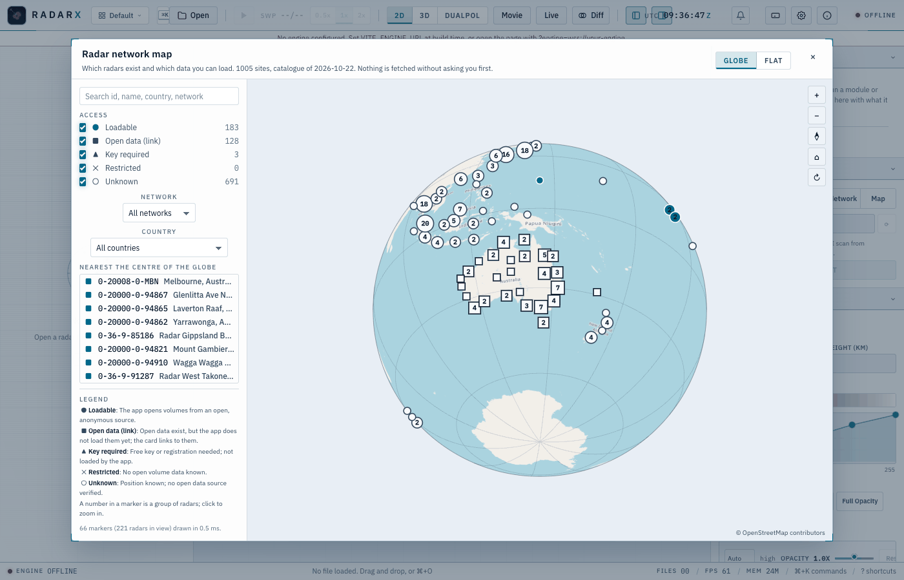
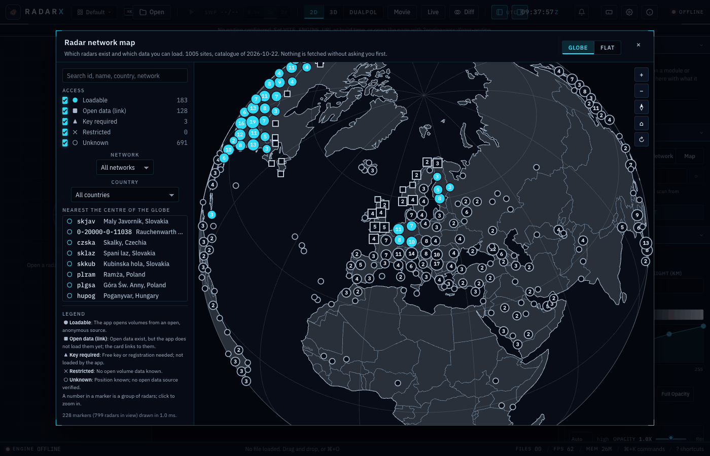
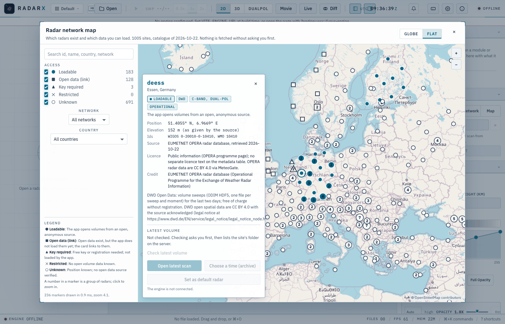

# Radar network map: which radars exist and which data you can load

The **Map** tab of the Cloud data panel (and *Radar network map* in the command palette) opens a map of
every weather radar in the bundled catalogue: 1072 sites on six continents. It is a **globe** you can turn
where your graphics support it, and a flat map otherwise or when you prefer it. Each marker says what the app can
do with that radar's data, and each site's card says where its position comes from, under which licence, and
offers the actions that exist for it.

```{image} images/ui/radar-globe-dark.png
:alt: The radar network map as a globe, centred on Africa and Europe, dark theme, with the radar markers, the access filters and the list of radars nearest the centre
:width: 100%
```

The catalogue ships inside the app: opening the map downloads nothing but the map picture your basemap
setting asks for (see [What the map pictures send](#what-the-map-pictures-send); choose *None* to send no request at
all), and **every listing or download of radar data asks you first**, with the host and the size, exactly as the
radar-site markers do ({doc}`RADAR_SITES`).

## The globe and the flat map

The **Globe | Flat** switch at the top right of the dialog changes the view, and the app remembers your choice.
Both views show the same radars with the same filters, search, legend and card, and a radar you pick in one is
picked in the other. Where the graphics driver does not offer WebGL2 the *Globe* button is greyed out, a note says
why, and the flat map is shown.

```{image} images/ui/radar-globe-europe-card.png
:alt: The globe turned to Europe with the card of the Essen radar open and the list of nearby radars on the left
:width: 100%
```

| To do this | Mouse or touch | Keyboard |
| --- | --- | --- |
| **Turn the globe** | Drag. The point under the pointer stays under it. After a quick drag the globe glides a little further, unless your system asks for reduced motion | Arrow keys |
| **Zoom** | Mouse wheel, trackpad pinch, two fingers on a touch screen, or the **+** and **−** buttons | **+** and **−** |
| **Centre on a place** | Double-click it | |
| **Tilt the globe about the line of sight** | Hold Shift and drag | Shift with the left or right arrow |
| **Point north up again** | The compass button (its needle shows the tilt) | **N** |
| **Back to the start** | The house button | **Home** |
| **Turn slowly by itself** | The turn button. It is off until you press it, and unavailable if your system asks for reduced motion | |
| **Pick a radar** | Click its marker (hovering shows its name), or click a result of the search | The search box, or the list *Nearest the centre of the globe*: Tab to a radar, Enter |
| **See a place in detail** | **Open in flat map here**, a button that appears once you have zoomed in 3 times | |

The list *Nearest the centre of the globe* is there for the keyboard and for screen readers: it follows the
filters and updates when the globe stops. The globe itself can be reached with Tab, announces where it is
centred and how many radars are in view, and does everything above with the keyboard alone. Radars on the far side
of the globe are not drawn.

The globe draws the world at a low level of detail: a few dozen small map pictures, or the bundled outlines.
That is enough to find your way and to pick a radar. For streets and place names use **Open in flat map here**:
the flat map opens centred on the same place at the same scale.

## What the map pictures send

The picture on the sphere follows the same basemap setting as the flat map.

| Basemap | What the globe sends | What the flat map sends |
| --- | --- | --- |
| **OpenStreetMap** (the default) | 64 small pictures of the lowest-detail level (zoom 3) from the OpenStreetMap tile servers, about 200 KB in all, once; the nearest ones first, six at a time, kept for the rest of the session. The OpenStreetMap credit stays on screen | the pictures for the part of the world in view |
| **OpenTopoMap** | the same 64 pictures from the OpenTopoMap servers; they are larger (up to about 3 MB in all, estimated from the size of one picture) | the pictures for the part of the world in view |
| **None** | **nothing at all.** The sphere shows land and ocean from outlines that ship inside the app (Natural Earth, public domain), with a graticule, coastlines and country borders | nothing |

Whatever the basemap, the radar markers, the catalogue and the search never leave your computer. Without a
connection the globe still works: until the pictures arrive (or if they never do) the coastlines and borders from
the bundled outlines are drawn on the sphere, and the app retries a failed picture a few times and then pauses.
The dark and light themes recolour the map pictures and the outlines alike.

| OpenStreetMap, light theme, turned to Australia | Basemap *None*, dark theme | The flat map with the same card open |
| --- | --- | --- |
|  |  |  |

## What a marker means

The marker **shape** carries the access class; the legend and the card spell it out in words, so nothing depends
on colour alone. A number inside a marker is a group of radars: click it to zoom in, or zoom in far enough to see
every site on its own (about 3.5 times on the globe, level 7 on the flat map).

| Marker | Access class | Meaning |
| --- | --- | --- |
| filled circle | **Loadable** | The app opens volumes from an open, anonymous source: *Open latest scan* and *Choose a time (archive)* work. |
| square | **Open data (link)** | Open data exist (often composite products rather than single-site volumes), but the app does not load them yet. The card links to them. |
| triangle | **Key required** | A free key or registration is needed. The app does not embed or ask for keys yet; the card links to the portal. |
| cross | **Restricted** | No open volume data is known. |
| hollow ring | **Unknown** | The position is known; no open data source has been verified for this network. This is the neutral state, not a judgement. |

The access class is a statement about what was *verified* when the catalogue was built, not about the data
policy of the operator: a radar marked *unknown* may well have open data that nobody has checked yet
(see [Asking for more](#asking-for-more)).

## The card

Click a marker (or a search result) for its card:

* id, name, country, network, band and polarisation where the source gives them, declared status;
* **position** and elevation as given by the source (never computed here), WMO and WIGOS ids when known;
* **source**, retrieval date, **licence** and **credit** of the catalogue entry;
* for loadable sites, the **latest volume**: name, scan time (UTC, from the file name), age, size and number
  of files, listed only after you agreed to the listing;
* the actions: **Open latest scan**, **Choose a time (archive)**, **Open the provider's page**, and
  **Set as default radar**, which for now only hands the site to the default-radar setting that is being
  built (a notice says so; nothing is saved yet).

*Choose a time* lists one UTC day of volumes with their time, size and number of sweeps; incomplete volumes
(a sweep still being transmitted) are shown but cannot be opened. NEXRAD sites open the Cloud panel's Archive
tab instead, as the radar-site markers do.

## Which networks are loadable today

Verified from the development machine on 2026-10-21/22 by listing the source and opening a volume in the app:

| Network | Sites | Source | What is loaded | Licence and credit |
| --- | --- | --- | --- | --- |
| NEXRAD (United States) | 156 | Unidata mirror of NOAA NEXRAD Level II on AWS S3, anonymous | the newest Level II volume, or any volume of a day | US government data; credit NOAA/NWS and Unidata |
| DWD (Germany) | 17 | DWD Open Data, `opendata.dwd.de`, anonymous | the last two days: ten sweeps every five minutes, reflectivity (DBZH) and radial velocity (VRADH), one ODIM HDF5 file per sweep and moment; the app downloads the twenty files of a volume and assembles one volume of ten sweeps | CC BY 4.0 with the source acknowledged ("Source: Deutscher Wetterdienst") |
| FMI (Finland) | 10 | FMI open data on AWS, public bucket `fmi-opendata-radar-volume-hdf5`, anonymous | full polar volumes (ODIM HDF5, 16 moments including DBZH, VRADH, ZDR, KDP, RHOHV) of **a two-day sample, 7 and 8 February 2023**. The bucket is not a live feed; the card says so and *latest* means the newest file of the sample | CC BY 4.0; credit the Finnish Meteorological Institute |

The verification opened an Essen (DWD) volume of 21 October 2026 21:50 UTC: 20 files, 1.5 MB, ten sweeps from
0.5 to 25 degrees, 360 rays, 720 gates of 250 m at the low elevations; and an Anjalankoski (FMI) volume of
7 February 2023 10:35 UTC: 13.8 MB, ten sweeps, 16 moments. Both open through the standard ODIM reader; the
DWD assembly joins the reflectivity and velocity files of each sweep, which share the same rays and gates
(if a pair ever differed, the sweep would keep both on their own coordinates and the open would say so).

### Credit, licence and provenance

What you open from a network carries that network's credit line and licence in its provenance (the OBS chip
of the layer, the Layers panel) and in every export (`data_attribution`, `data_licence`,
{doc}`ENVIRONMENT`). Figures made from these data should credit the source as its licence asks.

## Open sources that are not loaded yet

Checked from the development machine; the card of each site links to the portal.

| Network | What exists | Why it is not loaded |
| --- | --- | --- |
| Environment and Climate Change Canada (29 sites) | MSC Datamart and GeoMet: CAPPI, DPQPE, 24 h accumulation and composites as GIF, GeoTIFF and WMS; Open Government Licence - Canada | products, not volume scans |
| Met Office (United Kingdom, 16 sites) | UK radar observations on AWS Open Data, CC BY-SA 4.0 | composite products, not single-site volumes |
| MET Norway (12 sites) | Nordic reflectivity composites on THREDDS | composites, not single-site volumes |
| Terminal Doppler Weather Radars, TDWR (United States, 47 sites) | NOAA NCEI archives the Level II volumes and gives them away free of charge; the real-time Unidata bucket the Cloud panel uses also holds them (one Denver volume was opened by the app's reader) | the app has no TDWR provider yet: the sites are on the map, the card links to the NCEI page, and a file you download opens with *Open* ({doc}`opening-data`) |
| Australia (Bureau of Meteorology, 82 sites) | NCI's operational radar archive: ODIM HDF5 volumes, one zip of about 1.5 GB (radar 2) per UTC day, the newest being the previous day when checked; open HTTP without an account (checked for radar 2) | daily zips of that size need a provider that reads single volumes from inside the zip by byte range; not built. Volume data: access not verified for the other sites |
| IDEAM (Colombia) | level II IRIS/Sigmet files in a public AWS bucket, CC BY 4.0, updated as data arrive | no radar positions from a source the catalogue uses, so the sites are not on the map yet |
| KNMI (Netherlands, 3 sites) | radar volumes (ODIM HDF5) on the KNMI Data Platform | a free API key is required; the app does not handle keys yet |

Not verified, hence *unknown* on the map: Météo-France, MeteoSwiss, DMI (Denmark), the Japanese, Korean,
Indian and Chinese networks, the South African Weather Service (14 radars; the card links to its home page,
because the address of its radar page could not be checked), and the rest of the OSCAR list. OPERA data for
all of Europe are available to external users through MeteoGate under CC BY 4.0, but that service was not
exercised.

## The catalogue: sources and licences

| Source | Sites taken | Licence and terms | Attribution |
| --- | --- | --- | --- |
| NOAA NCEI Historical Observing Metadata Repository, NEXRAD station list (downloaded 2026-10-19 for NEXRAD, 2026-10-22 for TDWR) | 156 NEXRAD and 47 TDWR (the same file lists both; station type TDWR) | public domain (US government work); NOAA asks for credit | NOAA National Centers for Environmental Information |
| Bureau of Meteorology / NCI Australian operational radar archive, site list (`radar_site_list.csv`, downloaded 2026-10-22) | 82 sites (from 87 radar ids: radars at the same place are one site; 11 are closed, 1 is marked not operational; positions, band, Doppler and dual-polarisation flags, in-service dates) | CC BY 4.0: the licence file `rq0_level1_license-cc4.pdf` sits in the archive's top folder beside the list; the NCI collection record says licences vary by dataset, so confirm before redistributing | Bureau of Meteorology and NCI Australia (Soderholm, Protat and Jakob, 2019, doi:10.25914/5cb686a8d9450) |
| EUMETNET OPERA radar database (`OPERA_RADARS_DB.json`, downloaded 2026-10-22) | 217 (28 European countries; positions, WMO and WIGOS ids, ODIM codes, band, polarisation, status) | the OPERA page calls the database "public information, location and details of the radars"; the metadata table carries no separate licence text (OPERA radar *data* are CC BY 4.0 via MeteoGate) | EUMETNET OPERA |
| WMO OSCAR/Surface, station class *weather radar* (downloaded 2026-10-22) | 570 of 943 (311 were the same radars as above, within 2 km, and kept their HOMR or OPERA entry; 62 of the 66 Australian rows were the same radars as the Bureau's list and were merged into it, giving the WIGOS id; the other 4 are kept as OSCAR-only, unconfirmed) | public WIGOS metadata repository of the WMO; its terms-of-use page could not be reached when the catalogue was built, so the terms are recorded as not verified | World Meteorological Organization, OSCAR/Surface |

Every entry names its source and retrieval date; the licence shown on the card is that source's. Which TDWR
sites were active comes from one list of folder names of the Unidata real-time bucket for 21 October 2026: 43
of the 47 had data that day (Fort Lauderdale, West Palm Beach and the two Puerto Rico airport radars did not;
their status is *unknown*); the bucket also has two folders (TDJT, TOK2) that HOMR does not list as TDWR and
that are not on the map. The Denver TDWR's position agrees with the position in a real Level II volume of it
within about 120 m.

The Australian rows keep the Bureau's own radar numbers (the archive folder numbers, which are also the numbers
on the Bureau's radar pages), so each card links to that radar's page there. The Bureau's web pages have no
open licence (personal or in-organisation use only), so nothing but those link addresses was taken from them.
WIGOS ids in the archive's list disagree with OSCAR for 14 radars; the card shows OSCAR's. Closed radars are on
the map with their status. The catalogue used to say that this
archive was CC BY-NC-SA 4.0; the licence file in the archive is CC BY 4.0, which is what the cards now say. The DWD
positions from OPERA were cross-checked against the `where` attributes of each radar's own ODIM file: all 17
agree within 20 m. Nothing was taken from Wikidata or OpenStreetMap.

The catalogue is a transcription for finding radars; it is not an official product of NOAA, EUMETNET or the
WMO, and a position or status may be out of date. Check the operator's own information before relying on it.

## Limits

* Marker state covers only the sites you checked this session; there is no network-wide "which radars are
  up" view, because that would be a thousand requests you did not ask for.
* *Latest* for DWD is the newest **complete** five-minute volume (all ten reflectivity sweeps present); the
  one being transmitted is listed as incomplete. DWD keeps about two days; older volumes are not available
  from that server. The listing itself is two folder indexes of about 1 MB each.
* The FMI bucket is a fixed two-day sample. For live Finnish data the app has no provider yet.
* The DWD provider loads reflectivity and radial velocity; the polarimetric moments DWD also publishes
  (ZDR, RhoHV, PhiDP) are not fetched yet.
* Open-link and key-required sites show a link; the app does not fetch anything from them.
* Positions are the sources' values; an *unknown* access class says only that nothing was verified.
* The globe's outlines (with the basemap *None*, and while the map pictures load) are Natural Earth at the
  1:110 million scale, rounded to about 5 km: small islands and lakes are missing and the coasts are coarse. Country
  borders are drawn as Natural Earth draws them, including its choices for disputed boundaries, which say nothing about
  any view of ours. They are for finding your way, not for surveying.
* Near the poles, dragging far sideways cannot keep north up. The globe then also turns about the line of sight so that
  the point you hold still follows the pointer; the compass shows the tilt and **N** puts it right.
* The globe only draws what is in the catalogue and, like the flat map, shows no live state of any radar.

## Asking for more

To add a network, the catalogue needs a public source for the positions and the data need an open, anonymous
listing and files xradar can read (ODIM HDF5, CfRadial, IRIS/Sigmet, Rainbow, NEXRAD Level II, ...). Tell us
the URLs and the licence; a network whose positions and licence can be verified from a plain download can be
added to the next release.
