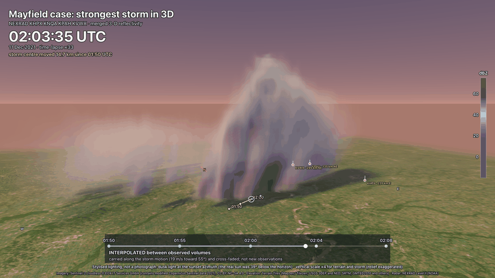
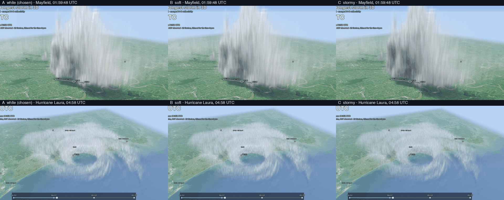

# Realistic ground and Realistic (stylised) storm

Two options of the 3D tab for gridded scenes (the merged mosaic volume), next to the flat map and
the scientific colour scale, which stay the defaults:

- **Realistic ground**: terrain with satellite imagery draped on it.
- **Storm: Realistic (stylised)**: reflectivity drawn like precipitation shafts, with sun light and
  soft shadows.

Both are choices of the **Ground** and **Storm** controls of the scene bar and are remembered.
The storm clips ({doc}`STORM_CLIP`, `rxd animate --realistic`) use the same renderer. The polar single-file 3D view is unchanged.




## Realistic ground
- **Elevation**: Terrain Tiles on AWS, Terrarium PNG (no key),
  `https://s3.amazonaws.com/elevation-tiles-prod/terrarium/{z}/{x}/{y}.png`. A pixel stores
  `metres = R * 256 + G + B / 256 - 32768`. The tiles are resampled to a 1024 x 1024 height map
  (km above sea level, sea level is the floor) registered in the same azimuthal-equidistant frame
  as the radar volume and the imagery.
- **Imagery**: Sentinel-2 cloudless 2021 by EOX IT Services GmbH (10 m), WMTS tiles
  `https://tiles.maps.eox.at/wmts/1.0.0/s2cloudless-2021_3857/default/g/{z}/{y}/{x}.jpg`.
- **How it is drawn**: the terrain is a height field ray-marched in the same shader pass as the
  volume (not a triangle mesh). A ray stops at the first terrain hit, so the cloud is hidden below
  hills by construction, and heights are metres above sea level, the same datum as the volume's
  levels, stretched by the same **Vertical** control (the relief is exaggerated like the storm,
  and the screen says so). A height field has no skirts and no level of detail to manage: the
  imagery and the height map are sampled at the level the screen needs. Past the edge of the data
  the ground goes on, mirrored, and fades into haze, so the scene has no visible edge. Relief shading
  uses the slope of the height map; the cloud casts a soft shadow on the ground (a short march
  toward the light).
- Where relief is small (the Mayfield, KY case is Mississippi lowland: about 60 to 150 m in the
  middle, hills up to 560 m at the west edge of the 230 km scene) it is hardly visible even at x4;
  raise the **Vertical** control to see it. The other example cases (El Reno, Laura,
  Michael, Milton) are flat country or coast as well.

### Terms and attribution
- **EOX Sentinel-2 cloudless** is released under the Creative Commons Attribution-NonCommercial-
  ShareAlike 4.0 licence (EOX capabilities document, `ows:Abstract` of the layer): free for
  non-commercial use with attribution, commercial use needs a licence from EOX
  (<https://cloudless.eox.at>). Derived images and videos carry the same ShareAlike terms.
  Attribution shown on screen: *Imagery: Sentinel-2 cloudless (c) EOX IT Services GmbH (contains
  modified Copernicus Sentinel data 2021), CC BY-NC-SA 4.0*.
- **Terrain Tiles** (Mapzen / Tilezen Joerd; USGS 3DEP and NED, SRTM, GMTED2010 and others) are
  free to use with attribution (<https://github.com/tilezen/joerd/blob/master/docs/attribution.md>),
  shown on screen too.
- **Not used**: Google Maps / Google Earth tiles (their terms forbid it), and Esri World Imagery
  (usable for display with attribution, but its terms restrict caching and offline use, which this
  feature depends on). NASA GIBS Blue Marble and MODIS are too coarse (250 m to 500 m) for a
  120 km storm scene.

### Tile policy, cache, offline
Tiles are fetched once, nearest first, with at most 4 requests at once. In the app a tile is kept
in the browser's Cache API (it survives restarts and works offline); where that is not available
it is fetched as a plain image. The storm-clip renderer goes through a local tile cache
that keeps tiles in `~/.cache/radarx-desktop/tiles`
(`--tile-cache` to change), asks one tile at a time with 0.12 s between
requests and a `User-Agent` that names the tool, never forwards a source or zoom that is not
listed, and reports the hosts that failed (`--offline` uses the cache only). This is for
interactive and research use; it is not a bulk downloader.

If a source cannot be reached the viewer says which one ("Could not load: satellite imagery
(tiles.maps.eox.at)") and falls back to what is available, ending at the flat map. Imagery is
never invented.

## Realistic (stylised) storm
The scientific colour scale maps dBZ to colours. The realistic look maps it to what the eye sees in
a daylight storm photograph:

| reflectivity | look |
|---|---|
| light echo, high tops (below about 25 dBZ) | thin white haze and cloud |
| moderate rain (25 to 40 dBZ) | dense, bright white cloud body |
| heavy cores (45 dBZ and above) | darker blue-grey, translucent grey rain curtains below the base |
| strongest cores (about 60 dBZ and above) | a faint green-grey tint only (a hail hint) |

There is no purple, violet or pink in the storm (every dBZ of every palette was checked).

How it is lit: a sun with a soft self-shadow (a short secondary march) and a
multiple-scattering floor, so shadows stay blue-grey instead of black; Henyey-Greenstein forward
(silver lining toward the sun) and back lobes; powder darkening in dense cores (thin edges stay
bright); a blue fill from the sky above and a green-grey bounce from the ground below; the base is
darker than the top; sun-lit edges are crisper (shading by the slope of the echo toward the light);
haze and aerial perspective bluish with distance; a saturated blue sky with a lighter horizon and a
sun glow. Cloud shadows fall on the terrain.

**Light.** The real sun is used when it is at least 6 degrees up. Otherwise there are two labelled
options (`--light daylight|dusk`): **Daylight (assumed)**, the default
for the realistic clip, a daytime sun at the azimuth the real sun has at 14:30 local solar time on
that date and place, raised to 36 to 50 degrees of elevation, labelled on screen *Stylised daylight;
the real sun was 39 degrees below the horizon at this time (not a photograph)*; and **Dusk**, a low
warm sun at the sunset azimuth with a dusk sky. The Mayfield scan (11 Dec 2021, 01:50 to 02:08 UTC,
about 19:50 local time) was 37 to 40 degrees below the horizon: the honest options are those two.
`--sun-azimuth` / `--sun-elevation` choose a direction for the shot.

**Stylised detail.** Four octaves of deterministic fractal noise (riding with the storm) brighten and
darken the shading and thin the FAINT parts of the echo into wisps and billows. Opacity is only
ever reduced, and only where it is low: it never adds echo where the radar has none and never moves
or weakens the cores.

**What radar does not see.** Radar sees precipitation-size particles (rain, graupel, hail, snow), not
cloud droplets. The cloud above and around the echo (the anvil, the cloud base, clear-air cloud) is
NOT observed. The realistic look draws the radar echo as if it were cloud, so its extent is the
echo's, and the screen says so ("radar sees rain and ice, not cloud droplets: cloud look and fine
detail are stylised, echo position and strength are radar data"). An observed alternative for a
later version is GOES ABI cloud imagery or the cloud water of a model such as HRRR.

Three variants were rendered on the same frames of the Mayfield storm and of Hurricane Laura
(`images/storm-palettes.png`): **white** (chosen: brightest, most cloud-like), **soft** (a little
less white) and **stormy** (grey-white body, darker cores: heavier but flatter). `--palette` selects one. An earlier grey palette was judged too grey and replaced.



What still looks fake (honest list): the cloud is the radar's 500 m smooth field, stretched x4
vertically, so it reads as soft vertical rain shafts and a hazy body, not as a cumulonimbus with a
hard anvil, cauliflower tops and a defined base; the ground imagery is a summer-biased composite at
10 m resolution that blurs at ground level; the cloud is only where the echo is.

## Look controls
The **Look…** button of the 3D tab (Storm: Realistic) opens a collapsible panel with every control below: a slider and a number box (type a value), a reset per control (↺), colour pickers (an empty colour is "auto": chosen by the light and palette), a preset menu, **Save** (kept in this browser), **Export** (JSON) / **TOML**, and **Import** (JSON or TOML). Changes are live. The same names are the keys of a look file for `rxd animate` (`--look file.json|toml`, `--look-preset NAME`, `--set key=value`).

### Scene
| key | what it does | range | default |
|---|---|---|---|
| `style` | Style: realistic: the stylised storm look. scientific: the dBZ colour scale (the data colours, unchanged). | realistic / scientific | realistic |
| `light` | Light: daylight (the real sun when it is up, otherwise an assumed daytime sun, labelled), dusk, thick overcast, or night (lit by lightning). | daylight / dusk / overcast / night | daylight |
| `palette` | Cloud palette: Colours and density of the echo as cloud: white cumulonimbus, soft, stormy grey, or a dense hurricane wall. | white / soft / stormy / cyclone | white |

### Exposure and colour
| key | what it does | range | default |
|---|---|---|---|
| `exposure` | Exposure: Overall light level (multiplies the light of the chosen scene). | 0.3 to 3 | 1.25 |
| `brightness` | Brightness: Added to the final colour: lifts or lowers everything, shadows included. | -0.4 to 0.4 | 0 |
| `contrast` | Contrast: Spreads the tones around mid grey. | 0.5 to 1.8 | 1 |
| `saturation` | Saturation: 0 is grey, 1 as lit, 2 vivid. | 0 to 2 | 1 |
| `gamma` | Gamma: Mid-tone brightness (above 1 lifts the mid tones and shadows). | 0.6 to 1.8 | 1 |
| `temperature` | White balance (cool - warm): Negative cools (bluer), positive warms (yellower). | -1 to 1 | 0 |
| `tint` | Tint (green - magenta): Negative greener, positive more magenta. | -1 to 1 | 0 |

### Cloud
| key | what it does | range | default |
|---|---|---|---|
| `cloudAlbedo` | Cloud whiteness: Reflectivity of the cloud colour (above 1 brightens the body, below greys it). | 0.5 to 1.3 | 1 |
| `densityScale` | Cloud density: Opacity of the echo as cloud (multiplies its extinction). | 0.2 to 4 | 1 |
| `lowDbzCutoff` | Faint-echo cutoff: Echo weaker than this is not drawn; just above it the echo shows as thin haze. | 0 to 40 dBZ | 12 |
| `detail` | Fine detail: Stylised fractal detail: brightness of billows and thinning of faint echo. Never adds echo or moves cores. | 0 to 1.5 | 1 |
| `rainStreaks` | Rain streaks: Vertical translucent streaks in the rain below the cloud base. | 0 to 1 | 0.25 |

### Rain and eyewall colours
| key | what it does | range | default |
|---|---|---|---|
| `rampLowDbz` | Haze to rain at: Reflectivity where the pale haze colour ends. | 5 to 40 dBZ | 16 |
| `rampMidDbz` | Rain to heavy at: Reflectivity where the heavy-rain colour starts. | 20 to 55 dBZ | 38 |
| `rampHeavyDbz` | Heavy to core at: Reflectivity where the core colour starts. | 35 to 65 dBZ | 52 |
| `rampHailDbz` | Hail hint from: Reflectivity above which the hail tint blends in. | 50 to 75 dBZ | 58 |
| `rampLow` | Colour: thin / low: Colour of faint echo (empty = the palette). | #rrggbb or empty | auto |
| `rampMid` | Colour: moderate: Colour of moderate rain. | #rrggbb or empty | auto |
| `rampHeavy` | Colour: heavy: Colour of heavy rain and the eyewall. | #rrggbb or empty | auto |
| `rampCore` | Colour: core: Colour of the strongest cores. | #rrggbb or empty | auto |
| `rampHail` | Colour: hail hint: Tint of the very strongest cores. | #rrggbb or empty | auto |
| `rainColor` | Rain streak colour: Colour of the rain streaks (empty = grey-blue). | #rrggbb or empty | auto |

### Light
| key | what it does | range | default |
|---|---|---|---|
| `sunElevation` | Sun elevation: -1 = chosen by the light. Degrees above the horizon. | -1 to 80 ° | auto |
| `sunAzimuth` | Sun azimuth: -1 = chosen by the light. Degrees clockwise from north. | -1 to 360 ° | auto |
| `sunColor` | Sun colour: Colour of the direct light (empty = the light kind). | #rrggbb or empty | auto |
| `sunIntensity` | Sun intensity: Strength of the direct light on cloud and ground. | 0 to 3 | 1 |
| `ambient` | Ambient (sky fill): Light from the sky: lifts the shadows and the cloud base. | 0 to 2.5 | 1 |
| `shadowStrength` | Shadow strength: How dark the cloud shades itself and the ground (0 = none). | 0 to 1.5 | 1 |
| `shadowSoftness` | Shadow softness: Higher keeps more light inside dense cloud: softer, lighter shadows. | 0 to 1 | 0.5 |
| `rim` | Rim / silver lining: Brightening of cloud edges lit from behind. | 0 to 2.5 | 1 |

### Sky and haze
| key | what it does | range | default |
|---|---|---|---|
| `skyZenith` | Sky: overhead: Sky colour overhead (empty = the light kind). | #rrggbb or empty | auto |
| `skyHorizon` | Sky: horizon: Sky colour at the horizon. | #rrggbb or empty | auto |
| `sunGlow` | Sun glow: Warm glow of the sky toward the sun. | 0 to 2 | 1 |
| `glowColor` | Glow colour: Colour of that glow. | #rrggbb or empty | auto |
| `hazeColor` | Haze colour: Colour distant cloud and ground fade into (empty = the sky at the horizon). | #rrggbb or empty | auto |
| `hazeDistanceKm` | Haze distance: Distance at which haze reaches 63% (0 = chosen by the scene size; smaller = hazier). | 0 to 2000 km | 0 |

### Ground and ocean
| key | what it does | range | default |
|---|---|---|---|
| `terrainBrightness` | Terrain brightness: Brightness of the satellite imagery. | 0.3 to 2.2 | 1 |
| `terrainSaturation` | Terrain saturation: Colour of the satellite imagery. | 0 to 2 | 1 |
| `oceanColor` | Ocean colour: Colour of open water (empty = dark grey-green). | #rrggbb or empty | auto |
| `whitecaps` | Whitecaps and spray: Foam and spray streaks; they follow the retrieved surface wind (none where no wind was retrieved). | 0 to 2 | 1 |

### Lightning
| key | what it does | range | default |
|---|---|---|---|
| `lightningBrightness` | Lightning brightness: Brightness of the channels and of the light they throw. | 0 to 3 | 1 |
| `lightningColor` | Lightning colour: Colour of the flash (empty = blue-white). | #rrggbb or empty | auto |

### Finish
| key | what it does | range | default |
|---|---|---|---|
| `bloom` | Bloom: Glow of very bright areas. | 0 to 1 | 0.15 |
| `vignette` | Vignette: Darkening toward the frame corners. | 0 to 1 | 0.2 |
| `grain` | Film grain: Fine noise (changes every frame). | 0 to 0.15 | 0.02 |

### Camera
| key | what it does | range | default |
|---|---|---|---|
| `fov` | Field of view: Vertical field of view (0 = the camera's own: 45° orbit, 60° window and flight; useful values 30 to 100). | 0 to 100 ° | 0 |
| `shake` | Camera shake: Strength of the shake of the flight camera in heavy rain (0 = none). | 0 to 3 | 1 |

## Presets
| preset | what it is | settings (on top of the defaults) |
|---|---|---|
| Daylight cumulonimbus | Bright white towering cloud, shadowed base, saturated blue sky (an assumed daytime sun when the real one was down). | `{"style":"realistic","light":"daylight","palette":"white","exposure":1.25}` |
| Golden hour | A low warm sun, long shadows, warm haze toward the sun. | `{"style":"realistic","light":"daylight","palette":"white","exposure":1.2,"sunElevation":9,"sunColor":"#ffb870","temperature":0.28,"sunGlow":1.5,"glowColor":"#ff9a4a","shadowStrength":1.15,"saturation":1.12}` |
| Dusk | Low warm light, blue-grey sky, orange glow only toward the light. | `{"style":"realistic","light":"dusk","palette":"white","exposure":1.3,"ambient":1.2}` |
| Stormy overcast | Heavy grey-green storm under thick cloud; readable, not black. | `{"style":"realistic","light":"overcast","palette":"stormy","exposure":1.55,"ambient":1.35,"shadowSoftness":0.65,"brightness":0.03,"contrast":1.05,"saturation":0.9,"rainStreaks":0.35}` |
| Night + lightning | No sun; a faint ambient light; the storm is lit by lightning. | `{"style":"realistic","light":"night","palette":"stormy","exposure":2,"lightningBrightness":1.8,"ambient":1.4}` |
| Hurricane (daylight) | A dense eyewall and rainbands in bright, hazy daylight; ocean with whitecaps. | `{"style":"realistic","light":"daylight","palette":"cyclone","exposure":1.3,"ambient":1.3,"shadowSoftness":0.6,"detail":1.1,"rainStreaks":0,"whitecaps":1.2,"saturation":0.95,"sunElevation":42}` |
| Hurricane (stormy) | The same wall under thick overcast: dim, desaturated, but readable. | `{"style":"realistic","light":"overcast","palette":"cyclone","exposure":1.75,"ambient":1.45,"shadowSoftness":0.7,"brightness":0.04,"detail":1.1,"rainStreaks":0,"whitecaps":1.3,"saturation":0.88,"vignette":0.28}` |
| Satellite white | Bright white cloud over the imagery, no dramatic shading: like a satellite picture. | `{"style":"realistic","light":"daylight","palette":"white","exposure":1.4,"shadowStrength":0.35,"shadowSoftness":0.9,"rim":0.4,"rainStreaks":0,"detail":0.7,"vignette":0,"grain":0,"bloom":0.08,"ambient":1.4,"cloudAlbedo":1.1}` |
| Scientific (dBZ) | The data colour scale, unchanged (the default of the viewer). | `{"style":"scientific"}` |

Your own looks: **Save** in the panel (stored in this browser, listed under "Saved" in the preset menu), **Export** to share a file, **Import** to load one. A look file is the settings that differ from the defaults; a file with unknown keys is refused with the nearest known key (for example `unknown look key "exposur" (did you mean "exposure"?)`), and out-of-range values, wrong types, bad colours and bad choices are errors naming the key.

### Config file example (TOML; JSON has the same keys)
```toml
# Radarx Desktop look: every key is optional
[scene]
light = "overcast"
palette = "cyclone"
[exposure_and_colour]
exposure = 1.7
temperature = -0.1
saturation = 0.9
[ground_and_ocean]
whitecaps = 1.3
oceanColor = "#16302c"
```
```
rxd animate -i laura -o clip.mp4 --realistic --camera flight \
    --look mylook.toml --look-preset "Hurricane (stormy)" --set exposure=1.9
```
Priority, lowest to highest: the defaults, `--look-preset`, `--look`, `--set` (and the flags `--palette` / `--light`). The look never changes the data: where echo exists and how strong it is come from the radar in every setting; the detail control only reshapes brightness and thins faint echo, and the density and cutoff controls scale the opacity law you can see in the transfer function. The controls were checked on a real frame: exposure, brightness, gamma, sun intensity and ambient make it lighter step by step, saturation 0 is grey and a warm white balance is warmer than a cool one.

## Realistic cyclone
A tropical cyclone is not a daylight cumulonimbus. The `cyclone` palette and the `overcast` or `night`
light make a dark, desaturated, heavy look with a dense eyewall, layered (horizontal) detail, an
ocean with whitecaps from the retrieved wind, and a flight camera that goes through the wall into the
eye. See {doc}`STORM_CLIP` ("Realistic cyclone") for the options and what is data and what is style.
