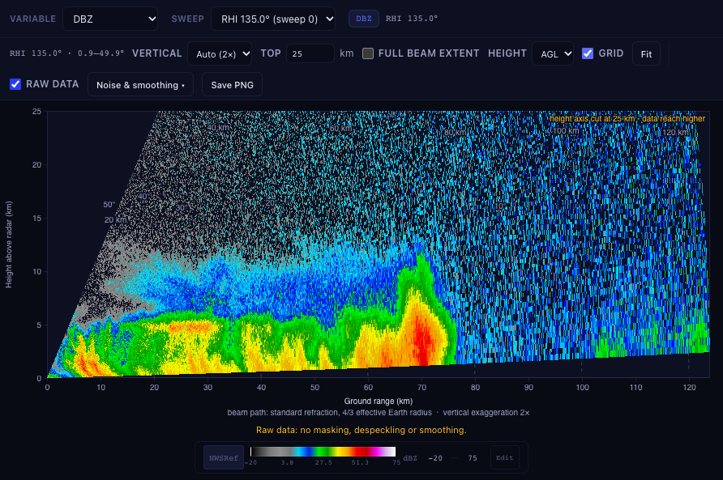
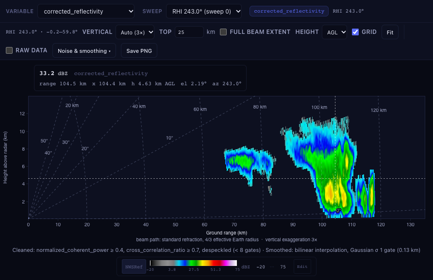
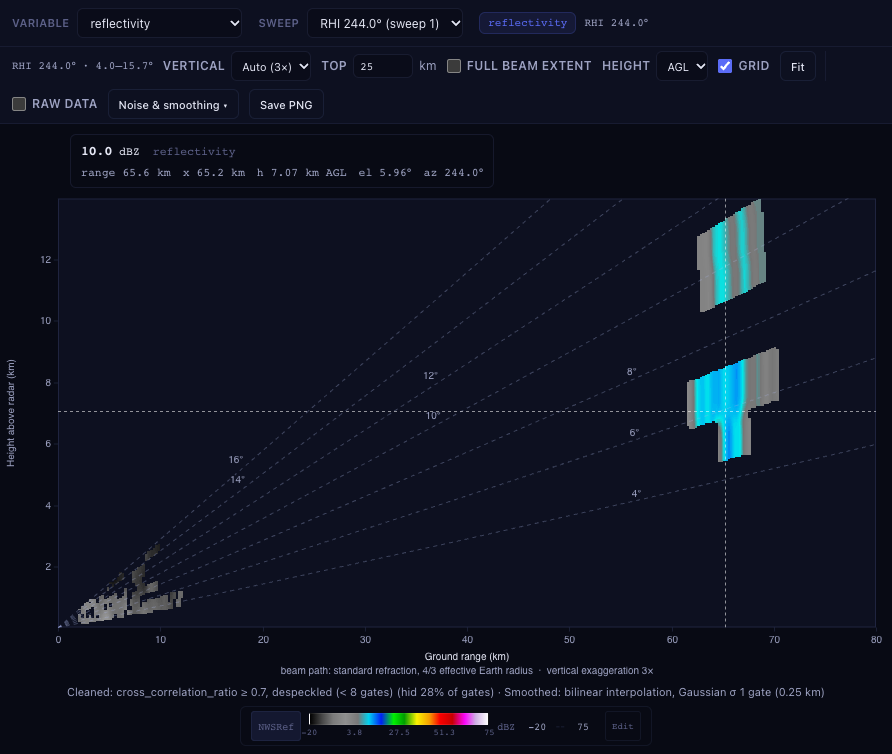

# Range-height (RHI) scans

An RHI keeps the antenna at one azimuth and sweeps it up in elevation, so the rays differ in *elevation*.
Drawn as a PPI map such a sweep collapses onto one line. Radarx Desktop detects RHI sweeps and shows them as
what they are: a vertical cut through the storm, ground range along x and height along y.

## How an RHI is recognised

The file's `sweep_mode` decides (`rhi`, `manual_rhi`, `sector_rhi`, `elevation_surveillance`, ...). Only when
a file states no usable mode, a sweep counts as an RHI if it has at least five rays that sweep through 3 degrees or more
of elevation while the azimuth barely moves. The sweep selector names each RHI by its azimuth,
for example `RHI 135.0 deg (sweep 0)`.

Real files are messy and the engine tidies them before the viewer sees them:

* CPOL stitches several passes together and NPOL interleaves them, so the rays are **not stored in elevation
  order**: they are sorted.
* A pseudo-RHI cut out of a volume (`PSEUDO_RHI_KGSP...`) has one or two rays per volume tilt, at slightly
  different azimuths. Rays within 0.03 degrees of elevation collapse to the one nearest the plane azimuth.
* The plane azimuth is the sweep's fixed angle when the rays really point there. Some writers (NPOL) store an
  elevation in that field; then the median ray azimuth is used.

The schema (`sweeps[i]`) gains `kind` (`ppi` or `rhi`) and, for an RHI, `azimuth`, `elevation_min`, `elevation_max`,
`n_rays` and the site `altitude` when the file has it. `get_sweep_data` sends the rays sorted and appends one
more frame, the per-ray elevation (`sweep_kind: "rhi"`, `rhi_azimuth`, `elevation_bytes` in the header). PPI replies are unchanged.

## The range-height view

* **Geometry.** Heights follow the standard beam model with a 4/3 effective Earth radius (the same as
  `radarx.fundamentals.geometry`); every axis says so. Cells are exact: each pixel is mapped back to
  (slant range, elevation) and looked up in the ray / gate grid, so gate edges stay sharp at any zoom and gaps between
  elevations, sector ends and lost rays stay empty instead of being smeared.
* **Axes.** The default window is the ground range and height that hold *valid* gates (not masked, not below the colour
  range), rounded up to a nice number. The beams of a steep RHI reach about 95 km, but there is no weather up there
  and noise must not stretch the axes: the **height is cut at 25 km** (`Top` box in the toolbar; raise it up to the
  beam reach) and stray gates do not count (the edge is where 99.9% of the valid gates end). **Full beam extent** shows
  everything the beams reach. Above about 30 km the hover read-out says *beyond the troposphere*.
* **Aspect.** True equal aspect at `1x`. `Vertical: Auto` (the default) uses 1x unless that would draw a very flat picture, then 1.5x,
  2x or 3x; the factor is printed on the axis. Heights can be above the radar (AGL) or above sea level (ASL) when the file
  states the radar altitude.
* **Controls.** The same variable, sweep, colormap and colour range as the PPI view; scroll to zoom, drag to pan, double-click
  or `0` to fit (the view never leaves the data window); a grid of constant range and constant elevation; hover read-out
  with value, slant range, ground range, height, elevation and azimuth.

## Noise and smoothing

Raw RHI data is mostly noise above the echo (half of all CPOL gates). The view therefore **cleans by default** and
says what it did in the caption under the plot:

| Step | Default | Notes |
|---|---|---|
| SQI / NCP mask | on, hide below 0.4 | the sweep's `SQI`, `NCP`, `normalized_coherent_power` ... |
| SNR mask | on, hide below 3 dB | when the sweep has one |
| RHOHV mask | on, hide below 0.7 | `RHOHV`, `cross_correlation_ratio` ... |
| Despeckle | on, groups under 8 gates | 8-connected groups of valid gates |
| Value mask | off | the shared per-variable mask (below / above / between / outside) |
| Smoothing | bilinear, Gaussian sigma 1 gate | NaN-aware: echo edges keep their level, nothing is invented over missing data |

A quality mask only applies when the sweep holds that field. A gate with no quality value is kept. **Raw data**
(toolbar) switches every step off. **Save PNG** writes the picture with title, colour bar and the caption, and stores the
caption in the PNG's text metadata. Hovering a gate that the settings hide says so and shows the measured value.

The value mask, Gaussian smoothing and interpolation are the same as in the cross-section ({doc}`CROSSSECTION`).

NPOL and the pseudo-RHI cut from a NEXRAD volume:

## Elsewhere in the app

* **3D** shows "3D needs PPI sweeps" for a file that only holds RHIs (RHI sweeps of a mixed file are skipped).
  Volume, 3D cross-section, modules, mosaics, wind retrieval and storm cells refuse an RHI sweep with a message
  instead of a wrong answer.
* **Table view** lists elevation instead of azimuth in the first column; **Metadata** and data export are unchanged.
* **Figure export** (also `rxd plot`) draws an RHI as a range-height plot with the same cleaning and axes as the
  viewer. The caption is part of the figure.
  Exports show the cleaned gates as measured: smoothing is a drawing step of the viewer only.

## Not done

* The sweeps of a pseudo-RHI are shown one at a time; they are not merged into one tall RHI.
* Exported figures are not smoothed.
* No RHI-specific tools yet (profile through an RHI, measuring on it).
