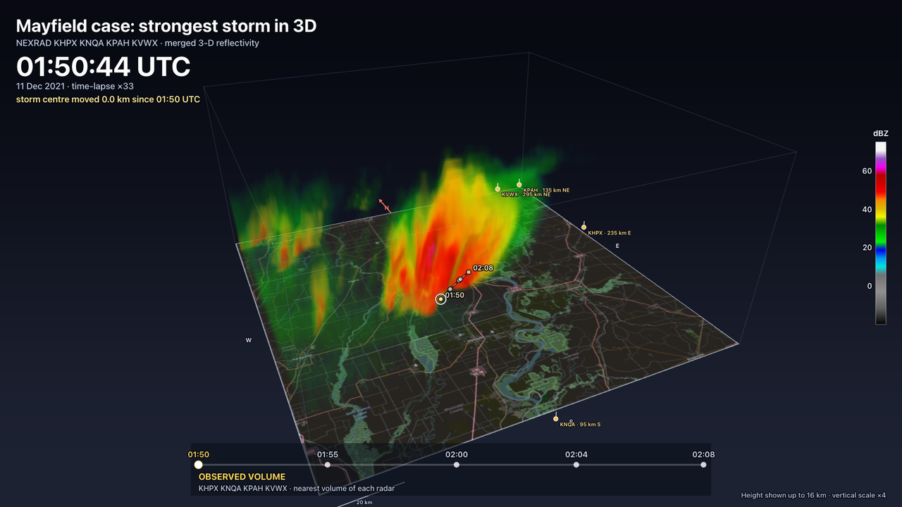
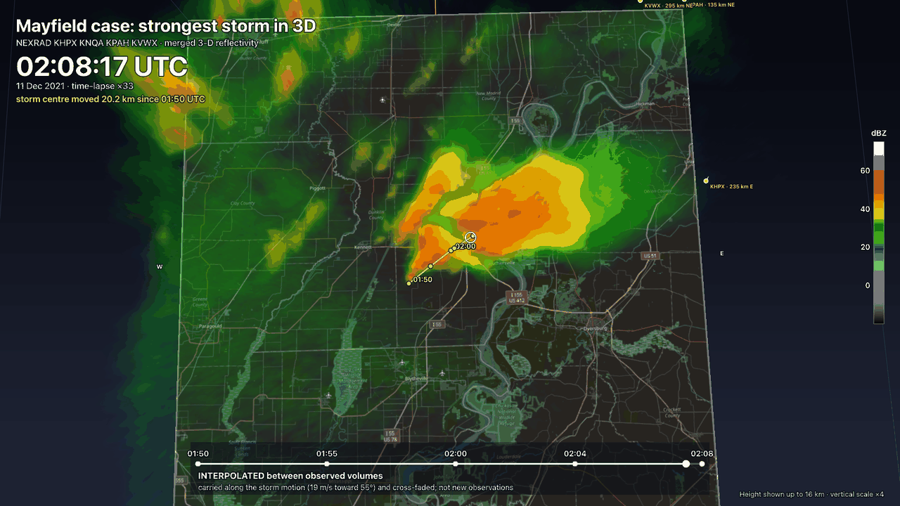
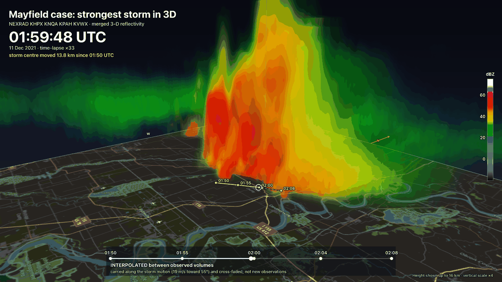

# Storm-centred 3D clip (MP4)

A reusable tool that turns several time steps of N radars into an MP4: the strongest storm of the
scene, in 3D, with a camera that moves around it while the storm travels across the map. It renders with the app's
own 3D viewer (`CartesianRenderer`, the same ray-marched volume, transfer function, lighting, map
ground and overlay as the 3D tab) in headless Chrome, so the look matches the app. It lives in
`tools/storm_clip/`; it adds nothing to the app's dependencies.





The clip shows only the reflectivity cloud over the map, with the storm's track drawn on the ground
and the UTC clock. There is no wind retrieval, no flow and no arrows in it.

## Realistic version
The same clip on terrain with satellite imagery and the stylised storm look
(`docs/REALISTIC_3D.md` has the sources, terms and the look):
```
/tmp/clipenv/bin/python tools/storm_clip/render_clip.py --bundle /tmp/storm_bundle --realistic \
    --out ~/Downloads/xradar-exports/storm3d_realistic_mayfield.mp4 \
    --stills ~/Downloads/xradar-exports/storm3d_realistic_stills
```
`--ground map|realistic` and `--storm-style scientific|realistic` choose each part on its own
(`--realistic` sets both); `--tile-cache DIR` and `--offline` control the tile cache. The camera,
the storm track, the motion-compensated interpolation, the UTC clock and the timing are the same as
in the scientific clip. On screen: the imagery and elevation attributions, "Stylised lighting, not a
photograph", and the vertical scale of terrain and storm. The page prints the hosts that could not be
reached; imagery is never invented (without it the ground is a grid). A frame takes about 0.5 to
0.8 s at 1080p (terrain ray-march and the soft-shadow march), so the 36 s clip takes 10 to 15 minutes
on an Apple M1 Pro; the first run also downloads the tiles (about 280 tiles, 5 MB), later runs use
the cache. The sun is computed per frame from the data time and the place.

## Make a clip
```
# 1. the data bundle (sidecar Python: needs the engine and radarx); the case folder is only read
python/.venv/bin/python tools/storm_clip/clipdata.py \
    --case ~/Downloads/SEVERE_CASES_TEST/mayfield --out /tmp/storm_bundle

# 2. the app, built once (the renderer serves dist/ itself)
npm run build

# 3. the clip: a scratch environment OUTSIDE the repository
python -m venv /tmp/clipenv && /tmp/clipenv/bin/pip install playwright av pillow
/tmp/clipenv/bin/python tools/storm_clip/render_clip.py --bundle /tmp/storm_bundle \
    --out ~/Downloads/xradar-exports/storm3d_mayfield.mp4 \
    --title "Mayfield case: strongest storm in 3D" --stills ~/Downloads/xradar-exports/storm3d_stills
```
Options: `--width/--height` (1920x1080), `--fps` (30), `--duration` (36 s), `--vexag` (4),
`--map-theme dark|light`, `--basemap`, `--crf`, `--stills-at`, `--every N` (a fast preview that renders
every Nth frame). The system `ffmpeg` is not used: PyAV encodes H.264 (yuv420p, `+faststart`).
Chrome is driven through Playwright's `channel="chrome"` (no browser download). A frame takes about
0.3 s at 1080p on an Apple M1 Pro (the 36 s Mayfield clip: 5 minutes).

Frames are deterministic: the page draws frame *i* for the clip time *i / fps* in one full-quality
pass straight into the canvas (`CartesianRenderer.exportRender`, no progressive bands, no real-time
clock), and the script grabs the pixels. Nothing depends on how fast the machine renders.

## What it does
1. **Time steps.** The reference radar is chosen automatically (`--reference auto`: the radar whose
   volume times give the most steps, then the smallest offsets of the other radars; or name one).
   For every volume of it each other radar contributes its volume nearest in time (offsets of up to
   5.5 min are accepted and listed in the bundle). A step is dropped if most radars have no new volume
   in it. Mayfield: reference KVWX, five steps, 01:50:44, 01:55:22, 02:00:00, 02:04:18 and 02:08:52 UTC
   (18 min; the largest offset of any radar is 193 s).
2. **Storm.** A coarse (2 km) 3D mosaic per step is searched for convective cells: connected
   areas of column-maximum reflectivity of at least 45 dBZ (at least 20 km²). A cell scores
   `max dBZ + 2 x echo-top km + 4 x log10(area km²)`. The best cell of the first step is tracked
   through the later steps (nearest centre, with the motion extrapolated); if the storm is lost it is
   carried along its last motion. The storm motion comes from the tracked centres (Mayfield:
   19 m/s toward 55°; 21 km in 18 min).
3. **Volumes.** A fine mosaic (500 m) per step on a box around the whole track (`keep_volume`),
   all on the same grid. The shown part is a box that does NOT move with the storm: it is fixed on the
   middle of the track and is as wide as the base 120 km plus the track's extent (the volume and the
   map are cropped to it, edges drawn as a frame), so the storm moves across the map past its
   landmarks and the radar markers.
4. **Time interpolation between the observed volumes (shown on screen as "interpolated").** The
   earlier volume is carried forward along the storm motion and the later one carried back, then
   the two are cross-faded (weight = position in the interval). So a moving cell stays on its path
   and the echo evolves by dissolving from one observation into the next. It is interpolation, not
   new observations: the screen says "OBSERVED VOLUME" when the clip is on an observed time (a yellow
   dot on the progress bar) and "INTERPOLATED between observed volumes ... not new observations"
   otherwise. One storm-motion vector is used for the whole domain (not a wind field), and the
   retrieved winds are not used. Without the shift the cloud would be a stationary picture that
   fades into the next one. The clip starts and ends on observed volumes (it holds for 1.5 s).
   **Pace:** the data time runs linearly through the observed span in the length of the clip (a
   time-lapse of about x33 for 18 min in 33 s, written on screen).
5. **Track.** The path of the storm centre is drawn on the map as a thin line: the travelled part
   solid and light, the rest dashed, a dot with the UTC time at every observed position, and a ring
   at the storm centre of the moment. The banner says how far the centre has moved since the first
   volume.
6. **Screen.** Title, the UTC time (seconds) and date, a progress bar with the observed times, a
   dBZ colour bar, the 3D tab's overlay (compass letters, scale bar), radar sites inside the box
   as masts and those outside as markers on the box edge with name and distance ("KNQA · 94 km S").

## Camera keyframes
The camera orbits a target that follows only part of the storm's motion: the target is the middle of
the track plus `targetLag` (default 0.3) of the storm's displacement from it, so the storm keeps
travelling across the view (the middle of the shot stays near the track, the storm stays in frame)
instead of being locked in the centre. A keyframe (`src/lib/utils/clipCamera.ts`,
`CamKey`): `t` (s), `theta` (azimuth of the camera as seen from the target, degrees, 180 = camera south
of the target), `phi` (elevation, degrees), `dist` (km), and `dx dy dz` (km shift of the target from the
followed point; `dz` = height ASL, multiplied by the vertical exaggeration). Every channel follows a
monotone cubic Hermite curve through the keyframes (continuous velocity, no overshoot, zero speed at
both ends), so there are no jerks. `theta` is unwrapped (a keyframe at 505 after 365 is a further 140°
of orbit).

| t (s) | what | theta | phi | dist (km) |
|------:|------|------:|----:|----------:|
| 0 | establishing oblique | 205 | 30 | 215 |
| 5 | approach | 215 | 27 | 165 |
| 12 | orbit | 365 | 22 | 118 |
| 19 | orbit | 505 | 18 | 100 |
| 24 | low angle from behind and right of the storm's heading, looking along its motion | heading + 145 | 6 | 128 |
| 29 | lift | low - 8 | 12 | 118 |
| 32.5 | top-down, north up | 180 | 86 | 152 |
| 36 | back to the establishing shot | 205 | 30 | 215 |

(`stormChoreography(duration, heading)` builds this for any length and heading; the low-angle
azimuth follows the storm's heading from the track.) A clip is therefore described by: a list of
observed volumes with their times, the storm track, `CamKey[]`, the clip length and fps, and the
crop size, which is the data model of a future in-app **Export animation**: the 3D tab already has
the renderer, the overlay and `window`-free drivers (`StormClip` in `src/lib/utils/stormClip.ts`
needs only a container, an overlay canvas and the volumes). The offline page is
`?clip=1` of the app (`StormClipView.svelte`; the normal app is unchanged without that parameter).

## Limits
- One tracked storm; a merged squall line counts as one cell. The track is a centre of
  reflectivity (a mesocyclone-scale detail is not tracked).
- The radars' volumes are not simultaneous (up to a few minutes apart); the mosaic weights them
  by time but the cloud of one step is not an instant. Step times are those of the reference radar.
- The storm is not locked in the middle of the frame (`targetLag`, 0 = fixed, 1 = locked): with a
  long track a larger box or a larger lag is needed to keep it in the view.
- A uniform storm motion is applied for the interpolation: parts of the scene that move differently
  (outflow, a second line) are only cross-faded there.
- The map comes from the keyless tile server used by the app (needs network); without it the
  ground is a grid. Labels are those of the tiles (legible at the top-down and low views, small at the
  far views).
- Needs Chrome (GPU) and a built app; software GL works but is slow. Resolution is bounded by the
  GPU's 3D-texture and canvas limits.
- No audio and no wind: this clip is about the reflectivity cloud.
- Realistic version: the light is dusk light, not the real (night) sky; the imagery is the 2021
  Sentinel-2 mosaic (a summer-biased composite), not the scene of that evening; radar sites and the
  scale bar are drawn at sea level, not on the terrain. The cloud is drawn from 500 m radar data
  stretched x4 vertically: it looks smooth and soft, not like a photograph of a cloud.

## Checked: the storm moves across the map
A fixed top-down render of the clip at three clip times (vertical scale 1, far camera so the height
parallax is negligible), the strong-echo centroid (yellow to red pixels) measured within 40 km of the
tracked centre and converted to km with the projected ground points: the tracked storm moved
13.8 km in 542 s of data time (25 m/s) and 20.8 km in 1084 s (19.2 m/s; tracked speed 19.2 m/s toward
55°); the echo centroid moved 13.7 km and 22.0 km (25 and 20 m/s). On screen the storm travels
across the map past the river bends, Kennett and Caruthersville (compare the stills at 0, 18 and 33 s).

## Tests
`python/tests/test_storm_clip_tools.py` also covers the tile proxy (URL and path mapping, one fetch
per tile then the cache, offline mode, failed hosts). `src/lib/utils/terrain.test.mjs` (Terrarium
decoding, tile maths, resampling orientation, sea and missing tiles), `sunPosition.test.mjs`
(solstice, equinox, the night over Mayfield, sunset azimuth, real sun versus dusk light) and
`realisticStyle.test.mjs` (opacity and brightness ramp, warm tint only for the strongest cores).
`python/tests/test_storm_clip_tools.py`: steps and the nearest volume per radar, repeated volumes
dropped, cell finding and ranking, tracking the moving storm rather than a stronger stationary one,
a lost storm carried along, storm motion, the choice of the reference radar. `src/lib/utils/clipCamera.test.mjs` (`npm run test:unit`):
the fixed box and the partly following camera target, the Hermite curve through the keyframes, no jumps over the whole choreography at 30 fps, the shot
list, the storm centre, the data time mapping (holds at both ends, never backwards), the interval
and the interpolation shifts (a moving echo stays on its path), the UTC label.
