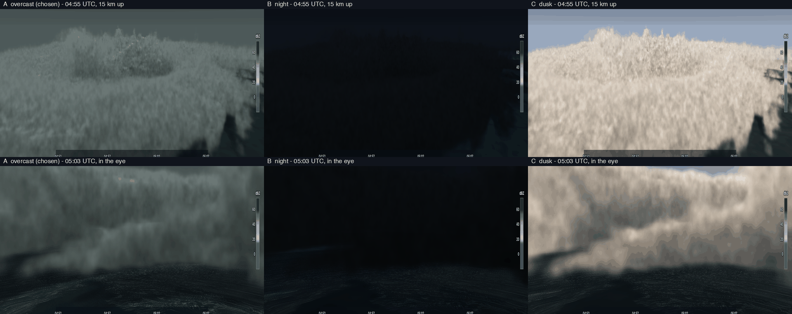

# Storm-centred 3D clip (MP4)

A storm clip turns several time steps of one or more radars into an MP4: the strongest storm of the scene, in 3D, with
a camera that moves around it while the storm travels across the map. It is drawn with the app's own 3D viewer (the same
ray-marched volume, transfer function, lighting, map ground and overlay as the 3D tab) in a headless Chrome, so the look
matches the app. The command is `rxd animate` (any number of files, the nearest volume per radar within a tolerance,
a disk cache, resume, camera files; see {doc}`ANIMATE`); this page describes what the clip shows and how it is made.


The plain clip shows only the reflectivity cloud over the map, with the storm's track drawn on the ground and the UTC
clock. There is no wind retrieval, no flow and no arrows in it unless you ask for the winds (`--winds`).

```bash
rxd animate -i mayfield -o mayfield.mp4                               # the scientific clip
rxd animate -i mayfield -o mayfield_realistic.mp4 --realistic         # terrain, imagery, stylised storm
rxd animate -i mayfield -o window.mp4 --camera window --realistic --timelapse 24
```

## Realistic version

The same clip on terrain with satellite imagery and the stylised storm look ({doc}`REALISTIC_3D` has the sources, terms
and the look). `--ground map|realistic` and `--storm-style scientific|realistic` choose each part on its own
(`--realistic` sets both); `--tile-cache DIR` and `--offline` control the tile cache. The camera, the storm track, the
motion-compensated interpolation, the UTC clock and the timing are the same as in the scientific clip. On screen: the
imagery and elevation attributions, "Stylised lighting, not a photograph", and the vertical scale of terrain and storm.
The command prints the hosts that could not be reached; imagery is never invented (without it the ground is a grid). A
frame takes about 0.5 to 0.8 s at 1080p (terrain ray-march and the soft-shadow march), so the 36 s clip takes 10 to 15
minutes on an Apple M1 Pro; the first run also downloads the tiles (about 280 tiles, 5 MB), later runs use the cache.
The sun is computed per frame from the data time and the place.

## Window camera, flow, lightning and sound

`--camera window` is a camera standing on the ground (default 10 m eye height) beside the storm track, 10 km to its right
and 4 km upwind of its middle (`--observer`, `--observer-dist`, `--observer-upwind`, `--observer-side`, `--eye-m`,
`--pan`, `--pitch` change it), looking at the storm like a camera on a window sill. The scene is at TRUE scale (vertical
exaggeration 1), the observer stands on the terrain, the radar's lowest level is carried down to the ground so rain
reaches it, the compass strip at the top gives the heading, and an inset map shows where the camera stands, its view cone,
the storm echo and the storm track. `--timelapse N` sets the pace (clip length = data span / N + 3 s: x24 gives 18 min of
Mayfield in 48 s). With the terrain and imagery the parallax against the ground and the horizon makes the motion obvious;
with the orbit camera at 100 km distance the same 20 km travel is small.

**Time interpolation along a flow** (all cameras, with `--winds`). Multi-Doppler winds are retrieved for every step. Between
two scans the echo is carried by a GPU pass: every cell of the interpolated volume is traced back to the time of volume A
and forward to the time of B along the velocity (the tracked storm translation plus the storm-relative observed wind
anomaly, midpoint steps), A and B are read there and blended by their coverage. The mean wind of the echo at each height
is removed (that is the translation, which the tracker measures), so what the winds add is the turning and shearing: a
rotating wind field turns the echo. Where no wind was retrieved for an interval the echo is translated only and the screen
says so ("carried along the storm motion only"); where it was, it says "carried by the storm motion and the observed
Doppler wind (4-radar)". It is interpolation, not new observations, and it says that too. The shader was checked in a
browser against a synthetic vortex turned by a known solid-body rotation: at s = 0.25, 0.5 and 0.75 of the interval the
echo stands within 1.1 degrees of theta0 + s * omega * dt, as one echo (a plain cross-fade of the two pictures has two
weaker ones). Limits: the retrieved winds cover about 30% of the cells (where two radars cross at a good angle), the
interpolated echo keeps the shape of the observed ones (it is carried, not forecast), and the flow acts at the level of
2 km wind cells.

**Long series (cyclones).** The clip loads one step at a time: only the two volumes a frame needs are in memory, and every
step is summarised once while it is streamed past (column maximum for the inset, the ice-phase volume and lightning
candidates, the histogram that sets the opacity), so the memory of a one-hour or longer series is bounded by two volumes
and the winds of two steps. `--camera wide --view-km 330` is the orbit for a wide system; `--track linear` takes the
straight line through the tracked cell positions for a steady motion (a cyclone's eye, or steps where radars repeat a
volume); `--detail-m 1000 --crop-km 140` sizes the grid for a few hundred km. The Hurricane Laura case (KHGX, KLCH, KLIX,
KPOE; the TDWR files THOU and TIAH are skipped, named once: THOU cannot be read and TIAH has unscaled site coordinates) has
only four time steps over 15 minutes (04:52 to 05:07 UTC), not an hour.

**Realistic cyclone** (`--camera flight --realistic --palette cyclone --light overcast --sea --vexag 2 --track eye
--detail-m 1000 --crop-km 140`).



- **Eye from the data.** The eye is found as the centre of the largest echo-free hole (column maximum below 20 dBZ) that
  echo surrounds on most sides (distance transform; an open-water patch is rejected), with its radius; `--track eye`
  follows its centre. Laura: 17 to 18 km radius. This is a hole in the radar echo, not the wind-based radius of maximum
  wind.
- **Look.** The `cyclone` palette has a dense, near-opaque eyewall and rainbands from about 35 dBZ, pale grey where thin,
  charcoal green-grey in the wall; the detail noise has its vertical frequency higher than the horizontal (layered; the
  vertical streaks of the earlier look came from the opposite), shading and thinning of the faint echo only. `--light
  overcast` is a dim light filtered by thick cloud with a dark horizon haze, labelled "Stylised lighting ... thick
  overcast; the real scene was at night". `--light night` is the honest night: no sun, a faint ambient, the storm lit by
  lightning (it is very dark between flashes). Dusk was the third candidate: cheerful and cream coloured; rejected.
- **Ocean.** Terrain at sea level is dark grey-green water; whitecap and foam streaks follow the wind direction (stretched
  noise along the retrieved wind), their amount rises from 9 to 30 m/s of RETRIEVED near-surface wind (the lowest retrieved
  level, 1.5 km for Laura, x 0.65 for the step down to the surface: a labelled estimate), and spray whitens the surface
  above 22 m/s. Where no wind was retrieved the sea stays calm: nothing is invented (the analysis covers 22 to 30% of its
  box).
- **Flight.** A wide establishing view, a descent to 12 km along the rainband, down through the wall to 3 km into the eye,
  looking back at the wall around it, out, and a high look straight down. The camera is placed relative to the moving eye;
  in heavy echo it shakes a little (smooth, deterministic, eased by the echo at the camera).
- **HUD, real numbers only**: eye radius from the echo, the strongest 1% of the retrieved wind speed cells (99th
  percentile; the single highest cell is shown too but it is often an outlier at the QC limit of 100 m/s), the lowest 3 km,
  the analysis coverage and number of radars, the centre's movement since the start, camera altitude and distance from the
  eye. It says that winds exist only where radars cross well and that no intensity category is inferred.
- **Rotation and motion**: the echo is carried by the retrieved wind between scans (see above); Laura has only four volumes
  in 15 minutes, two of which repeat for some radars, so the translation of the eye is 2 km in the data and the rotation
  comes from the winds.
- **Sound**: wind roar from the retrieved wind near the camera (within 16 km), louder in heavy echo (x (0.6 + 0.4 x rain
  level)); rain hiss; the thunder machinery for the rare modelled flashes.

**Lightning.** Every flash carries its source and the screen says which: *OBSERVED* if the clip renderer was given
lightning files (GLM L2 LCFA netCDF or LMA `.dat` files read from DISK; nothing is downloaded: the GLM files, GOES-16/18,
must be fetched by the user, for example from NOAA's public GOES bucket; only the time and place of a flash are data, the
channel is synthetic), otherwise *MODELLED from radar echo, NOT observed*. Modelled flashes are **off** by default
(`--lightning-model`). The model is a Poisson process, with a deterministic seed, whose rate follows the volume of strong
echo (35 dBZ and above) above the -10 C level (default 5 km; the factor is a scale for the clip, not a calibrated
flash-rate relation) and whose places are the strong columns of the radar volume carried with the storm. Flash shape: a
jagged channel by midpoint displacement with forks (cloud-to-ground from the charge region to the terrain, intracloud as
horizontal channels), 2 to 4 return strokes within 0.15 to 0.5 s for cloud-to-ground, a hot white core with two blur halos
in additive blending, and light: the cloud, the ground and the sky brighten around the channel for a moment. The channel
is drawn over the picture (a bolt behind a dense core is not hidden; the cloud around it lights up from inside).

**Sound.** The clip renderer can synthesise wind, rain and thunder from the data, with a listener at the observer
(position and heading from the camera) and HRTF panning, and add it as an AAC track to the MP4 (`rxd animate --sound` does the same for any camera, with a virtual listener and
the thunder source of your choice: see {doc}`ANIMATE`). The screen says "Synthesised from the data, not a recording". *Wind*: filtered noise whose level
and brightness follow the wind speed at the observer: the retrieved multi-Doppler wind of the lowest level around the
observer (x 0.65 for the ground), with gusts; if there is no wind it is a proxy from the storm motion and the rain,
labelled "not measured". *Rain*: bright noise whose level follows the reflectivity near the ground over the observer (20
to 55 dBZ). *Thunder*: each flash starts thunder that arrives after distance / 343 m/s (shortened by a factor, default 8,
because the clip is a time-lapse; 1 is the real physics), every segment of the channel at its own arrival time (this makes
the rolling), louder the nearer, a lower low-pass cutoff the farther (3200 Hz / (1 + d / 3.5 km), floor 70 Hz), a longer
tail the farther, three parts panned from where the channel is, and a sharp crack on top of the rumble for a strike within
4 km. No samples are used. Every flash is listed with its distance and thunder arrival in the record next to the clip.

## Look files and presets

Every colour and light of the realistic look is a named setting ({doc}`REALISTIC_3D` lists all of them with ranges, the
presets and an example). For clips: `--look-preset "Hurricane (stormy)"`, `--look my.toml` (JSON or TOML), `--set
exposure=1.6`; the viewer's **Look...** panel edits the same keys live. The defaults are bright (exposure 1.25);
`--look-preset "Scientific (dBZ)"` is the data colour scale.

## Make a clip

```bash
rxd animate -i mayfield -o mayfield.mp4 --title "Mayfield case: strongest storm in 3D"
rxd animate -i mayfield --realistic -o mayfield_realistic.mp4 -p still.png --still-at 12
```

The options of the clip (size, frame rate, duration, vertical exaggeration, map theme, basemap, quality) are in
{doc}`ANIMATE`. Chrome is driven through Playwright's system-Chrome channel (no browser download); PyAV encodes H.264
(yuv420p, `+faststart`). A frame takes about 0.3 s at 1080p on an Apple M1 Pro (the 36 s Mayfield clip: 5 minutes).

Frames are deterministic: the page draws frame *i* for the clip time *i / fps* in one full-quality pass straight into the
canvas (no progressive bands, no real-time clock), and the pixels are grabbed. Nothing depends on how fast the machine
renders.

## What it does

1. **Time steps.** The reference radar is chosen automatically (`--reference auto`: the radar whose volume times give the
   most steps, then the smallest offsets of the other radars; or name one). For every volume of it each other radar
   contributes its volume nearest in time (offsets of up to 5.5 min are accepted and listed). A step is dropped if most
   radars have no new volume in it. Mayfield: reference KVWX, five steps, 01:50:44, 01:55:22, 02:00:00, 02:04:18 and
   02:08:52 UTC (18 min; the largest offset of any radar is 193 s).
2. **Storm.** A coarse (2 km) 3D mosaic per step is searched for convective cells: connected areas of column-maximum
   reflectivity of at least 45 dBZ (at least 20 km²). A cell scores `max dBZ + 2 x echo-top km + 4 x log10(area km²)`.
   The best cell of the first step is tracked through the later steps (nearest centre, with the motion extrapolated); if
   the storm is lost it is carried along its last motion. The storm motion comes from the tracked centres (Mayfield: 19
   m/s toward 55°; 21 km in 18 min).
3. **Volumes.** A fine mosaic (500 m) per step on a box around the whole track, all on the same grid. The shown part is a
   box that does NOT move with the storm: it is fixed on the middle of the track and is as wide as the base 120 km plus
   the track's extent (the volume and the map are cropped to it, edges drawn as a frame), so the storm moves across the
   map past its landmarks and the radar markers.
4. **Time interpolation between the observed volumes (shown on screen as "interpolated").** The earlier volume is carried
   forward along the storm motion and the later one carried back, then the two are cross-faded (weight = position in the
   interval). So a moving cell stays on its path and the echo evolves by dissolving from one observation into the next. It
   is interpolation, not new observations: the screen says "OBSERVED VOLUME" when the clip is on an observed time (a
   yellow dot on the progress bar) and "INTERPOLATED between observed volumes ... not new observations" otherwise. One
   storm-motion vector is used for the whole domain (not a wind field) unless `--winds` is given. Without the shift the
   cloud would be a stationary picture that fades into the next one. The clip starts and ends on observed volumes (it
   holds for 1.5 s). **Pace:** the data time runs linearly through the observed span in the length of the clip (a
   time-lapse of about x33 for 18 min in 33 s, written on screen).
5. **Track.** The path of the storm centre is drawn on the map as a thin line: the travelled part solid and light, the
   rest dashed, a dot with the UTC time at every observed position, and a ring at the storm centre of the moment. The
   banner says how far the centre has moved since the first volume.
6. **Screen.** Title, the UTC time (seconds) and date, a progress bar with the observed times, a dBZ colour bar, the 3D
   tab's overlay (compass letters, scale bar), radar sites inside the box as masts and those outside as markers on the box
   edge with name and distance ("KNQA · 94 km S").

## Camera keyframes

The camera orbits a target that follows only part of the storm's motion: the target is the middle of the track plus
`--target-lag` (default 0.3) of the storm's displacement from it, so the storm keeps travelling across the view (the
middle of the shot stays near the track, the storm stays in frame) instead of being locked in the centre. A keyframe has a
time `t` (s), an azimuth (of the camera as seen from the target, degrees, 180 = camera south of the target), an elevation
(degrees), a distance (km) and a shift of the target from the followed point (km; the height is multiplied by the vertical
exaggeration). Every channel follows a monotone cubic Hermite curve through the keyframes (continuous velocity, no
overshoot, zero speed at both ends), so there are no jerks. The azimuth is unwrapped (a keyframe at 505 after 365 is a
further 140° of orbit). Camera files use the same keys ({doc}`ANIMATE`).

The default orbit:

| t (s) | what | azimuth | elevation | distance (km) |
|------:|------|------:|----:|----------:|
| 0 | establishing oblique | 205 | 30 | 215 |
| 5 | approach | 215 | 27 | 165 |
| 12 | orbit | 365 | 22 | 118 |
| 19 | orbit | 505 | 18 | 100 |
| 24 | low angle from behind and right of the storm's heading, looking along its motion | heading + 145 | 6 | 128 |
| 29 | lift | low - 8 | 12 | 118 |
| 32.5 | top-down, north up | 180 | 86 | 152 |
| 36 | back to the establishing shot | 205 | 30 | 215 |

The low-angle azimuth follows the storm's heading from the track.

## Limits

- One tracked storm; a merged squall line counts as one cell. The track is a centre of reflectivity (a mesocyclone-scale
  detail is not tracked).
- The radars' volumes are not simultaneous (up to a few minutes apart); the mosaic weights them by time but the cloud of
  one step is not an instant. Step times are those of the reference radar.
- The storm is not locked in the middle of the frame (`--target-lag`, 0 = fixed, 1 = locked): with a long track a larger
  box or a larger lag is needed to keep it in the view.
- A uniform storm motion is applied for the interpolation (unless `--winds` is given): parts of the scene that move
  differently (outflow, a second line) are only cross-faded there.
- The map comes from the keyless tile server used by the app (needs network); without it the ground is a grid. Labels are
  those of the tiles (legible at the top-down and low views, small at the far views).
- Needs Chrome (GPU) and the renderer files; software GL works but is slow. Resolution is bounded by the GPU's 3D-texture
  and canvas limits.
- The plain clip has no audio unless `rxd animate --sound` is given ({doc}`ANIMATE`), and no wind: it is about the reflectivity cloud.
- Realistic version: the light is dusk light, not the real (night) sky; the imagery is the 2021 Sentinel-2 mosaic (a
  summer-biased composite), not the scene of that evening; radar sites and the scale bar are drawn at sea level, not on
  the terrain. The cloud is drawn from 500 m radar data stretched x4 vertically: it looks smooth and soft, not like a
  photograph of a cloud.

## Checked: the storm moves across the map

A fixed top-down render of the clip at three clip times (vertical scale 1, far camera so the height parallax is
negligible), the strong-echo centroid (yellow to red pixels) measured within 40 km of the tracked centre and converted to
km with the projected ground points: the tracked storm moved 13.8 km in 542 s of data time (25 m/s) and 20.8 km in 1084 s
(19.2 m/s; tracked speed 19.2 m/s toward 55°); the echo centroid moved 13.7 km and 22.0 km (25 and 20 m/s). On screen the
storm travels across the map past the river bends, Kennett and Caruthersville (compare the stills at 0, 18 and 33 s).
