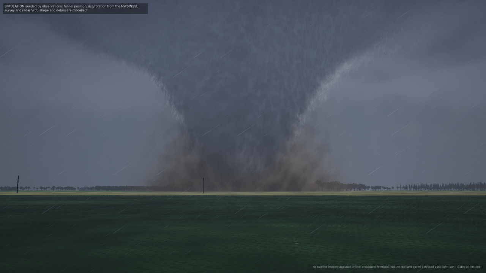
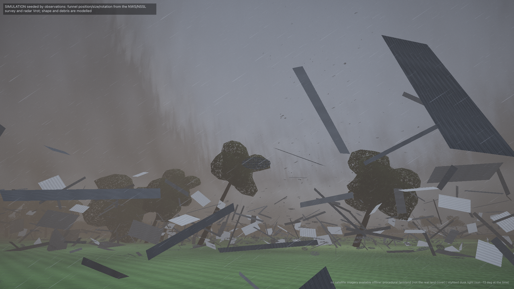

# Tornado simulation (first-person, physically based)

A **simulation seeded by observations**, not a video of the event. Given the survey of a tornado (rating, damage
width, begin and end points and times), the radar rotation, the temperature and dew point of nearby stations and the
positions and times of the lightning flashes, it builds a vortex whose wind and pressure fields follow physics,
derives the condensation funnel from them, fills the air with rain, dust and debris that move in that wind, and
draws it for a camera that stands on the ground at 1 km, at 100 m, or in the clear core. It lives in
`src/lib/utils/tornado/` (renderer, physics and tests), `src/lib/components/TornadoPreview.svelte` (a standalone page,
`?tornado=1`) and `tools/tornado_sim/` (seed builder, clip renderer, checks). It is loaded lazily and is not part of
the app's entry chunk.




Every frame carries a small tag: *SIMULATION seeded by observations: funnel position/size/rotation from the NWS/NSSL
survey and radar Vrot; shape and debris are modelled*. The ground carries its own: *no satellite imagery available
offline: procedural farmland (not the real land cover)* when no tiles are in the cache, or the imagery and elevation
attributions when they are. The view from inside the vortex says *simulated view*: the place is lethal and no camera
could record it.

## What is observed and what is modelled

| | Observed (in the seed) | Modelled |
|---|---|---|
| **Where and when** | the surveyed begin and end points and times; the track is the straight line between them (`INTERPOLATED`, the real one curves) | the position along the line at constant speed |
| **Size** | the damage swath width (366 m) | the core radius (see below), the funnel and dust sizes |
| **Strength** | the EF rating (EF2 = 111-135 mph, 49.6-60.3 m/s, a damage-based estimate) | the peak tangential wind: the midpoint of the rating's range, 55 m/s; the profile |
| **Rotation** | the sense and the parent circulation from the radar: Vrot 11 m/s median (8-15), couplet diameter 1.8 km (1.1-5.9), cyclonic in 11 of 13 steps, 500 m grid. **The tornado vortex itself is unresolved** by a 500 m grid; the parent circulation turns once in about 8 minutes (too slow to see) | the swirl of the tornado: Lamb-Oseen; the survey-scale estimate of the data bundle (a solid-body core with the rated wind at the edge of the damage width) gives 19-23 s per turn, this model turns the core in 7.9 s and the damage-swath edge in about 40 s |
| **Air** | near-surface temperature, dew point and pressure of the nearest station (StickNet 0102A, 11 km, T 15.7 C, Td 15.4 C: rain-cooled, nearly saturated, LCL 38 m) and of the nearest warm inflow station (StickNet 0216A, 32 km, T 20.4, Td 18.3 C: LCL 263 m) | the funnel: where the vortex's own pressure deficit saturates the inflow air; the cloud base |
| **Rain** | the merged radar reflectivity at 0.5 km around the tornado (25-45 dBZ), turned into a rain rate by Z = 200 R^1.6 | the curtains, streaks and slant |
| **Lightning** | the position and time of every LMA flash | the channel is not drawn; the light is the flash's burst, scaled by distance, smoothed so that clusters do not strobe |
| **Debris** | nothing | the objects (dust, leaves, boards, sheet metal, timber, rare large objects) and where they start; the motion is physics |
| **Ground** | satellite imagery and terrain tiles when in the cache | the procedural farmland otherwise: fields, woods, tree lines, section-line roads, farm buildings (the survey mentions chicken houses) |
| **Light** | nothing: at 01:12 UTC the sun is 13 degrees below the horizon and the real scene was dark between flashes | the "stylised dusk" ambient light (`night` is the physical level) |

A radar grid cannot resolve a 366 m tornado, so no number of the near-core field is a measurement: they follow from the
survey and the physics below. The tornado is never shown where there is no evidence of one: outside the surveyed span
`intensityAt(t)` is zero (a 25 s formation and 40 s decay ramp are modelled at the ends).

## Physics

**Wind field** (`vortexField.ts`). A Lamb-Oseen vortex, `v(r) = Vt f(r/rm)`, `f(x) = (1 - exp(-B x^2)) / (C x)`,
`B = 1.2564`, `C = 1 - exp(-B) = 0.7153`: peaks at exactly `Vt` at `r = rm`, is a solid body inside (`omega = 1.756 Vt / rm`)
and potential outside (`v ~ 1/r`). The angular velocity on screen is `omega = v / r` (equal to `Vt / rm` at the core
radius). The core widens with height, `rm(z) = rm0 sqrt(1 + (z/Hf)^2)` (`Hf = 4 rm0`), the swirl is weaker in the lowest
tens of metres (friction) and decays above 2.5 km. A Burgers-style core inflow and updraft plus a surface-layer inflow
(`u_r = -0.3 v` in a 30 m layer, the updraft following from mass continuity) give the radial and vertical wind; `div u = 0` is
tested numerically. The sense is cyclonic (counter-clockwise from above) from the radar couplet. A second, km-scale
Lamb-Oseen vortex (the couplet: Vrot, radius 900 m) turns the cloud base and the noise, with a pressure deficit
small compared to the tornado's.

**Core radius.** `coreRadiusFromSwath`: the radius at which the swirl falls to the damage-onset wind (EF0, 29 m/s) is
half the surveyed swath width. For EF2 and 366 m this gives `rm = 69 m`. (A wider core, `rm` = half the width, gives the
data bundle's 19-23 s period but a fog bank instead of a funnel for the near-saturated air; both are listed above.)

**Pressure and funnel** (`funnel.ts`). The cyclostrophic balance `dp/dr = rho v^2 / r` is integrated from the far field:
`dp(r, z) = rho Vt(z)^2 G(r/rm(z))`, `G` tabulated (a central deficit of 56 hPa for 55 m/s; tested against the
balance within 1 %). A parcel of inflow air (T0, Td0, p0) carried to a lower pressure cools dry-adiabatically while its
vapour pressure falls in step, and saturates at a critical pressure ratio `pi_c` (solved, tested to be saturated exactly
there). The parcel's pressure at height z is the hydrostatic ambient pressure minus `dp`, so the visible funnel is
`(p0 - p_amb(z)) + dp(r, z) >= (1 - pi_c) p0`. With `dp = 0` this is the lifting condensation level: the solved cloud base
matches Espy (125 m per K) and Bolton within 5 % (tested). For the warm inflow (LCL 263 m) the funnel reaches the ground
at EF2 strength and flares from tens of metres wide at 30 m height to about 400 m at the cloud base: a cone. The
funnel shape is not drawn: it falls out of the field. A clear eye (two-cell core, radius 0.55 of the core radius) is a
modelled addition. Dust and a dark debris sheath wrap the base where the near-ground wind passes the damage onset
(about 30 m/s), with the skirt rising in the core by the updraft.

**Noise advected by the flow.** The funnel, dust and scud are textured with a 3D noise sampled at positions traced back
along the flow: rotated by `omega(r, z) tau`, moved radially by `u_r tau`, vertically by `w tau`, in two phases of a 3 s
cycle blended (the usual flow-noise scheme), so the streaks spiral at the rate of the field and shear with it.
`tools/tornado_sim/check_rotation.py` measures it on screen (below).

**Debris** (`debris.ts`). 12 000 particles of six classes (dust and soil, leaves and insulation, shingles and boards, sheet metal,
branches and timber, large objects), each with `dv/dt = k |u - v| (u - v) - g z^` (`k = rho Cd A / 2m`, terminal speed
`sqrt(g/k)`: 1 to 50 m/s), picked up from the ground where the surface wind passes the class's pick-up speed (18 to 48 m/s),
recycled when they leave 650 m or are 26 s old. The wind is the vortex plus the couplet plus the air carried with the storm.
Heavy objects keep their momentum and are flung out; light ones are lofted by the updraft (tested). The state at time t is a
pure function of the seed and the shot start (fixed 1/60 s steps, a hash-seeded stream per particle). The sprites are
stylised; the motion is physical. Trees bend in the local wind and go down as the vortex passes where the peak wind at
their crown height passes 33 m/s (hardwood) or 30 m/s (pine) (`treeDamage.ts`, modelled damage, not the surveyed damage there).

## Parameters

| Parameter | Value in the PERiLS EF2 case | Source |
|---|---|---|
| peak tangential wind `Vt` | 55 m/s (midpoint of 49.6-60.3) | survey rating |
| core radius `rm0` | 69 m | survey width, damage onset 29 m/s |
| translation | 24.5 m/s toward 47 degrees | survey begin and end, 01:08 to 01:20 UTC |
| spin | core 7.9 s per turn; on screen `omega = v/r` | model; survey-scale estimate 19-23 s |
| parent circulation | Vrot 11 m/s, couplet radius 900 m, cyclonic | radar (NOXP, 500 m grid), median of 13 steps |
| funnel air | T 20.4, Td 18.3 C, 995.6 hPa, LCL 263 m | StickNet 0216A (warm inflow) |
| haze air | T 15.7, Td 15.4 C, LCL 38 m | StickNet 0102A (nearest, rain-cooled) |
| rain | 5 to 24 mm/h (25-45 dBZ at 0.5 km) | merged radar volume, Marshall-Palmer |
| flashes | 337 within 45 km, t = 355-565 s | LMA |

`tools/tornado_sim/make_seed.py` builds all of this from the bundle into `tornado_seed.json` and prints which station was
used and why.

## API (`TornadoScene`)

```ts
import { TornadoScene } from './lib/utils/tornado/TornadoScene';
import { modePose } from './lib/utils/tornado/cameraModes';
import { drawLabels } from './lib/utils/tornado/labels';

const scene = new TornadoScene({ canvas, width: 1920, height: 1080, ambient: 'dusk' });
const seed = scene.setSeedData({            // the resolved physical parameters come back
  ef: 'EF2', width: 366,
  track: [{ t: 240, lat: 33.1008, lon: -88.4691 }, { t: 960, lat: 33.2105, lon: -88.3316 }],   // t: seconds on the data clock
  meso: { vrot: 11, radiusM: 900 }, sense: 'cyclonic',
  thermo: { t0: 15.7, td0: 15.4, p0: 994.4, source: 'StickNet 0102A ...' },
  inflowThermo: { t0: 20.4, td0: 18.3, p0: 995.6, source: 'StickNet 0216A ...' },
  lightningFlashes: [{ t: 456.5, lat: 33.12, lon: -88.43, altM: 8000 }],
  echo: { x0, y0, dx: 500, nx, ny, dbz: [...] },
  epochUtc: '2022-03-31T01:04:00Z',
});
scene.setShot(t0, t1);            // data-clock span of the shot: debris warm-up and the landscape focus
await scene.loadGround();         // imagery and terrain from the tile cache if present (a no-op otherwise)
scene.setTime(t);                 // data seconds; deterministic: the frame depends only on t
scene.render({ pos, target, fovDeg });     // local metres east / north / up of the first track point
scene.render(cameraFromGeo({ lat, lon, altM, headingDeg, pitchDeg, fovDeg }));   // or a geographic pose
scene.render(cam, { overlay: true });      // the tornado alone, premultiplied alpha, to composite over another render
```

`setTime(t)` can go forward or backward; the debris pool is re-run from `shotStart - 12 s` when the clock jumps back, so frame i
of clip time i/fps is always the same picture (checked: `tools/tornado_sim/check_determinism.py`). `isActive(t)` is false outside the survey span; the
page then draws no vortex. `info(t)` returns the numbers for labels, `groundInfo` says whether imagery was found,
`stats` the frame time and memory. `cameraModes.ts` has the three first-person modes (`chaser`, `debris`, `inside`) as
pure functions `modePose(mode, seed, tau, t, options)`.

### Integration in the PERiLS movie (clip time 46-70 s)

The tornado shot of `timeline.json` / `camera_path.json` is `t_clip` 46 to 70 s. The path is a low approach: at 46 s the
camera is 68 km away at 1270 m, from 49 s it is 1.2 km to 0.4 km from the tornado at 200 down to 37 m, looking up 8 to 19
degrees, and at 69 s it leaves. The time map `timeline.json` (`mapping.t_clip_s -> t_data_s`) gives data time 435 s at 46 s
and 486 s at 70 s (the slow-down around 58 s is part of it; the swirl then runs 3 times faster than real time on screen).
For physically right rotation use a constant 1 data s per clip s inside the shot instead.

```ts
const t0 = dataTimeAt(46), t1 = dataTimeAt(70);               // from timeline.json
const seed = scene.setSeedData(seedFromBundle);              // tools/tornado_sim/make_seed.py writes it
scene.setShot(t0, t1);
await scene.loadGround();
for (let i = 0; i < 24 * fps; i++) {
  const tc = 46 + i / fps;
  scene.setTime(dataTimeAt(tc));
  const p = cameraPathAt(tc);                                 // lat, lon, alt_m, heading_deg, pitch_deg, fov_deg
  scene.render(scene.cameraFromGeo({ lat: p.lat, lon: p.lon, altM: p.alt_m, headingDeg: p.heading_deg, pitchDeg: p.pitch_deg, fovDeg: p.fov_deg }));
  ctx2d.drawImage(scene.canvas, 0, 0);                        // the renderer agent's compositor; labels: drawLabels(ctx, w, h, info, state)
}
```

`alt_m` is taken as height above the movie's ground (a flat map); pass `groundElevM` if the path is above sea level.
`render_tornado.py --mode movie --clip-start 46 --duration 24` does exactly this for the shot (the camera path, the time map, an
optional alpha overlay with `--overlay`). The scene needs the 2D labels drawn by the movie's own overlay or by `drawLabels`.
Use `overlay: true` to keep the movie's ground and clouds and add only the funnel, dust and debris (the cloud and rain of the
movie's own volume then stay the movie's). Seed `lightningFlashes` from the same `events.json` (`t_data_s`).

## Tools and checks

```
npm run build
python tools/tornado_sim/make_seed.py                                    # bundle -> tornado_seed.json
python tools/tornado_sim/render_tornado.py --mode chaser --out chaser.mp4 # also: debris, inside, movie
python tools/tornado_sim/check_rotation.py                               # on-screen omega against the field
python tools/tornado_sim/check_determinism.py                            # the same frame twice
node --test src/lib/utils/tornado/*.test.mjs                             # physics, funnel, debris, seed, damage
```

Chrome is driven with Playwright as in the storm clip; the scratch environment (`playwright av pillow numpy`) stays outside the
repository. The ground follows the tile cache of `tools/storm_clip/` (`XRADAR_TILE_CACHE` or `--tile-cache`, `--online` lets
the proxy fetch missing tiles once): z13 to z15 imagery (EOX Sentinel-2 cloudless, CC BY-NC-SA 4.0) and Terrarium
terrain are mosaicked into a 7.2 km square around the shot and picked up automatically; the engine's proxy serves up to z13
(a finer zoom is asked first and the loader falls back to what is cached). With imagery the trees come from the dark
green pixels; with terrain the vortex stands on the height under its axis.

### Verification numbers

RESULTS_PLACEHOLDER

## Honest limits

- A 366 m tornado is not resolved by the radar: the near-core field, the funnel, the debris and all fine detail are
  modelled. The survey fixes the width, rating, track and time; the radar fixes only the sense and the parent circulation.
- The track is the straight line between the surveyed begin and end points; the real one curves, and the position at a given
  time is interpolated at constant speed.
- The wind profile is one of the family consistent with the survey (Lamb-Oseen core from the swath width); another
  choice (a wider core) changes the spin period (7.9 s here, 19-23 s for the data bundle's estimate) and the funnel width.
- The funnel uses the warm inflow's temperature and dew point; with the near-surface rain-cooled air (LCL 38 m) any
  pressure drop makes cloud and the whole neighbourhood is fog. Which air feeds the real funnel is not known.
- The stylised dusk light and the clear eye, the wall cloud lowering (60 m), the scud and the rain curtains are artistic or
  modelled choices; the real scene was dark between flashes.
- Debris and trees are procedural; their count and where they are lofted from are not data. Tree damage follows the model's
  wind field, not the survey damage at that place.
- Without tiles the ground is invented farmland, not the real land cover.
- Lightning is positions and times only; the channel is not drawn and the brightness is a model.
- Frame time is about 1 to 3 s at 1080p on an Apple M1 Pro with an integrated GPU, 50 MB of GPU memory, one frame at a time.
